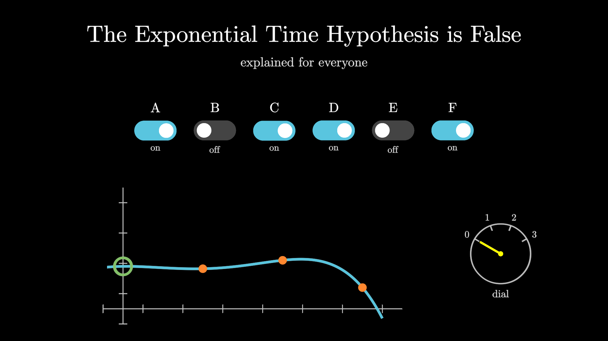

# Awesome Millennium

Visual explainers for papers that claim to solve, partly solve, or reshape the landscape around the seven [Millennium Prize Problems](problems/README.md). Each explainer has a written walkthrough with figures, runnable code that checks the key identities, and a 3Blue1Brown-style video made with [manim](https://github.com/3b1b/manim).

> [!IMPORTANT]
> Listing a paper here is **not** an endorsement. Many recent entries are AI-generated preprints that have not been peer reviewed. Every explainer states the claim exactly as the authors make it, says what it does *not* imply, and records its verification status with a date.

<!-- BEGIN:stats -->
**11** explained papers · **0** queued · catalog regenerated by `tools/catalog.py`
<!-- END:stats -->

## Featured: The Exponential Time Hypothesis is False

<a href="papers/2026/10/eth-is-false/"></a>

On 26 October 2026 OpenAI released a preprint giving a **deterministic algorithm that counts the satisfying assignments of any $k$-CNF formula in time $2^{O(n \log\log n / \sqrt{\log n})}$** (times a polynomial in the input size) and polynomial space. For $3$-SAT this refutes the Exponential Time Hypothesis, and with it SETH, #ETH, Gap-ETH and NSETH. It does **not** resolve P vs NP. [Read the explainer →](papers/2026/10/eth-is-false/)

## The seven problems

<!-- BEGIN:problems -->
| Problem | Status | Explained here | Queued |
|---|---|---|---|
| [P vs NP](problems/p-vs-np.md) | Open | 3 adjacent | — |
| [Riemann Hypothesis](problems/riemann-hypothesis.md) | Open | 1 partial | — |
| [Yang–Mills Existence and Mass Gap](problems/yang-mills.md) | Open | 1 adjacent | — |
| [Navier–Stokes Existence and Smoothness](problems/navier-stokes.md) | Open — a claimed resolution (forced breakdown, Sep 2026) is under evaluation | 1 resolves, 1 adjacent | — |
| [Hodge Conjecture](problems/hodge-conjecture.md) | Open | 1 partial | — |
| [Birch and Swinnerton-Dyer Conjecture](problems/birch-swinnerton-dyer.md) | Open | 1 partial | — |
| [Poincaré Conjecture](problems/poincare-conjecture.md) | Solved — Perelman (2002–2003); prize awarded 2010, declined | 1 resolves, 1 adjacent | — |
<!-- END:problems -->

## Latest explainers

<!-- BEGIN:latest -->
- **[Exact Birch–Swinnerton-Dyer Formula from Low Selmer Corank](papers/2026/10/exact-bsd-low-selmer-corank/)** (2026-10-07) — Claims the complete Birch–Swinnerton-Dyer formula, with every prime factor exact, for every elliptic curve over $\mathbb{Q}$ whose Selmer group at some prime has corank $0$ or $1$, with no further hypotheses on the curve.  
  *Birch and Swinnerton-Dyer Conjecture (partial) · Preprint · Not formalized · Not yet examined · explainer + video + code*
- **[The rational Hodge conjecture for CM abelian varieties](papers/2026/10/hodge-cm-abelian-varieties/)** (2026-10-06) — Claims the Hodge conjecture for every complex abelian variety with complex multiplication, in every dimension and codimension, and through theorems of Milne the Tate conjecture for abelian varieties over finite fields.  
  *Hodge Conjecture (partial) · Preprint · Formalized (Lean 4) · Not yet examined · explainer + video + code*
- **[The canonical massive continuum limit of the two-dimensional O(3) model](papers/2026/10/o3-sigma-model-continuum-limit/)** (2026-10-04) — Claims a rigorous construction of the continuum limit of the two-dimensional lattice $O(3)$ model: an interacting relativistic quantum field theory with a unique vacuum and a positive mass gap, the same for every way of removing the cutoff.  
  *Yang–Mills Existence and Mass Gap (adjacent) · Preprint · Not formalized · Not yet examined · explainer + video + code*
- **[The Quasi-Riemann Hypothesis: a zero-free half-plane Re(s) > 7/8](papers/2026/09/quasi-riemann-hypothesis/)** (2026-09-30) — Claims that the Riemann zeta function and every Dirichlet $L$-function have no zeros with real part above $7/8$, a fixed margin from the edge that holds at every height and for every character, which mathematicians call the quasi-Riemann hypothesis.  
  *Riemann Hypothesis (partial) · Preprint · Formalized (Lean 4) · Under examination · explainer + video + code*
- **[Universal Computation with Eventually Stationary Navier–Stokes Forcing](papers/2026/09/navier-stokes-universal-computation/)** (2026-09-27) — For any Turing machine and input, an explicit smooth force, constant after time 1, makes a viscous fluid starting at rest carry one particle into a fixed region exactly when the machine halts.  
  *Navier–Stokes Existence and Smoothness (adjacent) · Preprint · Not formalized · Not yet examined · explainer + video + code*
- **[Bounded scalar curvature and smooth extension of four-dimensional Ricci flow](papers/2026/09/ricci-flow-scalar-curvature-extension/)** (2026-09-24) — Claims that a Ricci flow on a closed four-manifold continues smoothly whenever its scalar curvature stays bounded; a companion paper claims this fails in high dimension, with a flow on $S^2\times S^{q+1}$ whose scalar curvature stays bounded while its full curvature blows up.  
  *Poincaré Conjecture (adjacent) · Preprint · Not formalized · Not yet examined · explainer + code*
- **[The Unique Games Theorem](papers/2026/09/unique-games-theorem/)** (2026-09-23) — Claims a proof of Khot's Unique Games Conjecture, which would make the best known approximation algorithms for Max-Cut, Vertex Cover and many other problems provably optimal unless P = NP.  
  *P vs NP (adjacent) · Preprint · Formalized (Lean 4) · Under examination · explainer + code*
- **[Beyond the Square-Root Exponent for Depth-Three Boolean Circuits](papers/2026/09/depth-three-circuits-beyond-square-root/)** (2026-09-23) — Claims one explicit polynomial-time function whose three-layer OR–AND–OR circuits need $2^{\omega(\sqrt n)}$ gates, past the square-root exponent that explicit depth-three lower bounds had not beaten since the 1980s.  
  *P vs NP (adjacent) · Preprint · Formalized (Lean 4) · Not yet examined · explainer + code*
- **[Perelman's Ricci flow papers: the proof of the Poincaré conjecture](papers/2002/11/perelman-poincare/)** (2002-11-11) — Three arXiv preprints (2002–03) that finish Richard Hamilton's program: let a shape smooth itself by its own curvature (Ricci flow), cut out the thin necks that form, and show that a closed three-dimensional shape in which every loop can be shrunk dies out in finite time, which forces it to be the three-sphere.  
  *Poincaré Conjecture (resolves) · Preprint · Not formalized · Accepted · explainer + video + code*
- **[Finite Time Blowup for Navier–Stokes](papers/2026/09/navier-stokes-blowup/)** (2026-09-08) — For every viscosity, a smooth force that is switched on for a while drives a fluid starting at rest to unbounded speed at time 1 with bounded energy, which would settle the Clay problem through its breakdown alternatives (C) and (D).  
  *Navier–Stokes Existence and Smoothness (resolves) · Preprint · Formalized (Lean 4) · Under examination · explainer + video + code*
<!-- END:latest -->

## Browse

- **By problem:** [P vs NP](problems/p-vs-np.md) · [Riemann](problems/riemann-hypothesis.md) · [Yang–Mills](problems/yang-mills.md) · [Navier–Stokes](problems/navier-stokes.md) · [Hodge](problems/hodge-conjecture.md) · [BSD](problems/birch-swinnerton-dyer.md) · [Poincaré](problems/poincare-conjecture.md)
- **By year and tag:** [catalog/](catalog/README.md)
- **For scripts:** [catalog/papers.json](catalog/papers.json)
- **Queued for an explainer:** [backlog.yaml](backlog.yaml), also shown on each problem page

## How this repository is organized

```text
problems/                  one page per Millennium problem (+ problems.yaml registry)
papers/YYYY/MM/<slug>/     one directory per explained paper, sharded by date
    paper.yaml             metadata: claim, problem relation, verification status, links
    README.md              the explainer
    figures/               generated figures (light and dark variants)
    code/                  scripts that generate the figures and check the math
    video/                 manim scenes, narration script, captions, rendered video
catalog/                   generated indexes: by year, by tag, papers.json
backlog.yaml               papers queued for an explainer
templates/paper/           starting point for a new explainer
tools/catalog.py           validates metadata, lints math and links, regenerates indexes, runs paper checks
schema/paper.schema.json   editor support for paper.yaml
```

Indexes are generated, never edited by hand, and CI fails if they are stale — so adding the thousandth paper is the same amount of work as adding the first. Sharding by `YYYY/MM` keeps every directory listing small enough for GitHub to display in full.

## Contributing

```bash
pip install -r tools/requirements.txt
python tools/catalog.py new --date 2026-10-25 --slug my-paper --title "Title of the paper"
# write papers/2026/10/my-paper/README.md and paper.yaml, then:
python tools/catalog.py build        # validate + regenerate indexes
python tools/catalog.py run-checks   # run the papers' own verification scripts
```

See [CONTRIBUTING.md](CONTRIBUTING.md) for the explainer style guide, the status vocabulary, and how to render videos.
