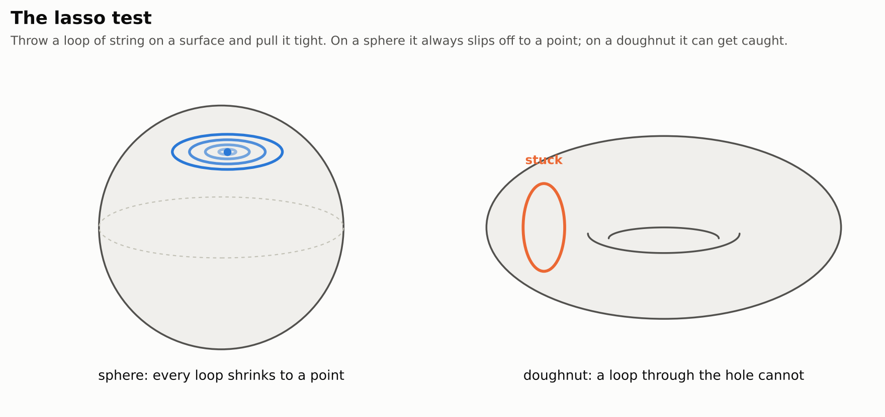
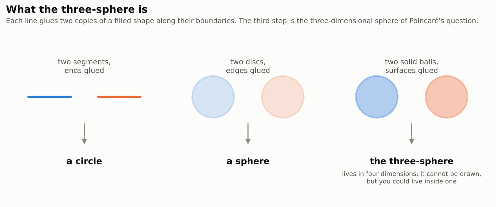
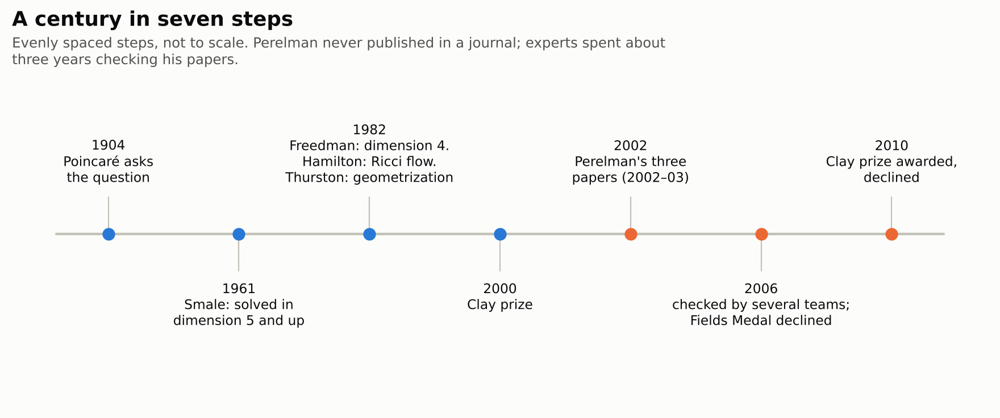
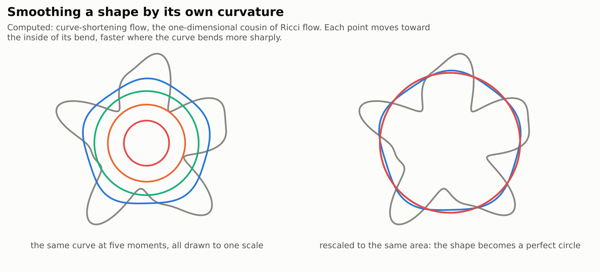
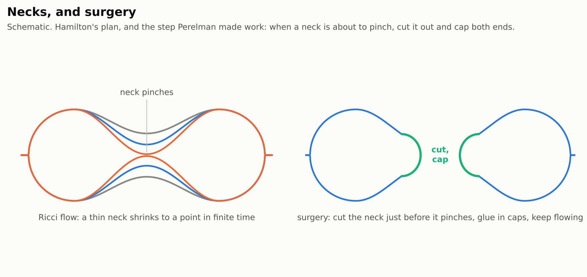
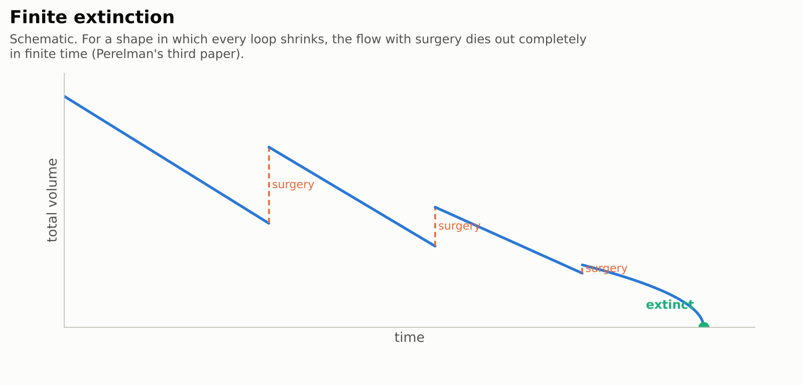

# Perelman's Ricci flow papers: the proof of the Poincaré conjecture

> **In one paragraph.** In 1904 Henri Poincaré asked a question about shapes: if a closed three-dimensional space has the property that every loop in it can be pulled tight to a point, must it be the simplest such space, the three-sphere? For two-dimensional surfaces the answer had long been known to be yes. Mathematicians settled every dimension from four upward by 1982, but three stayed stubborn. In 2002 and 2003 Grigori Perelman posted three short, dense papers online that finished a program begun by Richard Hamilton. Let the shape smooth itself out by its own curvature, the way heat evens out temperature. Wherever a thin neck forms and is about to pinch, cut it and cap off the ends. Then show that a shape in which every loop shrinks burns away completely in finite time. Tracing the cuts backwards shows the shape was a three-sphere all along. Experts spent about three years checking and writing out the details, and the result is accepted. Perelman declined both the Fields Medal and the Clay Millennium Prize.

| | |
|---|---|
| **Papers** | Grigori Perelman, [The entropy formula for the Ricci flow and its geometric applications](https://arxiv.org/abs/math/0211159) (11 November 2002), [Ricci flow with surgery on three-manifolds](https://arxiv.org/abs/math/0303109) (10 March 2003), [Finite extinction time for the solutions to the Ricci flow on certain three-manifolds](https://arxiv.org/abs/math/0307245) (17 July 2003) |
| **The claim, plainly** | A closed three-dimensional space in which every loop can be shrunk to a point is a three-sphere |
| **Millennium problem** | [Poincaré conjecture](../../../../problems/poincare-conjecture.md): solved; the only Millennium problem the Clay Institute has declared solved |
| **Status** (3 November 2026) | Never submitted to a journal. Details written out and checked by three teams in 2006 (Kleiner–Lott, Morgan–Tian, Cao–Zhu). Accepted. Clay prize awarded 2010, declined |
| **More** | [figures](figures/) · [figure code](code/make_figures.py) |

## Contents

1. [The lasso test](#1-the-lasso-test)
2. [The three-sphere](#2-the-three-sphere)
3. [The question, and a century of attempts](#3-the-question-and-a-century-of-attempts)
4. [Hamilton's idea: let the shape smooth itself](#4-hamiltons-idea-let-the-shape-smooth-itself)
5. [The trouble: necks that pinch](#5-the-trouble-necks-that-pinch)
6. [What Perelman added](#6-what-perelman-added)
7. [Putting it together](#7-putting-it-together)
8. [Checking it, and two prizes declined](#8-checking-it-and-two-prizes-declined)
9. [What it means, and what it does not](#9-what-it-means-and-what-it-does-not)

## 1. The lasso test

Topology studies shapes up to stretching and bending, without tearing or gluing. To a topologist a coffee mug and a doughnut are the same shape, because one can be squished into the other, while a ball and a doughnut are different, because the hole can't be squished away.

How can you tell shapes apart without seeing them from outside? Poincaré's test uses a loop of string. Lay a loop anywhere on the shape and pull it tight, keeping it on the surface. On a sphere, every loop slides off to a point. On a doughnut, a loop that goes around the hole gets stuck: no amount of sliding makes it shrink. A shape on which every loop can be shrunk is called **simply connected**.

<picture>
  <source media="(prefers-color-scheme: dark)" srcset="figures/loops-dark.png">
  
</picture>

For surfaces, this one test is enough. Every closed surface (finite in size, with no edge) in which every loop shrinks is a sphere, and this was known in the 1800s. The test is useful because it only needs you to move around *inside* the shape. You never have to step outside and look at it.

## 2. The three-sphere

A **closed three-dimensional space** (mathematicians say a closed three-manifold) is a space that looks like ordinary three-dimensional space near each point, but is finite in size and has no edge. You could live inside one: wherever you are, the space around you looks normal, yet if you travel far enough in a straight line you may come back to where you started.

The simplest one is the **three-sphere**. You can't draw it, because it naturally sits in four dimensions, but you can build it by gluing. Glue two line segments at their ends and you get a circle. Glue two discs along their edges, like the two halves of a balloon, and you get a sphere. Glue two solid balls along their surfaces, so that leaving one ball through its surface puts you into the other, and you get the three-sphere.

<picture>
  <source media="(prefers-color-scheme: dark)" srcset="figures/gluing-dark.png">
  
</picture>

In symbols the three-sphere is the set of points at distance one from the origin in four-dimensional space, written $S^3$. Every loop in it can be shrunk to a point.

## 3. The question, and a century of attempts

Poincaré asked whether the lasso test still works one dimension up. In the form used by the Clay Institute:

> **The Poincaré conjecture.** Every simply connected, closed three-manifold is homeomorphic to the three-sphere $S^3$.

"Homeomorphic" means "the same shape up to stretching and bending". So the conjecture says: if every loop in a closed three-dimensional space can be shrunk, the space is a three-sphere in disguise.

Poincaré himself had first guessed a weaker test and then found a counterexample to it (the Poincaré homology sphere), which is why he posed the loop version as a question in 1904. Surprisingly, the higher-dimensional versions turned out to be easier, because there is more room to move things around. Stephen Smale proved them for dimensions five and up in 1961, and Michael Freedman did dimension four in 1982. Both won Fields Medals. Dimension three, the one Poincaré asked about, resisted every topological attack.

<picture>
  <source media="(prefers-color-scheme: dark)" srcset="figures/timeline-dark.png">
  
</picture>

Also in 1982, William Thurston proposed a far bigger conjecture, **geometrization**. It says every closed three-manifold can be cut, in a standard way, into pieces that each carry one of eight uniform geometries. The Poincaré conjecture is one small consequence. Thurston proved it in many cases, but not in the cases that contain Poincaré.

## 4. Hamilton's idea: let the shape smooth itself

Richard Hamilton suggested in 1982 to stop thinking of the shape as fixed and let it *evolve* instead. Give the shape a way of measuring distances, so it has a definite geometry with bumps, dents and curvature. Then let the geometry change in time so that it smooths itself out, much as heat flows from hot spots to cold spots until the temperature is even. If the shape ends up perfectly round, it must have been a sphere all along, since smoothing never tears or glues.

The rule Hamilton chose is called **Ricci flow**. At each point, the geometry shrinks in directions where the space curves positively (like a sphere) and expands in directions where it curves negatively (like a saddle). In symbols, with $g$ the rule for measuring distances and $\operatorname{Ric}(g)$ its Ricci curvature:

$$\partial_t g = -2 \operatorname{Ric}(g).$$

It is a heat equation for geometry: it averages out curvature the way the ordinary heat equation averages out temperature.

A simpler cousin shows the idea in two dimensions. Take a wiggly closed curve in the plane and let every point move toward the inside of its bend, at a speed equal to how sharply the curve bends there. Gage, Hamilton and Grayson proved in the 1980s that any such curve becomes convex and then shrinks to a point, looking more and more like a perfect circle as it goes.

<picture>
  <source media="(prefers-color-scheme: dark)" srcset="figures/curve-flow-dark.png">
  
</picture>

Hamilton proved in 1982 that Ricci flow does exactly this for a three-dimensional shape that is already curved positively in every direction. The shape shrinks, becomes rounder and rounder, and vanishes as a perfectly round point. That proved such shapes are spheres (or simple quotients of spheres). The hope was that the same would happen for every simply connected shape.

## 5. The trouble: necks that pinch

For a general shape the flow can go wrong. Picture a dumbbell: two round balls joined by a thin neck. The neck is highly curved around its circumference, so Ricci flow squeezes it hardest, and it pinches off in finite time while the balls are still large. At that moment the curvature at the neck becomes infinite and the flow cannot continue. This is a **singularity**.

<picture>
  <source media="(prefers-color-scheme: dark)" srcset="figures/neckpinch-dark.png">
  
</picture>

Hamilton's plan was **surgery**. Just before a neck pinches, cut it, cap each end with a round cap, and restart the flow on the pieces. Cutting along a sphere and capping is a controlled operation, so at the end you can glue everything back and know what you started with. To make the plan work, three things had to be shown:

1. **The only singularities are ones you can cut.** Necks are fine. A long, thin, cigar-shaped tip that never pinches would be a disaster, because there is no good place to cut it. Hamilton could not rule it out.
2. **Surgery doesn't run out of control.** Each cut must leave a shape at least as tame as before, and cuts must not pile up infinitely often in a finite time.
3. **Something happens in the end.** After all the cuts, the flow has to finish in a way you can read off, for example by every piece shrinking away to nothing.

Hamilton worked on this program for twenty years and settled many parts, including surgery for a class of four-dimensional shapes, but the three points above stayed open in dimension three.

## 6. What Perelman added

Perelman's three preprints read as an extended sketch rather than a polished proof: many steps are stated in a sentence and left to the expert reader. Their key new ideas are these.

**A quantity that only goes up (first paper, Sections 1–4).** Perelman found that Ricci flow can be seen as climbing a hill: there is an entropy-like quantity, built from the geometry, that never decreases while the flow runs. A quantity that can only move one way is a powerful tool, because it rules out the flow going back and forth forever, and it lets you compare the shape at very different times.

**No local collapsing (first paper, Section 4).** From that entropy he proved that wherever the curvature is under control at a given scale, the shape can't be squashed thin at that scale: a small ball always holds a definite fraction of the volume an ordinary ball of that size would hold. This kills the cigar. A cigar tip, zoomed in, is a thin collapsed tube, so it can never appear as a blowup of Ricci flow on a closed shape.

**A list of what high curvature can look like (first paper, Section 12; second paper).** Combining no local collapsing with a second monotone quantity, a "reduced volume", Perelman showed that near any point where the curvature is very large, the shape looks almost exactly like one of a short list of models: a long thin round tube (a neck), a neck closed off by a cap, or a small, whole, nearly round piece. These are the **canonical neighbourhoods**. Every one of them is something you know how to cut.

**Surgery that stays under control (second paper).** Perelman specified exactly where to cut: deep inside very thin necks, at a scale chosen in advance. He proved that after each surgery the canonical neighbourhood description still holds, and that only finitely many surgeries happen in any finite stretch of time. Pieces that become tiny round components are recognised as standard shapes and set aside.

**Finite extinction (third paper).** For a shape in which every loop shrinks, Perelman proved that the flow with surgery dies out completely in finite time: after finitely many cuts, every piece shrinks away to nothing. The argument measures how "wide" the shape is, using the smallest area of a disc that a loop can be filled with as the loop is swept across the shape, and shows this width falls at a definite rate under the flow. A positive quantity that falls at a definite rate must reach zero, so the shape must vanish. Tobias Colding and William Minicozzi published an independent proof of this step, using a width measured by sweeping spheres instead of loops.

<picture>
  <source media="(prefers-color-scheme: dark)" srcset="figures/extinction-dark.png">
  
</picture>

## 7. Putting it together

Start with any closed three-dimensional space in which every loop can be shrunk. Put any geometry on it and run Ricci flow. Whenever a neck is about to pinch, cut it and cap the ends. Set aside each piece that has become a small round standard shape. By finite extinction, after finitely many surgeries nothing is left.

Now run the film backwards. Every piece that vanished or was set aside is a known shape: a round three-sphere, or one of a few simple relatives. The original shape is these pieces glued back together along the spheres where the necks were cut. In a shape where every loop shrinks, no piece can carry a loop that gets stuck, and the relatives of the three-sphere all do. So every piece was a three-sphere. A cut that didn't split the shape in two would also be ruled out, since a loop running once through that neck could never be shrunk. Gluing three-spheres together along necks gives back a three-sphere, and so the original shape was a three-sphere.

The same machinery, together with a study of how the flow behaves for a very long time when it does *not* die out, proves Thurston's geometrization conjecture. Perelman sketched this in his second paper, and later book-length accounts filled in the details.

## 8. Checking it, and two prizes declined

Perelman posted his papers on the arXiv, a free preprint server, gave a series of lectures in the United States in 2003, and never submitted the papers to a journal. Because so many steps were compressed, several teams set out to write complete versions:

- **Bruce Kleiner and John Lott** wrote detailed notes on all three papers, posted online and updated from 2003, with a full version in 2006 [published in *Geometry & Topology*, 2008](https://arxiv.org/abs/math/0605667).
- **John Morgan and Gang Tian** wrote a book-length proof of the Poincaré conjecture along Perelman's lines, [posted in 2006](https://arxiv.org/abs/math/0607607) and published by the Clay Institute in 2007.
- **Huai-Dong Cao and Xi-Ping Zhu** published a complete account in the *Asian Journal of Mathematics* in June 2006. It drew criticism over how it credited the work of others, and the authors issued a correction.

All three found the argument correct, with gaps that experts could fill. In August 2006 Perelman was awarded the Fields Medal and became the first person to decline it. On 18 March 2010 the Clay Mathematics Institute awarded him the first Millennium Prize, a million dollars, which he also declined, saying that Hamilton's contribution was no less than his own.

## 9. What it means, and what it does not

**What it settles.** The Poincaré conjecture is true: the lasso test recognises the three-sphere. With geometrization, every closed three-dimensional space is now understood as a combination of eight kinds of uniform pieces, a classification as complete as the one for surfaces. It is still the only Millennium problem the Clay Institute has declared solved.

**What it showed about methods.** The problem is purely about shape, with no measurement in it, and yet it was solved by adding geometry and running a differential equation, the same kind of mathematics used for heat and fluids. Ricci flow is now a standard tool in geometry, and it has been used to prove other results, such as the differentiable sphere theorem of Brendle and Schoen (2007).

**What it does not settle.**

- **The smooth four-dimensional Poincaré conjecture is still open.** Freedman's 1982 result says a four-dimensional shape that passes the right tests is a four-sphere up to stretching. Whether it must also be the *smooth* four-sphere, with no exotic way of doing calculus on it, is unknown. Ricci flow in four dimensions can develop singularities that are far harder to classify than necks and caps.
- **It does not give a simple proof.** Every complete account runs to hundreds of pages, and we know of no complete computer-checked (formal) proof.
- **It was not a solo effort in the sense of starting from scratch.** Perelman finished a program whose framework, Ricci flow and surgery, came from Hamilton, and whose target, geometrization, came from Thurston.

## Sources

- G. Perelman, [The entropy formula for the Ricci flow and its geometric applications](https://arxiv.org/abs/math/0211159), arXiv math/0211159, 2002.
- G. Perelman, [Ricci flow with surgery on three-manifolds](https://arxiv.org/abs/math/0303109), arXiv math/0303109, 2003.
- G. Perelman, [Finite extinction time for the solutions to the Ricci flow on certain three-manifolds](https://arxiv.org/abs/math/0307245), arXiv math/0307245, 2003.
- B. Kleiner and J. Lott, [Notes on Perelman's papers](https://arxiv.org/abs/math/0605667), *Geometry & Topology* 12 (2008).
- J. Morgan and G. Tian, [Ricci flow and the Poincaré conjecture](https://arxiv.org/abs/math/0607607), Clay Mathematics Monographs 3 (2007).
- H.-D. Cao and X.-P. Zhu, A complete proof of the Poincaré and geometrization conjectures, *Asian Journal of Mathematics* 10 (2006).
- T. Colding and W. Minicozzi, Estimates for the extinction time for the Ricci flow on certain 3-manifolds and a question of Perelman, *Journal of the AMS* 18 (2005).
- Clay Mathematics Institute, [press release on the award of the prize](https://www.claymath.org/wp-content/uploads/2022/06/Poincare-press-release.pdf), 18 March 2010.
