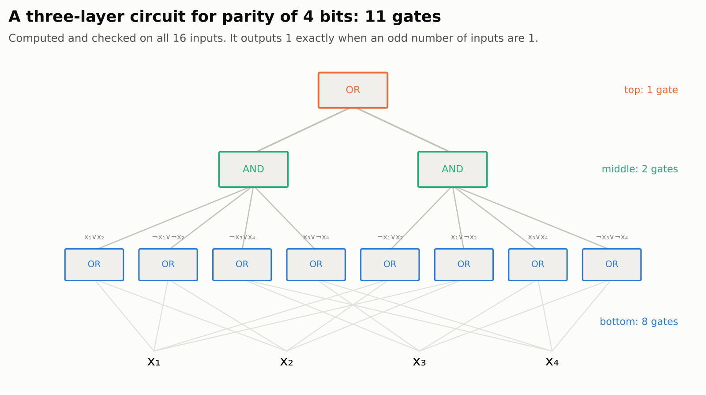
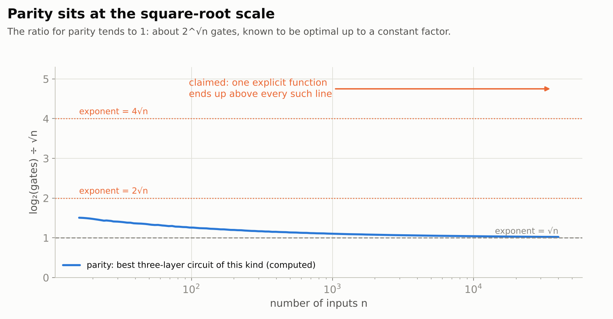
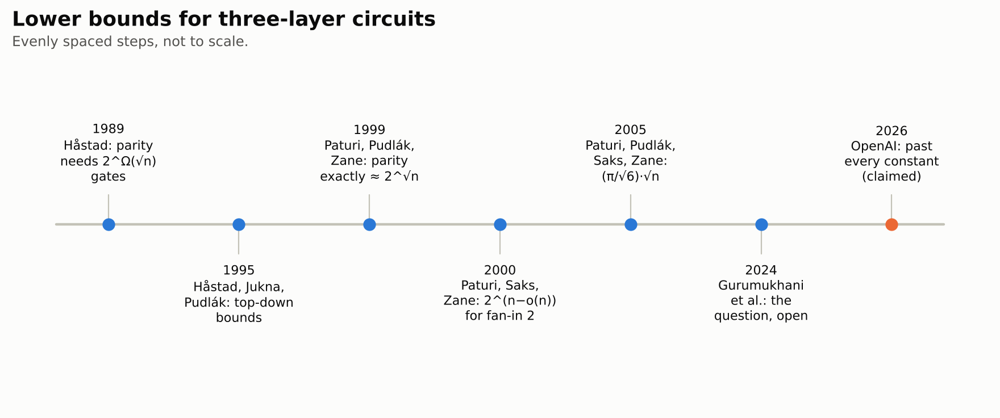
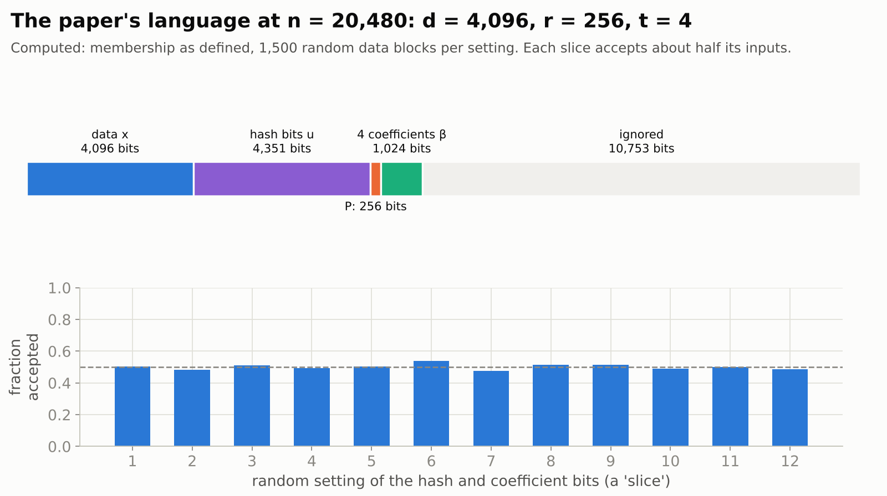
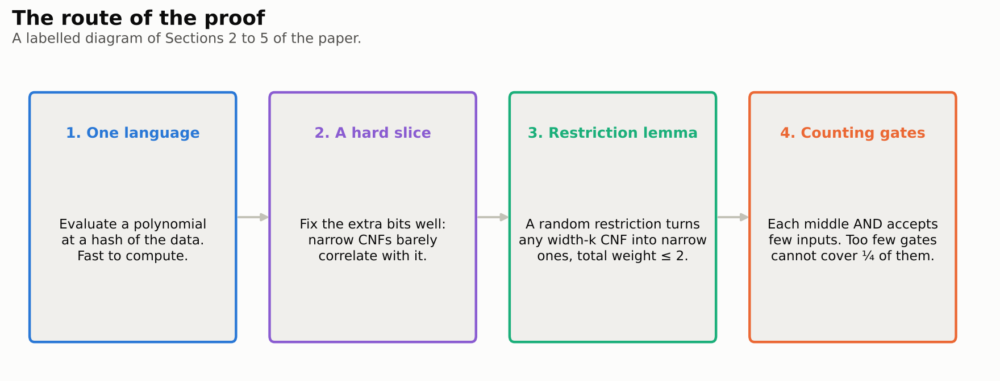
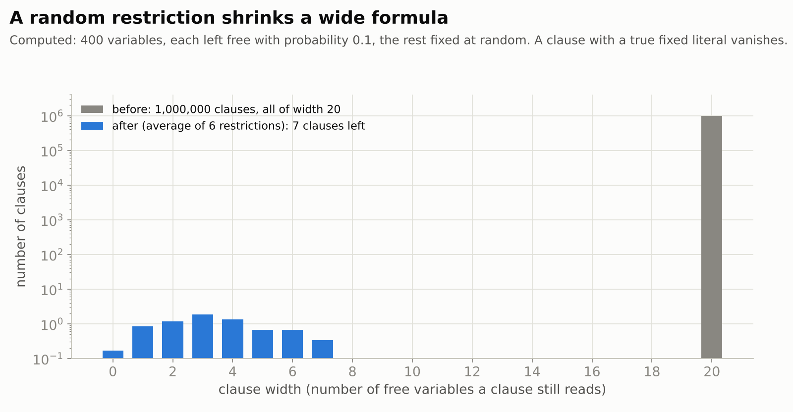

# Beyond the Square-Root Exponent for Depth-Three Boolean Circuits

> **In one paragraph.** One way to attack P vs NP is to prove that some explicit problem needs huge circuits: networks of AND, OR and NOT gates. For general circuits, nobody can prove even a modest lower bound. So researchers study simpler circuits, such as circuits with only three layers of gates. For these, a 1980s method shows that some explicit functions need about $2^{\sqrt n}$ gates on $n$ inputs. For almost forty years, no explicit function was known that needs $2^{A\sqrt n}$ gates for every constant $A$. On 23 September 2026 OpenAI released a 20-page paper claiming one, together with a computer-checked proof in Lean. The function can be computed quickly by an ordinary program. Three-layer circuits for it need more than $2^{A\sqrt n}$ gates for every constant $A$, once $n$ is large enough. This is a step in the study of circuit lower bounds. It is far from P vs NP, and far from what would be needed for the next landmark question about three-layer circuits.

| | |
|---|---|
| **Paper** | [Beyond the Square-Root Exponent for Depth-Three Boolean Circuits](https://github.com/openai/math/blob/main/preprints/Beyond-the-Square-Root-Exponent-for-Depth-Three-Boolean-Circuits-September-23-2026/main.pdf), OpenAI, 23 September 2026 (20 pages) |
| **The claim, plainly** | One explicit, fast-to-compute function needs $2^{\omega(\sqrt n)}$ gates in three-layer OR–AND–OR circuits: more than $2^{A\sqrt n}$ for every constant $A$, at every large enough input length |
| **Millennium problem** | [P vs NP](../../../../problems/p-vs-np.md): adjacent. It is about a weak kind of circuit and does not decide P vs NP |
| **Status** (4 November 2026) | Not peer reviewed. Lean 4 formalization of the main theorem published by OpenAI. A follow-up preprint builds on it, according to search results. No independent assessment found |
| **More** | [Lean scope](https://github.com/openai/math/blob/main/lean/docs/112.md) · [figures](figures/) · [figure code](code/make_figures.py) |

## Contents

1. [Circuits, and why lower bounds matter](#1-circuits-and-why-lower-bounds-matter)
2. [Three-layer circuits](#2-three-layer-circuits)
3. [The square-root barrier](#3-the-square-root-barrier)
4. [The claim](#4-the-claim)
5. [The function](#5-the-function)
6. [How the proof works](#6-how-the-proof-works)
7. [Checking it](#7-checking-it)
8. [What it does not do](#8-what-it-does-not-do)

## 1. Circuits, and why lower bounds matter

A **Boolean circuit** computes a yes/no answer from $n$ input bits, using gates that compute AND, OR and NOT. Its **size** is the number of gates. Any fast program can be turned into a circuit that is not much larger than its running time. So to show that a problem has **no** fast program, it is enough to show that it needs very large circuits. If this were proved for a problem in NP, such as 3SAT, it would show that P ≠ NP, a Millennium Prize problem.

Proving such **lower bounds** is extremely hard. For general circuits, the best lower bound known for an explicit function is only a small constant times $n$ gates. So researchers prove lower bounds for restricted circuits first, to learn which techniques work and why.

## 2. Three-layer circuits

The paper studies circuits with exactly three layers. The bottom layer has OR gates that read the inputs and their negations (a NOT on an input is free). The middle layer has AND gates that read the bottom gates. A single OR gate at the top reads the middle gates. Gates can take any number of inputs, and a bottom gate can feed several middle gates. The size counts every AND and OR gate.

In logic terms, each middle gate computes a **CNF**: an AND of **clauses**, where each clause is an OR of input bits or their negations. The whole circuit is an OR of CNFs. The **width** of a clause is the number of inputs it reads.

<picture>
  <source media="(prefers-color-scheme: dark)" srcset="figures/circuit-dark.png">
  
</picture>

Every function of $n$ bits can be computed this way. The question is how many gates it takes.

## 3. The square-root barrier

**Parity** asks whether an odd number of input bits are 1. In the 1980s Johan Håstad showed, with his random-restriction method, that three-layer circuits for parity need $2^{\Omega(\sqrt n)}$ gates. Later work sharpened the constant. Paturi, Pudlák and Zane (1999) showed that parity needs about $n^{1/4}2^{\sqrt n}$ gates, and this matches a known construction up to a constant factor. So parity itself can never beat the square-root scale. The best explicit bound before 2026, by Paturi, Pudlák, Saks and Zane (2005), had exponent about $(\pi/\sqrt 6)\sqrt n$. That is still a constant times $\sqrt n$.

<picture>
  <source media="(prefers-color-scheme: dark)" srcset="figures/parity-dark.png">
  
</picture>

The curve above is computed from the standard parity circuit: split the inputs into about $\sqrt n$ blocks, and combine the parities of the blocks. Its size is about $2^{\sqrt n}$.

The open question, raised again by Gurumukhani, Paturi, Pudlák, Saks and Talebanfard (2024), was: is there an explicit function that needs more than $2^{A\sqrt n}$ gates for **every** constant $A$? Bounds of this strength were known only for circuits whose bottom gates read at most two or three inputs.

<picture>
  <source media="(prefers-color-scheme: dark)" srcset="figures/timeline-dark.png">
  
</picture>

## 4. The claim

The paper's main theorem (Theorem 1.1), as stated:

> There is a language $L\subseteq\lbrace 0,1\rbrace^{\ast}$, a deterministic Turing machine deciding $L$, and fixed positive integers $C,a$ such that the machine runs in time at most $C(n+1)^a$ on every input of length $n$. If $f_n$ is the membership function of $L$ on $\lbrace 0,1\rbrace^n$, then $\lim_{n\to\infty}\log_2 S_3(f_n)/\sqrt n=\infty$. Equivalently, for every real $A\gt 0$, there is an integer $N_A$ such that $S_3(f_n)\gt 2^{A\sqrt n}$ for every $n\ge N_A$. No uniformity or bottom fan-in restriction is imposed on the circuits.

Here $S_3(f)$ is the smallest total number of AND and OR gates in a three-layer OR–AND–OR circuit computing $f$ exactly.

In plain words: there is one fixed problem, solvable by a fast program, such that three-layer circuits for it eventually need more than $2^{A\sqrt n}$ gates, whatever constant $A$ you pick. The paper stresses the word **one**: the problem and its program are fixed before $A$ is chosen.

## 5. The function

The input of length $n$ is cut into blocks. With $d$ about $n/5$:

- $d$ **data bits** $x$;
- **hash bits** $u$, which define a linear hash $h(x)$: $r$ bits, each a sum modulo 2 of some data bits, with $r$ about $d^{2/3}$;
- the coefficients of a **polynomial** $P$ of degree $r$ over the field with two elements;
- $t$ **coefficients** $\beta_0,\ldots,\beta_{t-1}$, with $t$ about $d^{1/6}$.

The input is accepted when $\sum_j \beta_j h(x)^j$, computed modulo $P$, has constant term 0. This takes polynomial time. Fixing every bit except the data gives a function of the data bits alone, which the paper calls a **slice**.

<picture>
  <source media="(prefers-color-scheme: dark)" srcset="figures/language-dark.png">
  
</picture>

We implemented the definition exactly ([code](code/make_figures.py)) and evaluated it at $n = 20480$. With random settings of the extra bits, each slice accepts about half of its inputs, as the proof requires.

The trick is that the hard slice does not have to be found by the program. The proof shows, by a probabilistic argument, that **some** setting of the extra bits gives a slice that is hard for circuits. A circuit for the whole language would give a circuit of the same size for that slice, so the whole language is hard too.

## 6. How the proof works

<picture>
  <source media="(prefers-color-scheme: dark)" srcset="figures/proof-dark.png">
  
</picture>

**Counting gates** (Section 5). Suppose a circuit with $S$ gates computes a hard slice. Each middle AND gate is a CNF that may only accept inputs the slice accepts, because the top gate is an OR. If every such CNF has tiny **correlation** with the slice, each accepts only a tiny fraction of inputs. The slice accepts at least a quarter of all inputs, so the circuit needs many middle gates. Clauses wider than $k$ are first deleted, at a small cost, with $k$ a constant times $\sqrt n$.

**Random restrictions** (Section 2). Leave each variable free with a small probability $p$, and fix the rest at random. A clause with a true fixed literal disappears, and the surviving clauses read few free variables.

<picture>
  <source media="(prefers-color-scheme: dark)" srcset="figures/restriction-dark.png">
  
</picture>

The paper's new **restriction lemma** makes this exact. After a restriction, a CNF of width $k$ can be written as a signed combination of CNFs of a constant width $b$. The expected total size of the coefficients is at most 2, **however many clauses** the CNF has. The proof counts chains of clause violations backwards, so that the number of clauses cancels out.

**A hard slice** (Sections 3 and 4). It remains to find a slice with small correlation with every narrow CNF, on most restrictions. A **sparse partition** lemma splits any narrow CNF into at most $2^{\eta m}$ pieces, each with few clauses. It builds on the sparsification method of Impagliazzo, Paturi and Zane (2001) and a refinement by Dell, Husfeldt, Marx, Taslaman and Wahlén (2014). There are then few enough tests that a moment bound handles them all at once. The hash and the polynomial supply the needed randomness.

**Putting it together.** The constants depend on $A$, but the language and its program do not.

## 7. Checking it

- **Lean.** OpenAI published a Lean 4 formalization of the main theorem ([scope](https://github.com/openai/math/blob/main/lean/docs/112.md)). It states the result for multi-tape Turing machines and exact OR–AND–OR circuits, with gate sharing, free negations and constants. The comparator statement contains `sorry` only as the challenge to be proved; the proof files under `OAI/Computability/DepthThree/` contain no `sorry`. We have not re-run the build.
- **Follow-up.** According to search results, an ECCC report in October 2026 (TR26-248) cites the result and extends a bound of this type to every fixed depth, using a different function. A separate record on Zenodo (17 October) reports a similar extension. We could not open these sources directly from our environment.
- **Experts.** We found no public expert assessment of the proof as of 4 November 2026, and no reported error.

## 8. What it does not do

- **It does not decide P vs NP.** Three-layer circuits are a very weak model. The function is easy for ordinary programs; only three-layer circuits for it must be large.
- **It does not reach $2^{n^{1/2+\varepsilon}}$.** The exponent grows faster than every constant times $\sqrt n$, but the paper does not claim a fixed power above one half, the question raised by Håstad, Jukna and Pudlák in 1995.
- **It is far from Valiant's target.** As background not discussed in the paper: Valiant (1977) showed that functions with linear-size, logarithmic-depth circuits have three-layer circuits of size $2^{O(n/\log\log n)}$. A three-layer lower bound beyond that would give a new lower bound for general circuits. The claimed result is still far below that scale.
- **It is not peer reviewed.** The formal proof covers the theorem as stated in Lean. Experts still need to read the written proof and confirm that the formal statement matches it.
