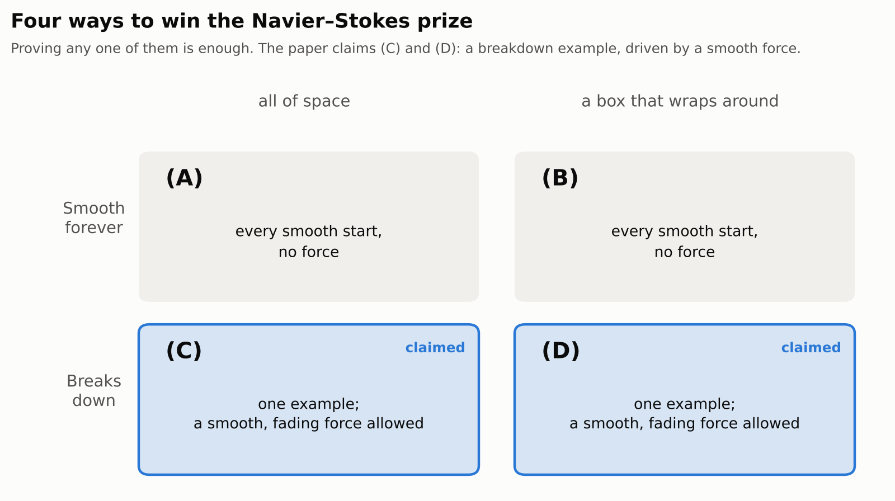
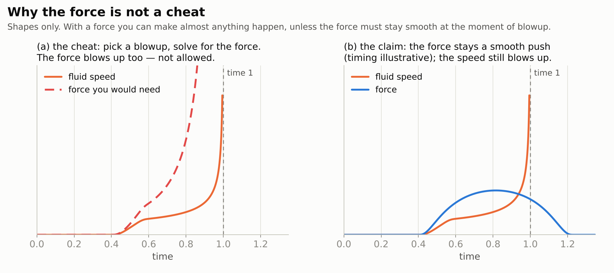
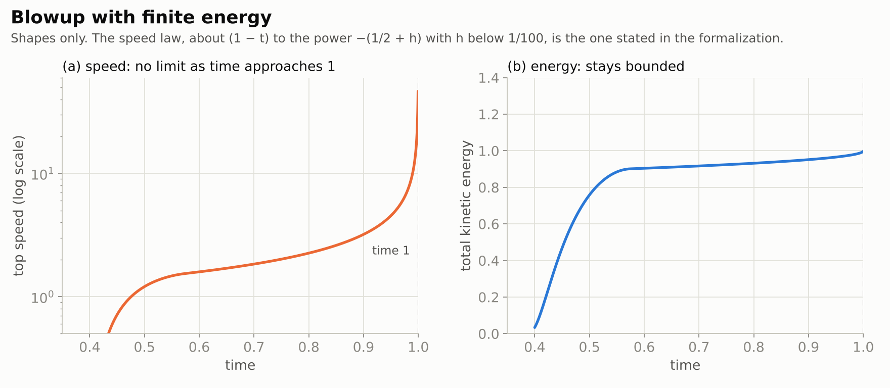
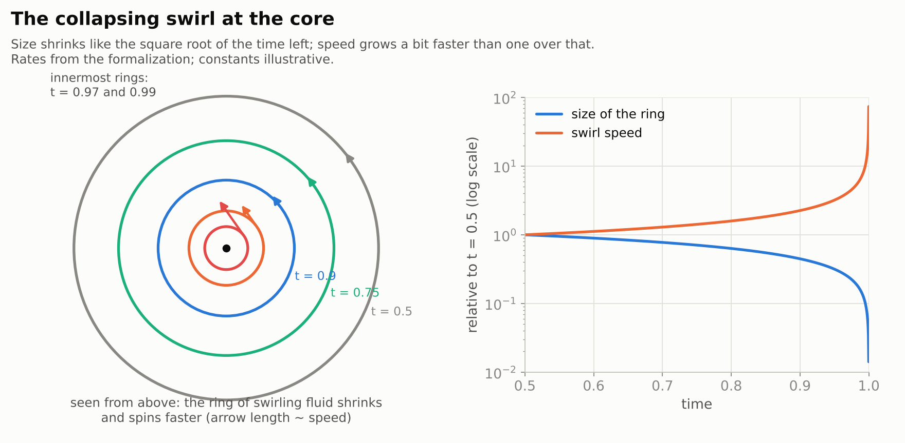
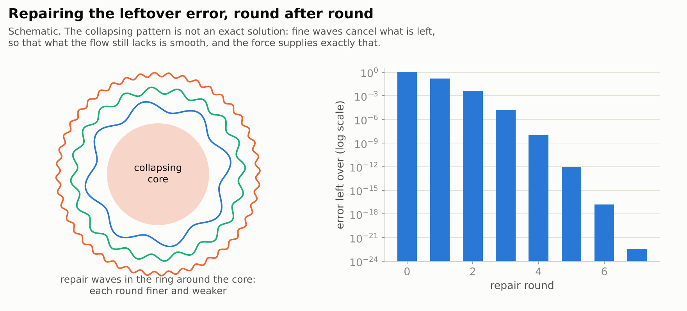

# Finite Time Blowup for Navier–Stokes

> **In one paragraph.** The Navier–Stokes equations describe how water and air move. The Millennium Prize question asks whether their solutions always stay smooth, or whether a flow can tear itself apart in a finite time, with its speed shooting to infinity at a point. On 8 September 2026 OpenAI released a paper claiming the second answer: for every viscosity, a fluid that starts at rest, pushed by a carefully designed smooth force, spins faster and faster in a shrinking region until its speed has no limit at time 1, while its total energy stays finite. The official problem explicitly allows this kind of example (its options (C) and (D)), so if the proof is right, it settles the problem as written. It would not tell us whether flows left to themselves, with no force, can break down. OpenAI also published a computer-checked proof in Lean. A group of mathematicians has shown that the computer proof does not follow the written paper step by step, which makes the paper itself still a matter for human review.

| | |
|---|---|
| **Paper** | [Finite Time Blowup for Navier–Stokes](https://cdn.openai.com/pdf/32d9f210-8b73-45e0-91bc-82a30aef8a9a/navier-stokes.pdf), OpenAI, 8 September 2026 |
| **The claim, plainly** | For every viscosity there is a smooth push, applied for a while to a fluid at rest, that makes the fluid's speed infinite at one point at time 1, with finite energy, and the equations cannot be continued smoothly past that moment |
| **Millennium problem** | [Navier–Stokes existence and smoothness](../../../../problems/navier-stokes.md): claims options (C) and (D) |
| **Status** (2 November 2026) | Not peer reviewed. Lean formalization published by OpenAI; its relation to the written proof is [disputed](#8-the-dispute-the-computer-proof-is-not-the-paper). The Clay Institute says it is evaluating the claim |
| **More** | [Lean formalization](https://github.com/openai/NavierStokesAndEuler) · [figures](figures/) · [figure code](code/make_figures.py) |

> [!NOTE]
> **How this page was written.** We could not obtain the written paper, which is hosted on a site this project's build environment cannot reach. The statement of the result below is taken from the published Lean formalization, which states it formally, and matches OpenAI's announcement. The outline in Section 6 is reconstructed from the formalization's documentation and from the manuscript sections it cites. The dispute in Section 8 is summarized from the critics' paper. We will check everything against the paper itself before this page is final.

## Contents

1. [The equations](#1-the-equations)
2. [The question: can a smooth flow break?](#2-the-question-can-a-smooth-flow-break)
3. [Four ways to win](#3-four-ways-to-win)
4. [Why the force is not a cheat](#4-why-the-force-is-not-a-cheat)
5. [The claim](#5-the-claim)
6. [How the construction works](#6-how-the-construction-works)
7. [Checking it by computer](#7-checking-it-by-computer)
8. [The dispute: the computer proof is not the paper](#8-the-dispute-the-computer-proof-is-not-the-paper)
9. [What it would mean, and what it would not](#9-what-it-would-mean-and-what-it-would-not)

## 1. The equations

Picture water in a tank. At every point and every moment it has a velocity: a speed and a direction. The Navier–Stokes equations say how that velocity changes, as the balance of four effects:

- **The fluid carries itself along.** Fast-moving water sweeps its own velocity downstream. This is the source of eddies, swirls and turbulence, and it is the only term that can make things more extreme.
- **Friction smooths things out.** Neighbouring bits of fluid drag on each other, evening out differences. How strongly is set by a number called the **viscosity**: high for honey, low for water.
- **Pressure keeps the volume fixed.** Water can't be squeezed, so pressure pushes back wherever the flow would compress or stretch it.
- **An outside force** may push on the fluid, like a stirring spoon or gravity.

In symbols, for a velocity $u$, pressure $p$, viscosity $\nu$ and force $f$:

```math
\partial_t u + (u \cdot \nabla)\, u = \nu\, \Delta u - \nabla p + f, \qquad \nabla \cdot u = 0 .
```

The first term on the right is friction, the second is pressure, and the second term on the left is the fluid carrying itself along. The tug of war between that self-carrying, which can sharpen a flow, and friction, which smooths it, is what the whole question is about.

## 2. The question: can a smooth flow break?

Start with a perfectly smooth flow: no jumps, no kinks, finite speed everywhere. The equations then say how it evolves. The question is whether it stays smooth forever. Or can the self-carrying effect win against friction, concentrating motion into a smaller and smaller region until, at some finite moment, the speed at a point becomes infinite? That event is called a **blowup**, or a **singularity**.

If a blowup can happen, the equations stop making sense at that point and moment: they no longer predict what comes next. People have studied the question since Jean Leray in 1934. Some partial answers are known:
- solutions can always be continued in a weak, "rough" sense (Leray);
- any breakdown must be confined to a vanishingly small set of points (Caffarelli, Kohn and Nirenberg, 1982);
- blowup has been proved for modified equations, for example Terence Tao's "averaged" Navier–Stokes in 2016;
- blowup has been proved for the frictionless Euler equations in special settings, for example rough data (Elgindi, 2021) and fluid next to a wall (Chen and Hou, with computer-assisted proofs).

For the real equations in three dimensions, the question has stayed open. In 2000 the Clay Mathematics Institute made it one of its seven Millennium Prize Problems, worth one million dollars.

## 3. Four ways to win

The official problem statement, written by Charles Fefferman, offers four ways to win the prize. Two say "smooth forever", two say "can break down", in two different settings: all of space, or a box whose opposite walls are glued together so the fluid wraps around (mathematicians call this a torus).

<picture>
  <source media="(prefers-color-scheme: dark)" srcset="figures/options-dark.png">
  
</picture>

The two halves are very different tasks:

- **(A) and (B)** must hold for *every* smooth starting flow, with *no* outside force.
- **(C) and (D)** need just *one* example of a breakdown, and they allow a smooth outside force, as long as it fades away fast enough in space and time.

The paper claims (C) and (D).

## 4. Why the force is not a cheat

At first sight, allowing a force seems to make breakdown easy. Here is the cheat: draw any flow you like that blows up, plug it into the equations, and call whatever is left over "the force". The equations then hold by definition.

The catch is that the rules require the force itself to be **perfectly smooth everywhere, at every moment, including the moment of blowup**, and to fade away. With the cheat, the force needed to hold up a blowup almost always blows up too.

<picture>
  <source media="(prefers-color-scheme: dark)" srcset="figures/force-dark.png">
  
</picture>

So the real challenge is to find a breakdown that a *smooth* push can sustain: a flow that tears itself apart while the force driving it stays calm. That is what the paper claims to construct.

## 5. The claim

Stated in plain words from the formal version, for **every** positive viscosity:

- the fluid **starts at rest**, and stays at rest for a while (until time 3/8);
- an outside **force** acts only inside a bounded region of space and a bounded stretch of time after the start, and is smooth everywhere;
- up to time 1 the flow is perfectly **smooth**, and its total **energy stays bounded**;
- as time approaches 1, the **speed** somewhere in the fluid **grows without limit**;
- **no smooth solution** with bounded energy, driven by the same force from the same rest state, can exist for all time.

The paper proves the same in the wrap-around box. Together these are options (C) and (D).

<picture>
  <source media="(prefers-color-scheme: dark)" srcset="figures/blowup-dark.png">
  
</picture>

How can the speed be infinite while the energy is finite? The fast motion happens in a region that shrinks as time runs out. Its volume shrinks faster than the square of the speed grows, so the energy contained in it stays small.

## 6. How the construction works

*This section is reconstructed from the formalization; see the note at the top.*

### Step 1: a collapsing swirl

At the heart of the construction is a **swirl**: fluid spinning around an axis, like water around a drain, but arranged symmetrically around the centre. As time approaches 1, the swirling ring **shrinks toward the centre** and **spins faster**. The formalization states the rates:
- the ring's size shrinks like the square root of the time left, $\sqrt{1-t}$;
- its swirl speed grows like $(1-t)^{-(1/2+h)}$, where $h$ is a fixed small number between 0 and $1/100$.

A flow that keeps the same shape while shrinking like this is called **self-similar**: each moment looks like a zoomed-in copy of the moment before. For the unforced equations, exactly self-similar blowups are known *not* to exist under natural conditions (Nečas, Růžička and Šverák, 1996; Tsai, 1998). The construction here is only approximately self-similar, and it has the force to help it.

<picture>
  <source media="(prefers-color-scheme: dark)" srcset="figures/collapse-dark.png">
  
</picture>

### Step 2: the pattern is not quite a solution

A drawn-up collapsing pattern does not satisfy the equations exactly. Plugging it in leaves an **error**, and near time 1 that error is far from smooth. If it were simply called "the force", we would be back to the cheat.

### Step 3: repair, round after round

The construction removes the error in infinitely many **repair rounds**. Each round adds small, rapidly oscillating **waves** inside a thin ring around the collapsing core. Their combined effect cancels most of the remaining error. Each round's waves are finer, and the error left behind is much smaller. The rounds are arranged so that the leftover error becomes perfectly smooth, in all its derivatives, right through time 1. The force is defined as exactly what the final flow lacks, which is now that smooth leftover.

<picture>
  <source media="(prefers-color-scheme: dark)" srcset="figures/repair-dark.png">
  
</picture>

Building flows out of layers of fine waves that cancel errors is the idea behind **convex integration**. It was invented by John Nash for geometry and later used by Tristan Buckmaster, Vlad Vicol and others to build unexpected solutions of fluid equations. The formalization's vocabulary (stress cones, covariance targets, wave pulses, a "diagonal" choice of stages) is that of this toolbox.

### Step 4: outside the core

Away from the collapsing core, the flow is gentle. Far out it simply spreads like heat, and the construction is cut off so that everything lives in a bounded region.

### Step 5: no other solution can escape

Building one flow that blows up is not quite enough. The rules ask that **no** smooth, finite-energy solution with the same force and starting state exists for all time. The paper shows that any such solution would have to **coincide** with the constructed one up to time 1. This is a comparison, or uniqueness, argument: two solutions that start together, with one of them well behaved, can never drift apart. So any rival solution inherits the blowup and cannot be smooth forever. This is the part of the proof examined most closely in the dispute (Section 8).

### Step 6: every viscosity at once

The construction is done once, at viscosity 1. Zooming space by the square root of the viscosity, $u_\nu(t,x)=\sqrt{\nu}\cdot u(t,x/\sqrt{\nu})$, turns it into a solution at any viscosity $\nu$, with the same blowup time.

## 7. Checking it by computer

OpenAI published a formal proof in **Lean 4**, a language in which a computer checks every logical step.
- **Size:** about 429,000 lines in some 800 files.
- **Shortcuts:** none. It uses no unproved steps ("sorry") and no extra axioms beyond Lean's three standard ones.
- **The statement:** the final theorems are checked against Lean statements of options (C) and (D). These are adapted from the [Formal Conjectures](https://github.com/google-deepmind/formal-conjectures/blob/main/FormalConjectures/Millenium/NavierStokes.lean) project, so they were not written by OpenAI. We compared them with Fefferman's official statement, condition by condition, and they match: smooth, divergence-free, rapidly decaying data and force; a solution smooth for all time with bounded energy.

If that check holds, the *theorem* is true, whatever the merits of the written paper. **We have not re-run the check ourselves.**

## 8. The dispute: the computer proof is not the paper

On 6 October 2026 A. Bastounis, F. Circelli and A. C. Hansen posted [*Navier–Stokes lost in translation*](https://arxiv.org/abs/2610.08144). Their point is narrow, and important.

**What they claim.** According to the authors, the Lean proof was produced by translating the paper into Lean with AI and accepting the translation once it compiled. A translation that compiles can quietly prove *different* steps from the paper. They give two concrete examples:
- **An inverse estimate** (the paper's Lemma 8.6, equation 8.19). The paper claims a bound that costs four extra derivatives. The Lean version proves a weaker bound costing five, by summing a different series.
- **A pressure bound in the uniqueness argument** (equation 10.19, Lemma 10.5). Both the bound and the way it is proved differ: different inequalities, a different route through Sobolev embedding, and an extra continuity step.

**What they do not claim.** They do not say the written proof is wrong, or that the theorem is false. Their conclusion is that a compiling Lean proof certifies the *theorem*, not the *paper*: the paper's own arguments still need ordinary peer review.

So the two questions come apart:

| Question | What would answer it |
|---|---|
| Is the theorem true? | The Lean check, if the formal statement is faithful and the check is independently re-run |
| Is the paper's proof correct, as written? | Human peer review of the paper |
| Has the prize been won? | The Clay Institute's rules: publication in a qualifying outlet, a waiting period, and acceptance by the community |

## 9. What it would mean, and what it would not

**If correct, it would:**

- settle the Millennium Prize problem in its official form, through the breakdown options (C) and (D): the forced Navier–Stokes equations can break down from smooth, harmless-looking data;
- show that bounded energy cannot rule out breakdown on its own, and that a smooth push suffices to drive a singularity.

**It would not:**

- **show that flows left to themselves blow up.** With no force, whether a smooth flow can break down on its own remains open. Many mathematicians regard that as the physical heart of the question, even though the prize's wording also accepts forced examples;
- **mean that real water or air blows up.** The equations are a model; at tiny scales real fluids are made of molecules, and the force here is specially engineered;
- **change weather forecasting or engineering.** It is an existence proof about an idealized model, not a new simulation method.

## Words used on this page

| Here | In the paper |
|---|---|
| speed infinite at a point | blowup; the velocity is unbounded as $t \to 1$ |
| smooth | infinitely differentiable, $C^\infty$ |
| wrap-around box | the torus $\mathbb{R}^3/\mathbb{Z}^3$ |
| friction strength | viscosity $\nu$ |
| collapsing swirl | an axisymmetric, approximately self-similar profile with swirl |
| repair rounds, waves | correction stages, wave packets (convex-integration style) |
| no other solution can escape | weak–strong uniqueness, comparison |
| error | the Navier–Stokes residual |

Figures: [`code/make_figures.py`](code/make_figures.py). The blowup rates come from `LocalAngularGrowth.lean` and `BaseAngularGrowth.lean` in the formalization; everything else drawn is schematic.
