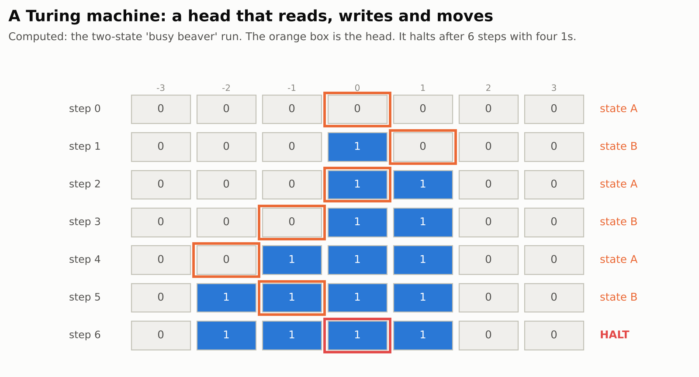
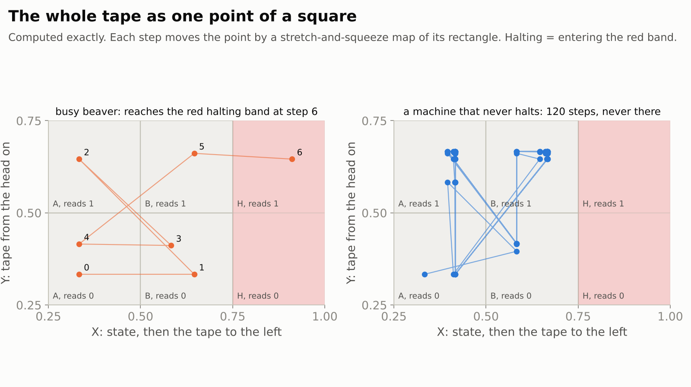
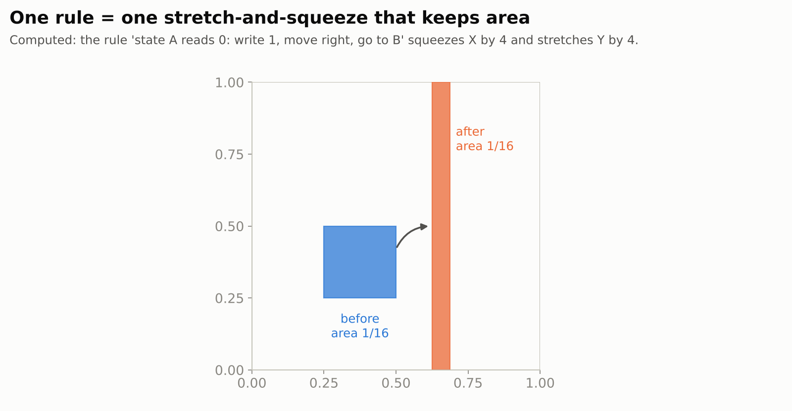
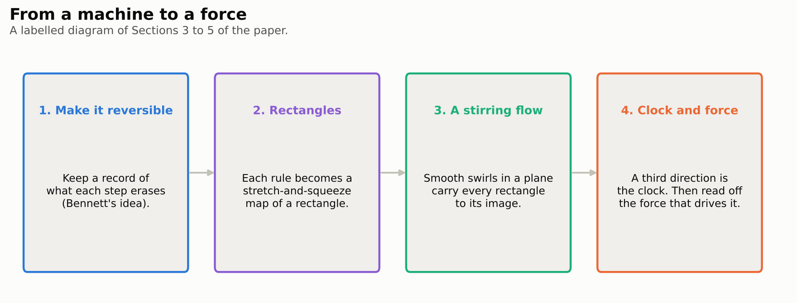
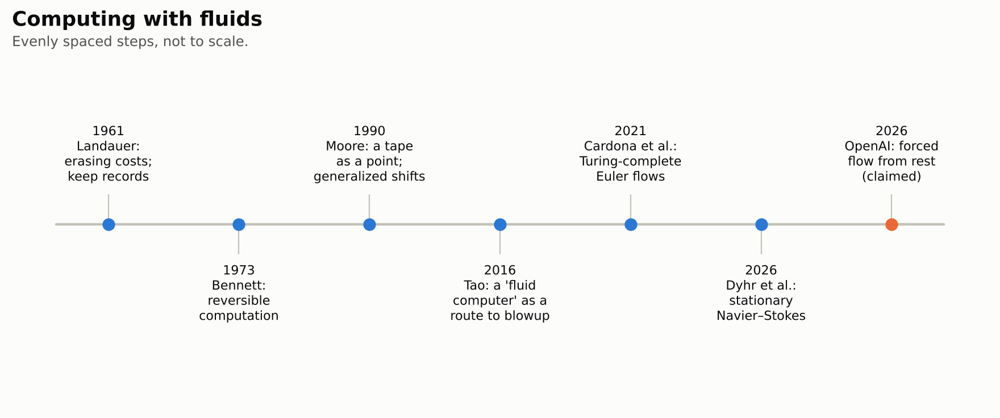

# Universal Computation with Eventually Stationary Navier–Stokes Forcing

> **In one paragraph.** Can water compute? On 27 September 2026 OpenAI released a 14-page paper claiming that a viscous fluid, obeying the Navier–Stokes equations, can run any computer program. Given any Turing machine and its input, the paper writes down a smooth push on the fluid, a **force**, that stops changing after one unit of time. Start the fluid at rest and follow one marked drop. The drop enters a fixed region if and only if the program eventually halts. Since no algorithm can decide whether every program halts, no algorithm can predict, in general, where a drop in such a forced flow will go. The flows stay smooth forever, so this does not answer the Navier–Stokes Millennium problem. But it is a precise version of an idea Terence Tao proposed as a possible route to blowup: fluids that compute. Closely related statements in the same release are checked in Lean. This exact statement is not, and no expert assessment has been reported.

| | |
|---|---|
| **Paper** | [Universal Computation with Eventually Stationary Navier–Stokes Forcing](https://github.com/openai/math/blob/main/preprints/Universal-Computation-with-Eventually-Stationary-Navier-Stokes-Forcing-September-27-2026/manuscript.pdf), OpenAI, 27 September 2026 (14 pages) |
| **The claim, plainly** | For any program and input, an explicit smooth force, constant in time after time 1, makes a fluid starting at rest carry one particle into a fixed region exactly when the program halts |
| **Millennium problem** | [Navier–Stokes existence and smoothness](../../../../problems/navier-stokes.md): adjacent. The flows are smooth for all time; the result is about computation, not blowup |
| **Status** (4 November 2026) | Not peer reviewed. Lean 4 formalizations of closely related constructions in the same family, not of this theorem. No expert assessment found |
| **More** | [figures](figures/) · [figure code](code/make_figures.py) · [our explainer of OpenAI's Navier–Stokes blowup paper](../navier-stokes-blowup/README.md) |

**[▶ Watch the video](video/navier-stokes-universal-computation.mp4)** (6 minutes): the story of this page, told with animations, narrated by an American male voice and captioned. Also with an [American female narrator](video/navier-stokes-universal-computation-us-female.mp4), same pictures and timing. The [script](video/storyboard.md) lists what is on screen and what is said, beat by beat.

## Contents

1. [Fluids and the Millennium problem](#1-fluids-and-the-millennium-problem)
2. [Machines and halting](#2-machines-and-halting)
3. [The claim](#3-the-claim)
4. [A tape as a point](#4-a-tape-as-a-point)
5. [How the proof works](#5-how-the-proof-works)
6. [Why it matters](#6-why-it-matters)
7. [Checking it](#7-checking-it)
8. [What it does not do](#8-what-it-does-not-do)

## 1. Fluids and the Millennium problem

The **Navier–Stokes equations** describe how a fluid with viscosity, like water, moves under its own momentum, its internal pressure, its friction, and any outside **force** $f$:

$$\partial_t u+(u\cdot\nabla)u=-\nabla p+\nu\Delta u+f,\qquad \nabla\cdot u=0.$$

Here $u$ is the velocity, $p$ the pressure, and $\nu$ the viscosity. The Millennium problem asks whether smooth solutions in three dimensions stay smooth forever, or can break down in finite time.

In 2016 Terence Tao suggested a strategy for proving breakdown: build a fluid that behaves like a **computer**, programmed to copy itself into a smaller, faster copy, again and again. He carried it out for a modified ("averaged") version of the equations. Whether real fluids can be programmed like this has been an active question since.

## 2. Machines and halting

A **Turing machine** is the simplest model of a computer: a head moves along an infinite tape of symbols, reading, writing and changing its internal state according to a finite table of rules. It **halts** if it reaches a stop state.

<picture>
  <source media="(prefers-color-scheme: dark)" srcset="figures/machine-dark.png">
  
</picture>

Turing proved in 1936 that no algorithm can decide, for every machine and input, whether it halts: the **halting problem** is undecidable. So if a physical system can imitate every Turing machine, some questions about its long-term behaviour are undecidable too.

## 3. The claim

The paper's main theorem (Theorem 1.1), in plain words:

- **The setting is fixed.** The fluid fills a three-dimensional box with opposite faces glued (the flat torus), has a fixed positive viscosity, and starts at rest.
- **The force is explicit.** An algorithm turns any Turing machine and input into a finite formula for a smooth force $f$. The force has zero average, all its derivatives are bounded, and it **stops changing after time 1**. The formula does not run the machine.
- **The fluid behaves.** The Navier–Stokes equations then have a smooth solution for all time, unique among classical solutions, with bounded energy.
- **One drop computes.** The fluid particle that starts at $(1/4,1/4,0)$ enters the region $\lbrace 1/32\lt Y\lt 1/8\rbrace$ at some time if and only if the machine halts.

The paper also gives variants: a force that is periodic in time from the start, and a force whose time derivatives are square-integrable. It stresses that undecidability concerns exact trajectories. It gives no tolerance for measuring with finite precision over an infinite computation.

## 4. A tape as a point

The key idea goes back to Cristopher Moore (1990). Write the tape to the left of the head, with the state in front, as the digits of one number $X$, and the tape from the head rightwards as the digits of another number $Y$. Then the whole configuration is one point $(X,Y)$ of a square.

<picture>
  <source media="(prefers-color-scheme: dark)" srcset="figures/encoding-dark.png">
  
</picture>

Each rule of the machine only looks at the state and the symbol under the head: the first digits of $X$ and $Y$. So it acts on one rectangle of the square. And it acts very simply: moving right shifts the digits of $Y$ one place and adds one digit in front of $X$'s tape. That is an **affine map** that squeezes one direction and stretches the other by the same factor.

<picture>
  <source media="(prefers-color-scheme: dark)" srcset="figures/area-dark.png">
  
</picture>

Our pictures use a simplified version of this encoding ([code](code/make_figures.py)), with every step checked in exact arithmetic. The paper's version adds gaps between digits, so that the source rectangles are separated from each other, and so are the target rectangles.

Squeezing and stretching by the same factor keeps **area**. That matters, because an incompressible fluid moves areas and volumes around without changing their size.

## 5. How the proof works

<picture>
  <source media="(prefers-color-scheme: dark)" srcset="figures/recipe-dark.png">
  
</picture>

- **Make it reversible** (Section 3). A machine can erase information, but a fluid's motion can always be run backwards. So the paper first compiles the machine into one that records what each step would erase. This is Bennett's idea from 1973, in an explicit seven-row form that the geometry needs.
- **Rectangles** (Section 4). With gapped digits, each rule becomes an area-keeping affine map from a source rectangle to a target rectangle.
- **A stirring flow** (Section 4). Smooth, localized swirls in the plane, each given by a stream function, carry every source rectangle to its target in one period. The rectangles are first moved out of the way to a parking region, reshaped, and then delivered in order, so no two collide. The flow is built for all rules at once, without knowing which ones the run will use.
- **Clock and force** (Section 5). The third direction serves as a clock: the velocity in that direction is one along the path, so moving up one unit runs one step. A smooth ramp starts this flow from rest during the first unit of time; afterwards the velocity field no longer changes. Finally, the force is simply read off from the equation. For a chosen velocity, $f$ is whatever makes the Navier–Stokes equation true. The work is in choosing the velocity well.

<picture>
  <source media="(prefers-color-scheme: dark)" srcset="figures/timeline-dark.png">
  
</picture>

## 6. Why it matters

Earlier fluid computers chose the geometry. Cardona, Miranda, Peralta-Salas and Presas (2021) built Turing-complete steady flows of the frictionless Euler equations, on a specially shaped three-dimensional sphere. Dyhr, González-Prieto, Miranda and Peralta-Salas (2026) did this for unforced Navier–Stokes, again with an adapted geometry. This paper fixes the ordinary flat geometry and a start from rest, and puts the program into the force.

The consequence is a kind of **unpredictability**. For a flow with an explicitly known smooth force, no algorithm can decide in general whether a given drop ever reaches a given region. That is a rigorous form of the old intuition that fluids can be as complex as computers.

## 7. Checking it

- **Lean.** OpenAI's Lean formalizations for this family ([scope](https://github.com/openai/math/blob/main/lean/docs/376.md)) cover four companion manuscripts. One of them, *Incompressible Box Transport and Finite Computation*, encodes every machine in a smooth forced Navier–Stokes flow on all of three-dimensional space, starting from rest and periodic after time 1. There, a fixed particle enters a fixed box exactly when the machine halts. Others cover rapidly vanishing forces and detection through the velocity field. The scope page notes that this paper's own fixed-particle detector on the torus is outside the formalized statements. We have not re-run the formalizations.
- **Experts.** We found no public assessment as of 4 November 2026, and no reported error. The paper is short and builds on well-understood ideas, which should make it easier to check than OpenAI's blowup claim.

## 8. What it does not do

- **It does not answer the Millennium problem.** All the flows here stay smooth forever. The problem asks about breakdown.
- **It does not carry out Tao's blowup program.** Making a fluid compute is one ingredient. Making it compute a self-copying, ever-faster blowup is a much harder, separate step.
- **It needs a designed force.** The program lives in the outside force, chosen for each machine. It says nothing about unforced flows on flat space.
- **It is exact, not robust.** Undecidability concerns exact trajectories. The paper gives effective error bounds over finite times, but no tolerance that works for an infinite computation.
