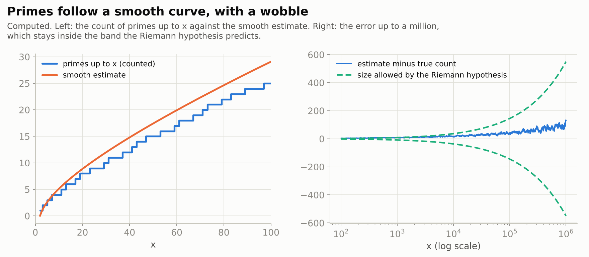
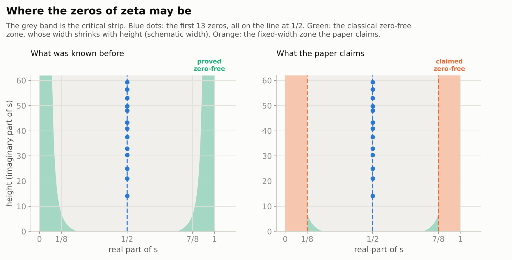
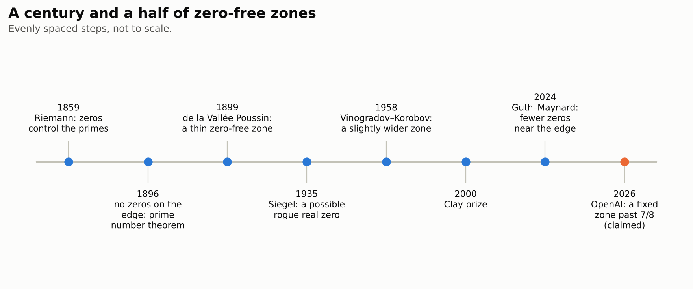
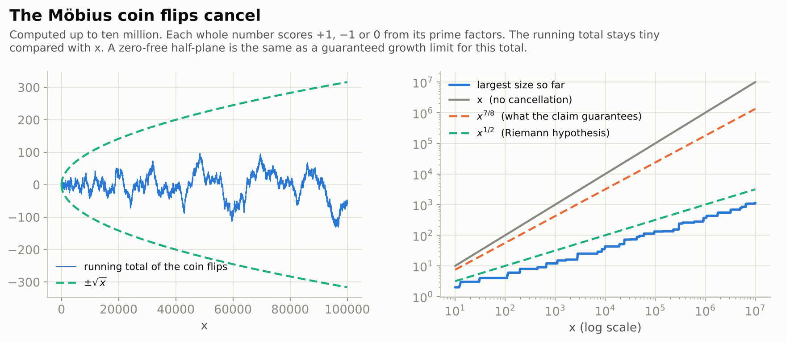
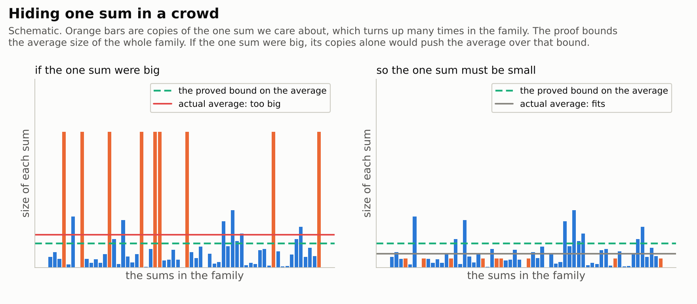
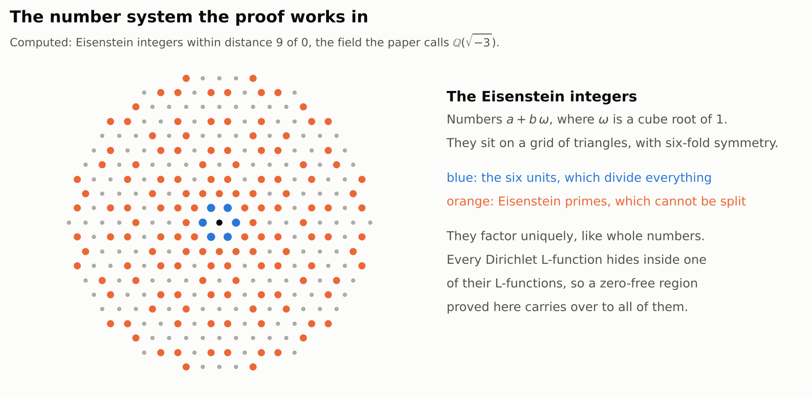
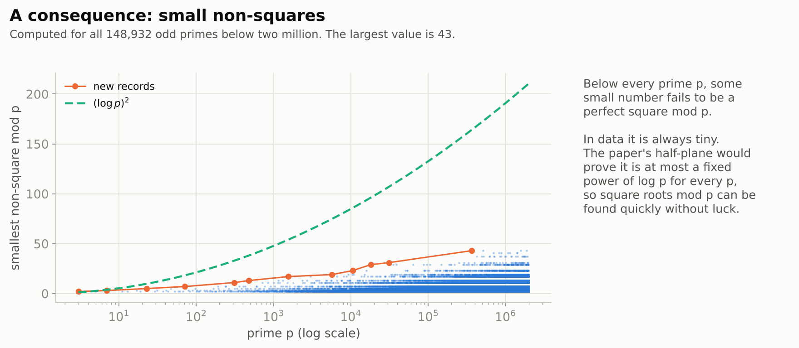

# The Quasi-Riemann Hypothesis: a zero-free half-plane

> **In one paragraph.** The prime numbers look random up close but follow a smooth curve from far away. How closely they follow it is controlled by the zeros of one function, Riemann's zeta function. The Riemann hypothesis, a Millennium Prize problem, says all those zeros sit on a single line, at real part $1/2$. That is the best possible case, and it remains unproved. Until now nobody could prove even a much weaker statement: that the zeros keep a fixed distance from the edge of the zone they live in, at real part $1$. That weaker statement is called the quasi-Riemann hypothesis. On 30 September 2026 OpenAI released a paper claiming it, with the boundary at $7/8$: no zeros at all with real part above $7/8$, for zeta and for a whole family of related functions. If it holds up, it settles several old questions about primes at once. It does not prove the Riemann hypothesis. OpenAI published a computer-checked version in Lean, and number theorists are now working through the 199-page proof.

| | |
|---|---|
| **Paper** | [The Quasi-Riemann Hypothesis: A Zero-Free Half-Plane $\operatorname{Re} s \gt 7/8$](https://github.com/openai/math/blob/main/preprints/The-Quasi-Riemann-Hypothesis-September-30-2026/paper.pdf), OpenAI, 30 September 2026 (199 pages) |
| **The claim, plainly** | Riemann's zeta function, and every Dirichlet $L$-function, has no zeros with real part greater than $7/8$ |
| **Millennium problem** | [Riemann hypothesis](../../../../problems/riemann-hypothesis.md): partial progress; the hypothesis itself stays open |
| **Status** (4 November 2026) | Not peer reviewed. Lean formalization of the main statements published by OpenAI. Under examination by number theorists; no error reported |
| **More** | [shorter 11/12 companion](https://github.com/openai/math/blob/main/preprints/The-Quasi-Riemann-Hypothesis-October-5-2026/paper2.pdf) · [Lean scope](https://github.com/openai/math/blob/main/lean/docs/003.md) · [figures](figures/) · [figure code](code/make_figures.py) |

## Contents

1. [Primes and their wobble](#1-primes-and-their-wobble)
2. [The zeta function and its zeros](#2-the-zeta-function-and-its-zeros)
3. [The Riemann hypothesis, and a weaker question](#3-the-riemann-hypothesis-and-a-weaker-question)
4. [The claim](#4-the-claim)
5. [How the proof works](#5-how-the-proof-works)
6. [What would follow](#6-what-would-follow)
7. [Checking it](#7-checking-it)
8. [What it does not do](#8-what-it-does-not-do)

## 1. Primes and their wobble

A prime is a whole number bigger than 1 that only divides by 1 and itself: 2, 3, 5, 7, 11, 13, and so on forever. One by one they look random. There is no simple rule for the next prime. But count them, and a pattern appears. The number of primes up to $x$ is very close to a smooth curve, about $x / \log x$. That fact is the **prime number theorem**, proved in 1896.

The interesting question is how far the true count wobbles away from the smooth curve. Up to a million there are 78,498 primes, and the smooth estimate is off by only about 130.

<picture>
  <source media="(prefers-color-scheme: dark)" srcset="figures/primes-dark.png">
  
</picture>

How big can the wobble get, in general? That is what the zeros of the zeta function decide.

## 2. The zeta function and its zeros

In 1859 Bernhard Riemann studied one function, now called the **zeta function**:

$$\zeta(s) = 1 + \frac{1}{2^s} + \frac{1}{3^s} + \frac{1}{4^s} + \cdots$$

The input $s$ is a complex number: it has a real part, which you can think of as a position left to right, and an imaginary part, which you can think of as a height. Euler had already noticed that this sum, built from all whole numbers, equals a product built only from the primes. So zeta knows about every prime at once.

Riemann found an exact formula for the prime count. It is the smooth curve plus one wave for each place where zeta equals zero. Each zero adds a wave to the count, and the zero's real part sets how loud its wave is: a zero at real part $\beta$ makes a wave of size roughly $x^{\beta}$. Zeros near real part $1$ would make waves almost as big as the count itself, while zeros at real part $1/2$ make waves of size about $\sqrt{x}$, which is as small as they can be.

Apart from some easy zeros at the negative even numbers, all zeros of zeta lie in a band called the **critical strip**, between real parts $0$ and $1$. They come in mirror pairs: a zero at real part $\beta$ is matched by one at $1 - \beta$.

<picture>
  <source media="(prefers-color-scheme: dark)" srcset="figures/strip-dark.png">
  
</picture>

## 3. The Riemann hypothesis, and a weaker question

The **Riemann hypothesis** says every zero in the critical strip has real part exactly $1/2$. Computers have checked more than ten trillion zeros, and all of them are on that line. It is one of the seven Millennium Prize problems, and still open.

What *has* been proved is much weaker. In 1896 Hadamard and de la Vallée Poussin showed there are no zeros on the edge, at real part exactly $1$, which is enough for the prime number theorem. Later results pushed the zeros a little way in from the edge, but only by a margin that **shrinks** as you go higher up the strip (the green slivers above). Nobody could rule out that, very high up, zeros creep arbitrarily close to the edge.

So mathematicians asked a far more modest question. Is there *some* fixed number below $1$, say $0.99$, such that no zero has real part above it, at any height? This is the **quasi-Riemann hypothesis**. Proving it with any number at all would have been historic.

The same questions make sense for a whole family of cousins of zeta, the **Dirichlet $L$-functions**. Each one counts primes in a particular pattern, for example the primes that leave remainder $1$ when divided by $4$. For these there was one more worry. A single rogue zero might sit on the real line extremely close to $1$, a so-called **Landau–Siegel zero**. No one could rule such zeros out, and their possible existence has haunted the subject since the 1930s.

<picture>
  <source media="(prefers-color-scheme: dark)" srcset="figures/timeline-dark.png">
  
</picture>

## 4. The claim

The paper's main theorem (Theorem 1.1), as stated:

> Every finite-order Hecke $L$-function over $F=\mathbb Q(\sqrt{-3})$ has no zero in $\operatorname{Re} s \gt 7/8$. The same holds for every Dirichlet $L$-function, including $\zeta(s)$. A pole at $s=1$ for a principal character is allowed.

In plain words: zeta, and every Dirichlet $L$-function, has no zeros to the right of real part $7/8$. By the mirror symmetry, there are none to the left of $1/8$ either. So all the zeros are trapped in the middle three quarters of the strip, at every height, for every one of these functions, with no exceptions. The "Hecke $L$-functions over $\mathbb Q(\sqrt{-3})$" are a larger family that contains all the others; the proof works with that family (section 5).

The paper proves this in two stages. Part I (Sections 3 to 11) proves a weaker boundary, $11/12$. Part II (Sections 12 to 20) sharpens it to $7/8$. On 5 October OpenAI released a separate, shorter paper (49 pages, written with human assistance) that gives a different proof of the $11/12$ boundary and is easier to read.

## 5. How the proof works

The proof is long and technical. The idea behind it can be told in four steps. The shorter $11/12$ companion lays these steps out most clearly (its Section 2), and the main paper follows the same plan.

**Step 1. Zeros show up as sums that refuse to cancel.** Give every whole number a score from its prime factors. Numbers with an even count of distinct prime factors score $+1$, an odd count scores $-1$, and numbers with a repeated prime factor score $0$. This is the **Möbius function**. Add up the scores from $1$ to $x$. The scores look like coin flips, and the running total stays small.

<picture>
  <source media="(prefers-color-scheme: dark)" srcset="figures/mobius-dark.png">
  
</picture>

This total is tied exactly to the zeros. A zero at real part $\beta$ would push it to size about $x^{\beta}$. Conversely, if the total provably never grows faster than $x^{\theta}$, there is no zero to the right of $\theta$. The Riemann hypothesis is equivalent to the total staying near $\sqrt x$, a link found by Littlewood in 1912. So the job becomes: prove that a sum like this, twisted by each character, grows a fixed power more slowly than its number of terms. Section 2 of the main paper does the bookkeeping. It assumes there is a rightmost zero beyond the boundary, builds one sum in two ways, and shows that one way forces the sum to be large while the other forces it to be small.

**Step 2. Hide the one sum in a crowd.** Bounding a single such sum directly is hopeless; that is the whole difficulty. So the proof builds a large **family** of related sums, by twisting the original with extra symbols (sixth-power residue symbols, a cousin of "is this number a perfect square"). Two facts then do the work. First, the family as a whole cancels well **on average**. Second, the original sum appears in the family **many times over**, as nearly identical copies, one for each of many primes. If the original sum were large, its copies alone would push the family's average over the proved bound. So it must be small.

<picture>
  <source media="(prefers-color-scheme: dark)" srcset="figures/family-dark.png">
  
</picture>

**Step 3. Compute the average using a hidden symmetry.** To bound the family's average, the proof transforms it (by Poisson summation) and finds sums of a special kind, **cubic Gauss sums**. These are the coefficients of a function with extra symmetry, the **cubic theta function** of Kubota and Patterson, studied since the 1970s. That symmetry lets the proof swap a long, hard sum for a shorter one, and repeating the swap shrinks the problem step by step (Sections 5 to 10 in Part I). Along the way it uses "large sieve" inequalities that bound many character sums at once, and a "zero detector" (Section 8) that turns any zero of the related functions met along the way into large values of some sums, which can then be counted.

**Step 4. Why $\mathbb Q(\sqrt{-3})$, and how zeta comes back.** Cube roots and sixth roots of $1$ are needed for the symbols and theta function above, and they live naturally in the **Eisenstein integers**, numbers of the form $a + b\omega$ with $\omega$ a cube root of $1$. That number system is what the paper calls $\mathbb Q(\sqrt{-3})$. The proof shows the zero-free half-plane for the whole family of $L$-functions of this number system at once. The whole family is needed, because the transformations in step 3 turn one function into its relatives. Every Dirichlet $L$-function is a factor of one of these: its $L$-function over the Eisenstein integers is a product of two ordinary Dirichlet $L$-functions. So the result carries over to all of them, and to zeta itself (Section 11.2).

<picture>
  <source media="(prefers-color-scheme: dark)" srcset="figures/eisenstein-dark.png">
  
</picture>

**From $11/12$ to $7/8$.** Part I runs this machine with two sums of equal length and reaches $11/12$. Part II starts from that result and changes the setup. It uses sums of unequal lengths, adds selected prime factors that cancel an unwanted term ("prime compensation"), and proves two new average estimates (Sections 17 and 18). Each improvement in the exponents is small, and together they move the boundary from $11/12$ to $7/8$.

## 6. What would follow

A fixed zero-free half-plane is exactly what many classical arguments were missing. The papers list these consequences, each drawn from known arguments once the half-plane is available:

- **No Landau–Siegel zeros.** A rogue real zero near $1$ is impossible, because there are no zeros past $7/8$ at all. OpenAI also released a separate, shorter paper giving a direct proof that such zeros stay a definite distance from $1$.
- **Small non-squares.** For every odd prime $p$, the smallest number that is not a perfect square modulo $p$ is at most a fixed power of $\log p$ (the corollary in Section 1). This proves an old conjecture of Vinogradov.
- **Square roots without luck.** Taking square roots modulo a prime can now be done by a fast algorithm that never needs random guessing. The 11/12 companion adds that Miller's primality test also becomes fast without randomness.
- **Primes in patterns.** Primes in every pattern of remainders follow their smooth curves, with an error at most about $x^{11/12}$, uniformly in the pattern (stated in the companion; the $7/8$ boundary would improve the exponent).
- **Old lists completed.** The companion notes that it confirms Euler's list of 65 "idoneal numbers" is complete. Weinberger had shown in 1973 that at most one more could exist.

<picture>
  <source media="(prefers-color-scheme: dark)" srcset="figures/nonresidue-dark.png">
  
</picture>

## 7. Checking it

**The computer check.** OpenAI published a Lean 4 formalization of the main statements ([scope](https://github.com/openai/math/blob/main/lean/docs/003.md)). It covers the $7/8$ half-plane for zeta, for every Dirichlet $L$-function and for the Hecke family over $\mathbb Q(\sqrt{-3})$, and the uniform gap for Landau–Siegel zeros. The [Lean statement for zeta](https://github.com/openai/math/blob/main/lean/ComparatorChallenges/QuasiRiemannHypothesis.lean) is one line: if the real part of $s$ is more than $7/8$, then zeta of $s$ is not zero. We have not re-run the formalization. A computer check certifies the theorem as stated in Lean, not that the 199-page written proof is correct as written. That gap mattered for OpenAI's Navier–Stokes paper ([see that explainer](../navier-stokes-blowup/README.md)).

**Human readers.** The paper was dated 30 September and released with OpenAI's batch of manuscripts on 6 October 2026. *Quanta Magazine* reported on 19 October that number theorists are working to understand the proof, that write-ups by mathematicians run from about 7 to 13 pages, and that Peter Sarnak repurposed a course he is teaching to go through it. It also reported doubts that this combination of techniques can be pushed all the way to $1/2$. The related Landau–Siegel argument has drawn independent reworkings: William Banks gave a version with explicit constants, Bryce Kerr a simpler proof, and Ben Green his own account. As of 4 November no error has been reported, and no journal has reviewed the paper. The result does not claim the Millennium Prize.

## 8. What it does not do

- **It does not prove the Riemann hypothesis.** The hypothesis puts every zero at real part $1/2$. This result only keeps them between $1/8$ and $7/8$. The prime-count wobble it guarantees is about $x^{7/8}$, against about $\sqrt x$ under the Riemann hypothesis: still far apart.
- **It is not the end of the road for the method.** Whether these techniques can go beyond $7/8$, let alone to $1/2$, is unknown, and experts quoted so far are skeptical.
- **It does not say where the zeros are inside the band.** It is a zone where zeros cannot be, not a map of where they are.
- **It is not yet confirmed.** Until experts finish reading the 199 pages, or the written proof is matched to the formal one, the claim should be treated as very promising but unconfirmed.
