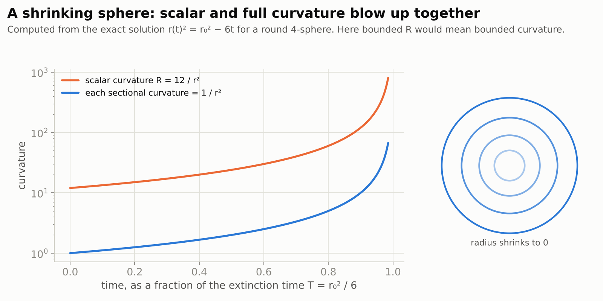
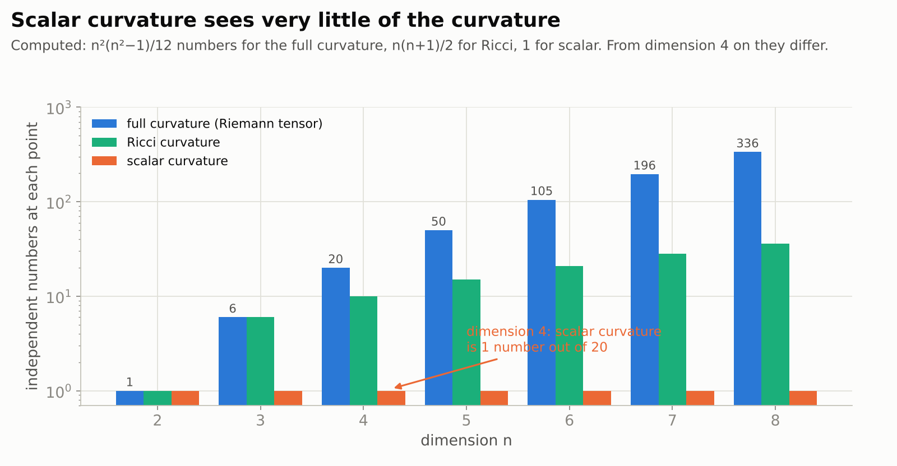
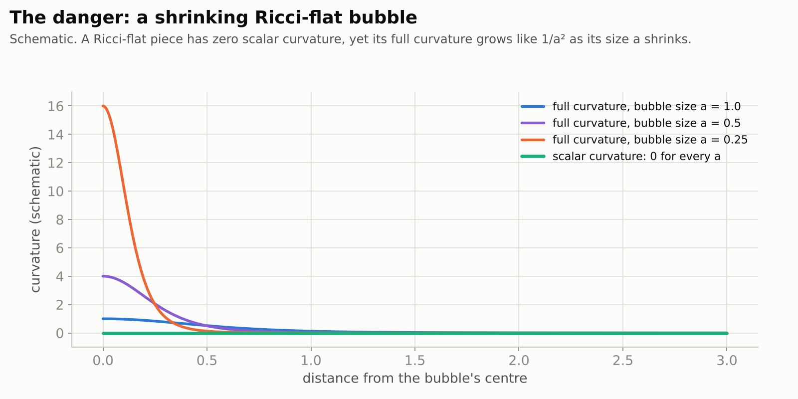
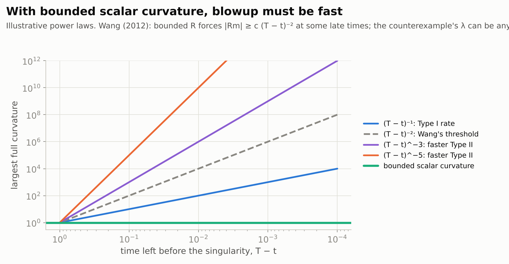
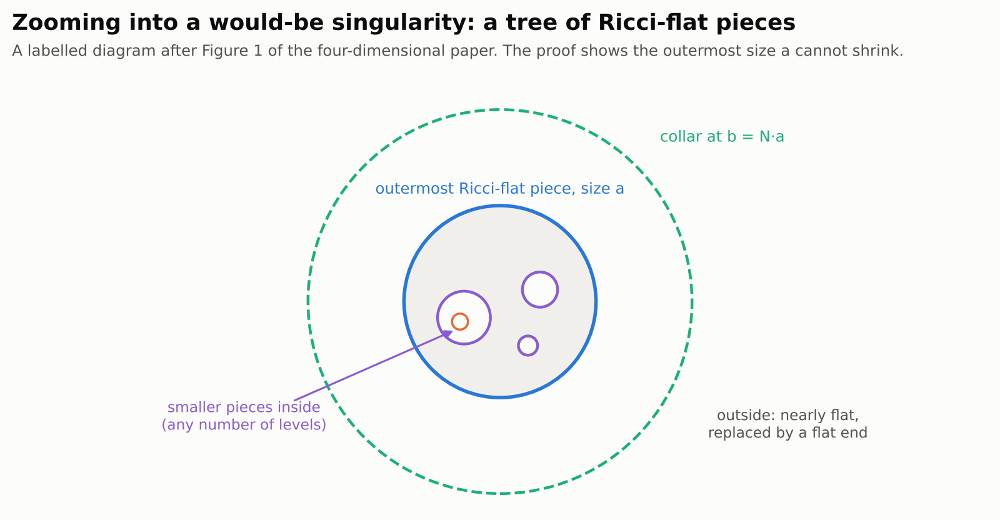
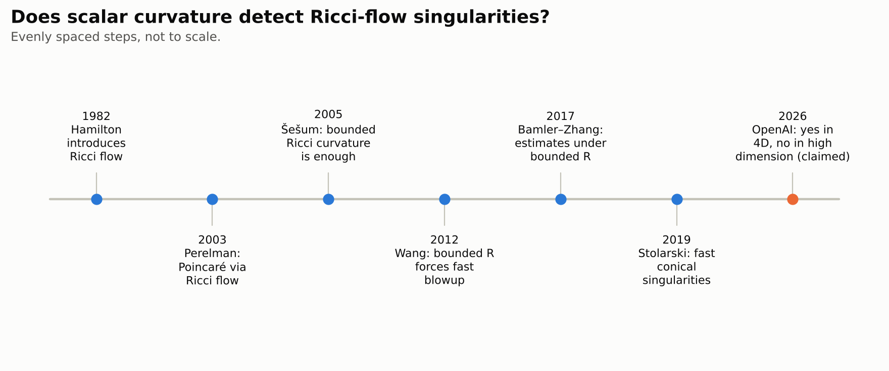

# Bounded scalar curvature and smooth extension of four-dimensional Ricci flow

*With its companion: [A closed Ricci flow with bounded scalar curvature and finite-time curvature blowup](https://github.com/openai/math/blob/main/preprints/A-closed-Ricci-flow-with-bounded-scalar-curvature-and-finite-time-curvature-blowup-September-24-2026/paper.pdf).*

> **In one paragraph.** Perelman proved the Poincaré conjecture by letting a shape smooth itself out under **Ricci flow** and studying the places where the flow breaks down. A basic question about such breakdowns has stayed open: does a breakdown always show up in the simplest curvature measurement, the **scalar curvature**? Or can the shape tear while that single number stays bounded? On 24 September 2026 OpenAI released two papers claiming opposite answers in different dimensions. In four dimensions, bounded scalar curvature means the flow continues smoothly (58 pages). In high enough dimensions, there is a flow whose scalar curvature stays bounded while its full curvature blows up anyway (20 pages). The Poincaré conjecture is already solved; these papers are about the tool used to solve it, one dimension up and beyond. No computer-checked proof or expert assessment has been reported.

| | |
|---|---|
| **Papers** | [Bounded scalar curvature and smooth extension of four-dimensional Ricci flow](https://github.com/openai/math/blob/main/preprints/Bounded-scalar-curvature-and-smooth-extension-of-four-dimensional-Ricci-flow-September-24-2026/paper.pdf) (58 pages) and [A closed Ricci flow with bounded scalar curvature and finite-time curvature blowup](https://github.com/openai/math/blob/main/preprints/A-closed-Ricci-flow-with-bounded-scalar-curvature-and-finite-time-curvature-blowup-September-24-2026/paper.pdf) (20 pages), OpenAI, 24 September 2026 |
| **The claims, plainly** | On a closed four-dimensional manifold, a Ricci flow whose scalar curvature stays bounded never breaks down in finite time. In some higher dimension, one can break down while its scalar curvature stays bounded |
| **Millennium problem** | [Poincaré conjecture](../../../../problems/poincare-conjecture.md): adjacent. About the singularities of Ricci flow, the tool behind Perelman's proof, in dimensions four and higher |
| **Status** (4 November 2026) | Not peer reviewed. No Lean formalization. No expert assessment found |
| **More** | [figures](figures/) · [figure code](code/make_figures.py) · [our explainer of Perelman's proof](../../../2002/11/perelman-poincare/README.md) |

**[▶ Watch the video](video/ricci-flow-scalar-curvature-extension.mp4)** (5 minutes): the story of this page, told with animations, narrated by an American male voice and captioned. Also with an [American female narrator](video/ricci-flow-scalar-curvature-extension-us-female.mp4), same pictures and timing. The [script](video/storyboard.md) lists what is on screen and what is said, beat by beat.

## Contents

1. [Ricci flow and the Poincaré conjecture](#1-ricci-flow-and-the-poincaré-conjecture)
2. [Curvature, full and scalar](#2-curvature-full-and-scalar)
3. [The extension question](#3-the-extension-question)
4. [The claims](#4-the-claims)
5. [How the four-dimensional proof works](#5-how-the-four-dimensional-proof-works)
6. [How the counterexample works](#6-how-the-counterexample-works)
7. [Checking it](#7-checking-it)
8. [What it does not do](#8-what-it-does-not-do)

## 1. Ricci flow and the Poincaré conjecture

**Ricci flow**, introduced by Richard Hamilton in 1982, changes the shape of a space over time, $\partial_t g=-2\mathrm{Ric}(g)$. Here $g$ measures lengths, and $\mathrm{Ric}$ is the **Ricci curvature**. Like heat spreading out, it tends to even out the curvature. A round sphere simply shrinks.

<picture>
  <source media="(prefers-color-scheme: dark)" srcset="figures/sphere-dark.png">
  
</picture>

The flow can also break down before the whole space shrinks away: a thin neck can pinch, and the curvature there blows up. Perelman (2002–2003) understood these **singularities** in three dimensions well enough to cut them out and continue. That proved the Poincaré conjecture. In four and more dimensions, the singularities are much less understood.

## 2. Curvature, full and scalar

At each point, the **full curvature** (the Riemann tensor, $\mathrm{Rm}$) is a collection of numbers describing how the space bends in every pair of directions. The **Ricci curvature** averages it over directions. The **scalar curvature** $R$ averages once more, down to a single number. It measures how the volume of small balls differs from flat space.

<picture>
  <source media="(prefers-color-scheme: dark)" srcset="figures/components-dark.png">
  
</picture>

In two dimensions the scalar curvature is all there is. In three, the Ricci curvature determines everything. From four dimensions on, much of the curvature is invisible to both. A space can have zero Ricci curvature, and so zero scalar curvature, and still be curved.

## 3. The extension question

A Ricci flow on a closed space continues as long as its full curvature stays bounded (Hamilton). Šešum showed in 2005 that bounded **Ricci** curvature is already enough. The **scalar-curvature extension problem** asks whether bounded **scalar** curvature is enough.

<picture>
  <source media="(prefers-color-scheme: dark)" srcset="figures/bubble-dark.png">
  
</picture>

The danger is a small **Ricci-flat** piece, a "bubble", that shrinks. Its scalar curvature is zero, but its full curvature grows like $1/a^2$ as its size $a$ shrinks. Any blowup with bounded scalar curvature would have to look like this when magnified.

Partial answers were known. Bamler and Zhang (2017) proved strong estimates under bounded scalar curvature. In four dimensions their work gives smooth extension when the space has no two-dimensional holes ($H_2(M;\mathbb F)=0$ for every field $\mathbb F$). Extension was also known for Kähler–Ricci flows (Zhang, 2010) and for singularities of "Type I" speed (Enders, Müller and Topping, 2011). Wang (2012) showed that with bounded scalar curvature, any blowup must be fast: at some late times the full curvature is at least a constant times $(T-t)^{-2}$, where $T$ is the time of the singularity.

<picture>
  <source media="(prefers-color-scheme: dark)" srcset="figures/rates-dark.png">
  
</picture>

## 4. The claims

**Four dimensions** (Theorem 1.1 of the first paper), as stated:

> Let $M$ be a closed connected smooth four-manifold, let $0\lt T\lt\infty$, and let $g(t)$, $0\le t\lt T$, be a smooth Ricci flow with smooth initial metric. If $\sup_{M\times[0,T)}|R(g(t))|\lt\infty$, then there are $\varepsilon\gt 0$ and a smooth Ricci flow $\widetilde g(t)$ on $M$, $0\le t\lt T+\varepsilon$, such that $\widetilde g(t)=g(t)$ for every $t\lt T$.

In plain words: in four dimensions, if the scalar curvature stays bounded, the flow does not break down; it continues smoothly on the same space. Equivalently (Corollary 1.2), at every finite-time singularity of a four-dimensional Ricci flow, the scalar curvature blows up.

**High dimensions** (Theorem 1.1 of the second paper): there are an integer $q\ge10$ and a smooth Ricci flow on the closed manifold $S^2\times S^{q+1}$ whose scalar curvature stays bounded while its full curvature tends to infinity at a finite time $T$. So the statement fails in its unrestricted, all-dimensions form. The full curvature in these examples blows up like a power of $(T-t)$, with exponents as large as one likes.

## 5. How the four-dimensional proof works

<picture>
  <source media="(prefers-color-scheme: dark)" srcset="figures/tree-dark.png">
  
</picture>

- **Zoom in.** Suppose the curvature concentrates at a point while $R$ stays bounded. Magnify repeatedly. What appears is a finite **tree** of Ricci-flat pieces: an outermost piece of size $a(t)$, with smaller pieces nested inside it. The task is to show that the outermost size cannot shrink to zero.
- **An energy.** Cut the geometry at a collar of radius $b=Na$ and attach a flat end. A renormalized **Einstein–Hilbert functional** $E$, the total scalar curvature with a boundary correction, measures the result. A companion paper, *Path selection and an elliptic inequality on degenerating Ricci-flat trees*, proves that $E$ is small compared with the Ricci error on such trees.
- **Flow estimates.** A constraint on the Ricci tensor removes one dangerous mode in the nearly flat region. A careful construction of the outer part keeps the error under control, however long the collar.
- **Contradiction.** If $K^2$ is the spacetime Ricci energy at scale $a$, the estimates give $cK^2\le o(1)(K+1)^2$, so $K\to 0$. Then the geometry at scale $a$ hardly changes over a time interval on which, by construction, $a$ changes by a fixed factor. That is impossible. So no curvature concentrates, and the flow continues.

## 6. How the counterexample works

The example lives on $S^2\times S^{q+1}$ with a lot of symmetry: the shape is described by two radii varying along an interval (a "doubly warped product"). Stolarski (2019) built such flows that form a conical singularity, approaching a Ricci-flat cone at the parabolic scale, with arbitrarily fast curvature blowup. He noted that bounded scalar curvature might hold for them. The new paper proves it for a suitable large dimension and mode, using Stolarski's estimates plus new estimates on the "cap" region near the tip and barrier arguments. It also proves matching upper and lower power-law bounds for the curvature.

<picture>
  <source media="(prefers-color-scheme: dark)" srcset="figures/timeline-dark.png">
  
</picture>

## 7. Checking it

- **Lean.** No formalization was released for these papers.
- **Experts.** We found no public assessment as of 4 November 2026, and no reported error. The four-dimensional proof also depends on a companion manuscript from the same release, so both need checking.
- **Consistency.** The two claims fit together: the counterexample uses a dimension of at least 13, where the geometry of Ricci-flat pieces is much richer, and the paper asserts nothing in dimension four.

## 8. What it does not do

- **It does not touch the Poincaré conjecture itself.** That was proved by Perelman and is not in question. These papers concern Ricci flow in four and more dimensions.
- **It does not say what happens at singularities with unbounded scalar curvature.** Those are the usual singularities, like the shrinking sphere or a pinching neck, and still need surgery or other methods.
- **The four-dimensional result says nothing about the smooth four-dimensional Poincaré conjecture.** That is a different, still open, topological question.
- **The counterexample is in high dimension only.** It works in one sufficiently high dimension, at least 13. Dimensions from five up to that one are not decided by either paper.
