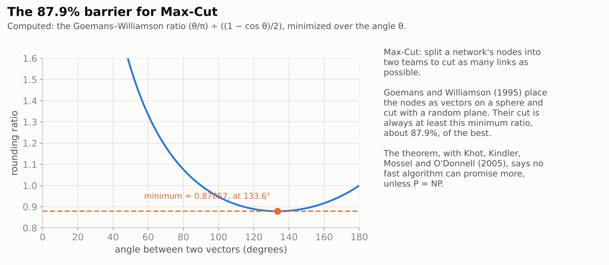
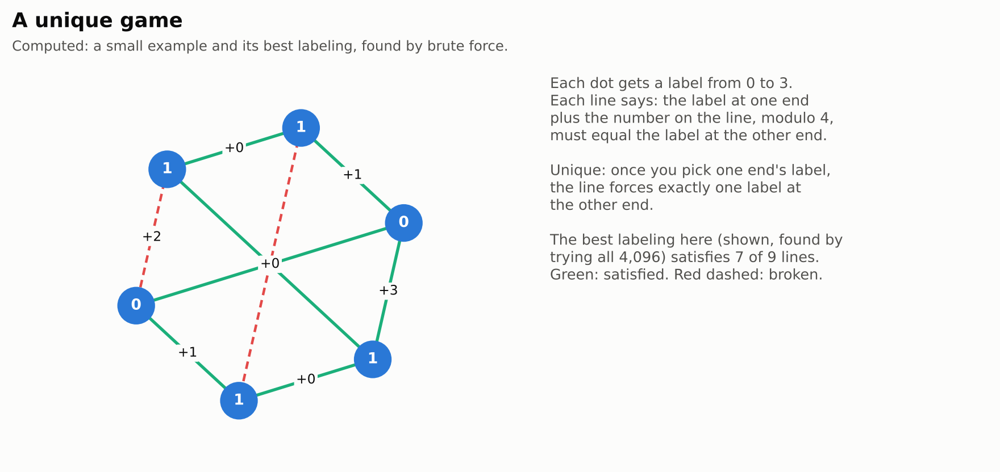
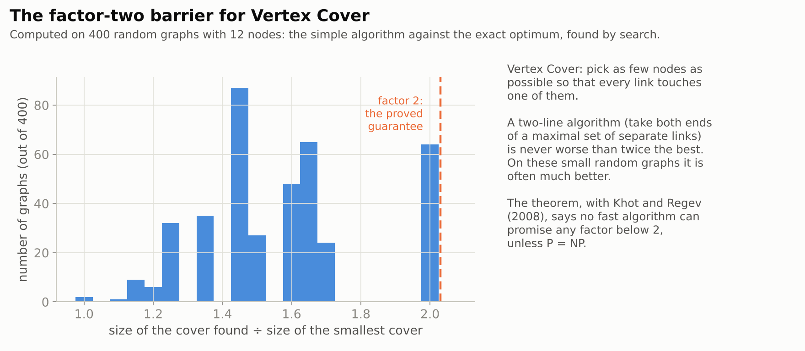
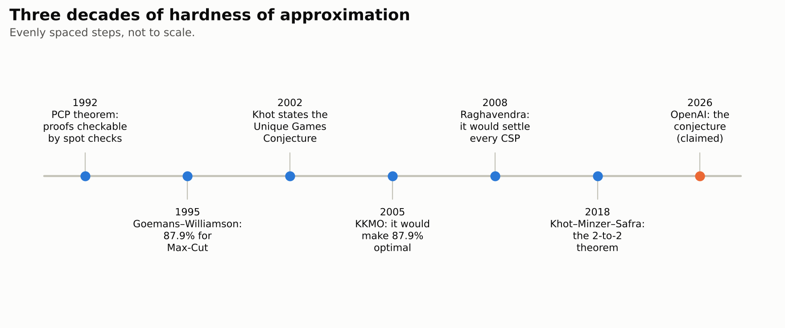
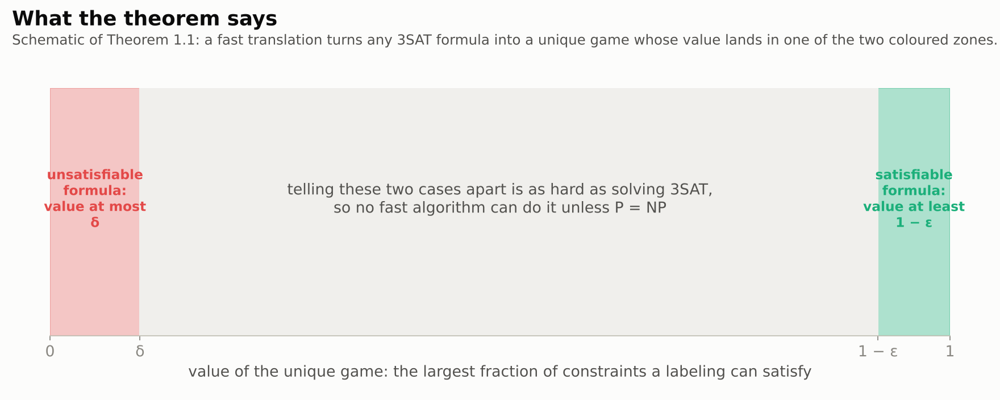

# The Unique Games Theorem

> **In one paragraph.** Many practical problems, like splitting a network into two teams or choosing a few nodes that touch every link, are too hard to solve exactly in reasonable time. So computer scientists settle for fast algorithms that come within a guaranteed factor of the best answer. For several famous problems the best known factors have stood for decades: about 87.9% for Max-Cut, a factor of two for Vertex Cover. In 2002 Subhash Khot made a conjecture, the Unique Games Conjecture, which would explain all of them at once: it implies that no fast algorithm can do better unless P = NP. On 23 September 2026 OpenAI released a 58-page paper claiming to prove the conjecture, together with a computer-checked version in Lean. If it holds up, it settles the limits of approximation for a long list of problems. It does not decide whether P equals NP. Experts were reported to be studying the proof as of October.

| | |
|---|---|
| **Paper** | [The Unique Games Theorem](https://github.com/openai/math/blob/main/preprints/The-Unique-Games-Theorem-September-23-2026/paper.pdf), OpenAI, 23 September 2026 (58 pages) |
| **The claim, plainly** | Telling apart unique games that are almost fully satisfiable from ones that are almost completely unsatisfiable is NP-hard |
| **Millennium problem** | [P vs NP](../../../../problems/p-vs-np.md): adjacent; it does not decide P vs NP |
| **Status** (4 November 2026) | Not peer reviewed. Lean formalizations of the main reduction and of four direct hardness results published by OpenAI. Reported to be under study by experts; no verdict yet |
| **More** | [Lean scope](https://github.com/openai/math/blob/main/lean/docs/102.md) · [figures](figures/) · [figure code](code/make_figures.py) |

## Contents

1. [Hard problems and good-enough answers](#1-hard-problems-and-good-enough-answers)
2. [Unique games](#2-unique-games)
3. [The conjecture, and why it mattered](#3-the-conjecture-and-why-it-mattered)
4. [The claim](#4-the-claim)
5. [How the proof works](#5-how-the-proof-works)
6. [What follows](#6-what-follows)
7. [Checking it](#7-checking-it)
8. [What it does not do](#8-what-it-does-not-do)

## 1. Hard problems and good-enough answers

Some problems have fast algorithms; others seem to need a search through an astronomical number of possibilities. The class **NP** contains the problems whose solutions are easy to check. Whether every such problem can also be solved quickly is the **P vs NP** question, a Millennium Prize problem. Most experts believe the answer is no. The hardest problems in NP, called **NP-hard**, include **3SAT**: deciding whether a list of rules about true/false switches can all be satisfied at once.

When exact answers are out of reach, we can ask for **approximations**. Two classic examples:

- **Max-Cut.** Split the nodes of a network into two teams to cut as many links as possible. In 1995 Goemans and Williamson found a fast algorithm that always cuts at least about **87.9%** as many links as the best split.
- **Vertex Cover.** Choose as few nodes as possible so that every link touches one of them. A simple fast algorithm is never worse than **twice** the best.

<picture>
  <source media="(prefers-color-scheme: dark)" srcset="figures/maxcut-dark.png">
  
</picture>

For decades nobody could beat these numbers, and nobody could prove they could not be beaten.

## 2. Unique games

A **unique game** is a puzzle on a network. Each node gets a label, from a fixed finite set such as the numbers $0$ to $k - 1$. Each link carries a rule that says which label at one end goes with which label at the other: here, "the label at this end plus $c$, modulo $k$, equals the label at that end". The rule is **unique**: once one end's label is chosen, it forces exactly one label at the other end. The **value** of a game is the largest fraction of rules that a single labeling can satisfy.

<picture>
  <source media="(prefers-color-scheme: dark)" srcset="figures/game-dark.png">
  
</picture>

If **every** rule can be satisfied, a quick propagation finds a labeling: pick one node's label, and the rules force all the others. So the interesting case is a game that is **almost** satisfiable, say 99% of the rules. Can one then quickly find a labeling satisfying even 1%?

## 3. The conjecture, and why it mattered

Subhash Khot's **Unique Games Conjecture** (2002) says no: for every small $\varepsilon$ and $\delta$, telling apart games whose value is at least $1 - \varepsilon$ from games whose value is at most $\delta$ is NP-hard, as long as the label set is large enough.

The conjecture became the central open problem of **hardness of approximation**. It turned out that, if true, it would make many old algorithms exactly optimal:

- Khot, Kindler, Mossel and O'Donnell (2005) showed it makes the Goemans–Williamson 87.9% optimal for Max-Cut.
- Khot and Regev (2008) showed it makes factor two optimal for Vertex Cover.
- Raghavendra (2008) showed it makes one family of algorithms, based on semidefinite programming, optimal for every constraint satisfaction problem.

<picture>
  <source media="(prefers-color-scheme: dark)" srcset="figures/cover-dark.png">
  
</picture>

Progress came slowly. In 2018 Khot, Minzer and Safra proved the related **2-to-2 theorem**, using a deep result about the expansion of "Grassmann graphs". It gave the hardness needed for unique games, but only for games about half satisfiable, not almost fully satisfiable. Closing that gap remained open. In September 2026, before OpenAI's release, a team including Dor Minzer posted a related result for "4-to-1 games", according to press coverage.

<picture>
  <source media="(prefers-color-scheme: dark)" srcset="figures/timeline-dark.png">
  
</picture>

## 4. The claim

The paper's main theorem (Theorem 1.1), as stated:

> For every fixed $\varepsilon,\delta\in(0,1/2)$, there are an integer $s\ge1$ and a deterministic polynomial-time reduction from 3SAT to explicit unweighted Unique Games instances $G_\varphi$ over $K=\mathbb F_2^s$ such that a satisfiable $\varphi$ gives $\mathrm{val}(G_\varphi)\ge1-\varepsilon$, and an unsatisfiable $\varphi$ gives $\mathrm{val}(G_\varphi)\le\delta$. The graph is simple and bipartite, and every constraint is a translation $a(v_e)=a(u_e)+c_e$ of $K$.

In plain words: there is a fast way to turn any 3SAT puzzle into a unique game. If the puzzle can be solved, almost all of the game's rules can be satisfied. If it cannot, almost none can. So a fast algorithm that tells these two cases apart would also solve 3SAT, which would mean P = NP. That is exactly Khot's conjecture.

<picture>
  <source media="(prefers-color-scheme: dark)" srcset="figures/gap-dark.png">
  
</picture>

## 5. How the proof works

The introduction (Section 1) explains the route.

**Start from known hardness.** The reduction begins with Håstad's theorem: for systems of 3-variable equations modulo 2, telling almost-satisfiable systems from ones about half satisfiable is NP-hard.

**Encode answers as tables.** Each answer is encoded as a table indexed by binary matrices, following a "matrix shortcode" of Barak, Kothari and Steurer. A test compares a table's value at a matrix with its value after a small change, a rank-one update.

**The obstacle: one half.** With the natural encoding, an honest answer passes that test only about half the time. That is why the 2018 theorem stopped at games about half satisfiable.

**The new idea: a nonlinear disguise** (Section 2). The paper builds a special nonlinear map from a larger space onto the label set, together with a random "noise". The map barely notices the noise, so an honest answer passes the test with probability close to one. Yet any table that cheats by using simple linear information detects the noise often. The construction uses quadratic blocks over a finite field, applied recursively.

**Soundness from expansion** (Sections 3 to 6). If some labeling satisfies even a small fraction of the game's rules, the paper decodes it into a good answer for Håstad's equations. This step uses the Khot–Minzer–Safra expansion theorem for Grassmann graphs as an outside input. Section 7 then derives the consequences.

## 6. What follows

If the theorem is right, a long list of earlier conditional results becomes unconditional (Section 7 states them with their original authors):

- **Max-Cut:** no fast algorithm can promise more than the Goemans–Williamson 87.9%, unless P = NP.
- **Vertex Cover:** no fast algorithm can promise any factor below 2, unless P = NP.
- **Every constraint satisfaction problem:** Raghavendra's semidefinite-programming algorithms are optimal.
- Similar sharp thresholds for ordering problems, Min-UnCut, directed feedback vertex set, and clustering.

OpenAI also released direct proofs of the Max-Cut and Vertex Cover thresholds that do not go through unique games, built from older, established hardness results.

## 7. Checking it

- **Lean.** OpenAI published Lean 4 formalizations ([scope](https://github.com/openai/math/blob/main/lean/docs/102.md)). They cover the main reduction (from 3SAT to unique games with the stated gap) and the four direct hardness results. The formal statements assume nothing about P vs NP: each is a reduction from 3SAT. We have not re-run them.
- **Experts.** According to press and blog coverage in October, Dana Moshkovitz was studying the proof with Subhash Khot, Johan Håstad, Dor Minzer and others, without a settled verdict yet. *Quanta Magazine* (7 October) described researchers racing to finish related work before the release. We could not open these sources directly from our environment; this summary is from search results.
- **No error reported** as of 4 November, to our knowledge, and no peer review yet.

## 8. What it does not do

- **It does not decide P vs NP.** Every consequence has the form "no fast algorithm, unless P = NP". If P = NP after all, all of these problems become easy.
- **It does not give new algorithms.** It explains why the old ones cannot be beaten.
- **It does not cover every approximation problem.** It settles the problems whose best thresholds were known to follow from the conjecture.
- **It is not yet confirmed by experts.** The formal check covers the reduction as stated in Lean. Experts still need to finish reading the written proof and match it to the formal statement.
