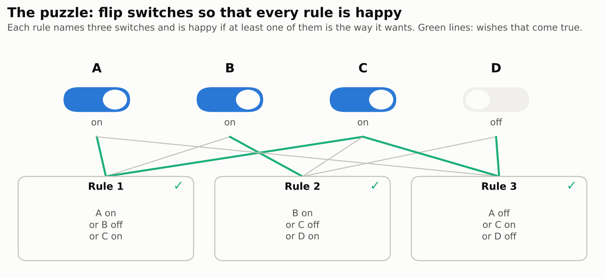
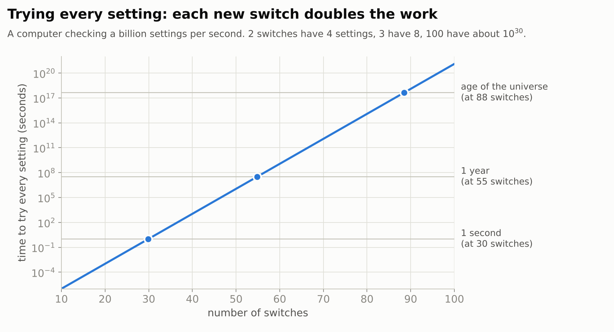
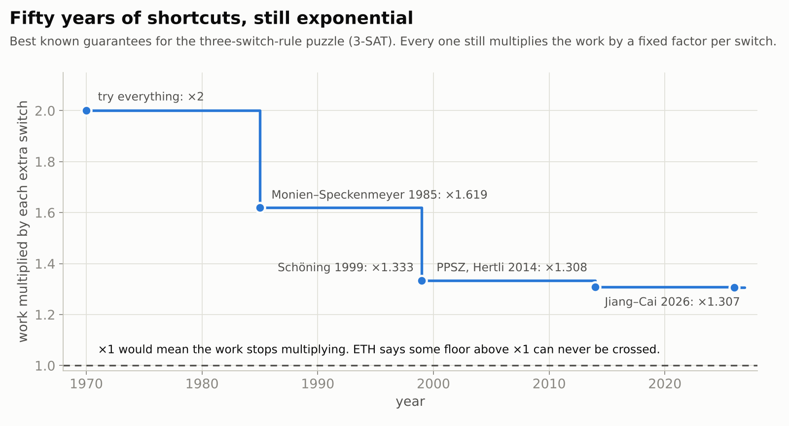
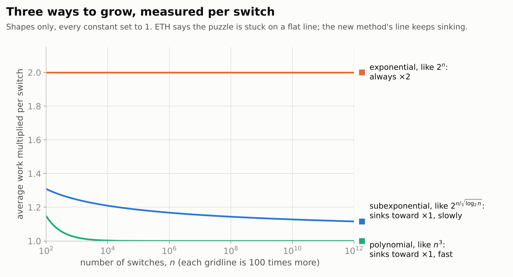
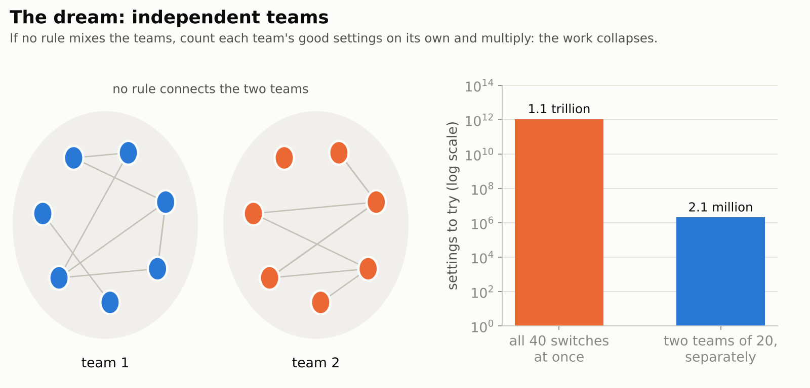
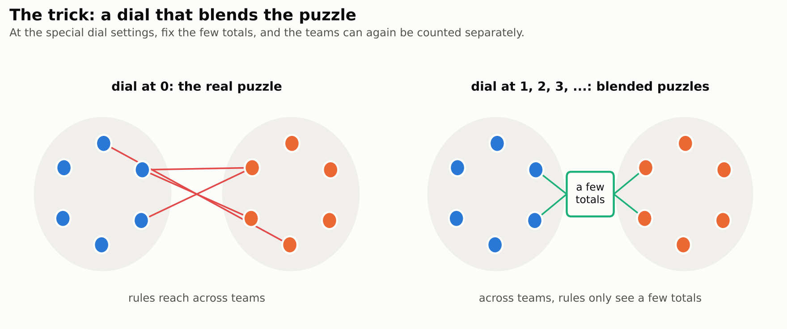
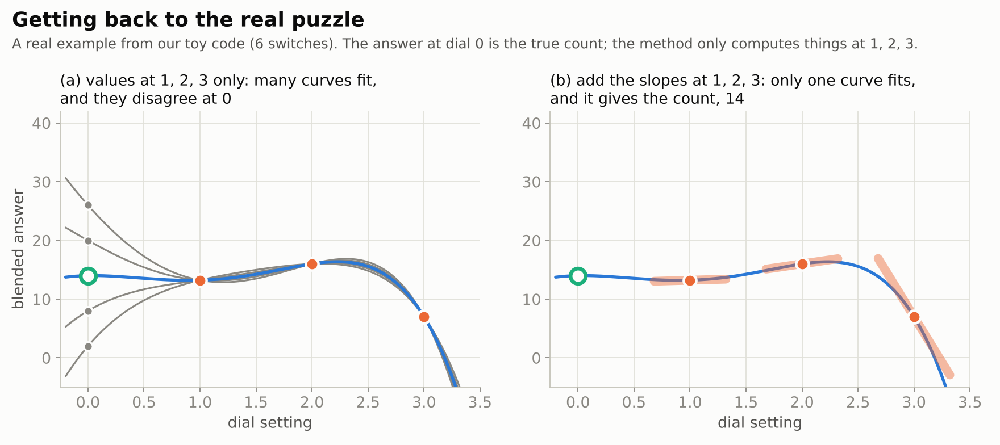
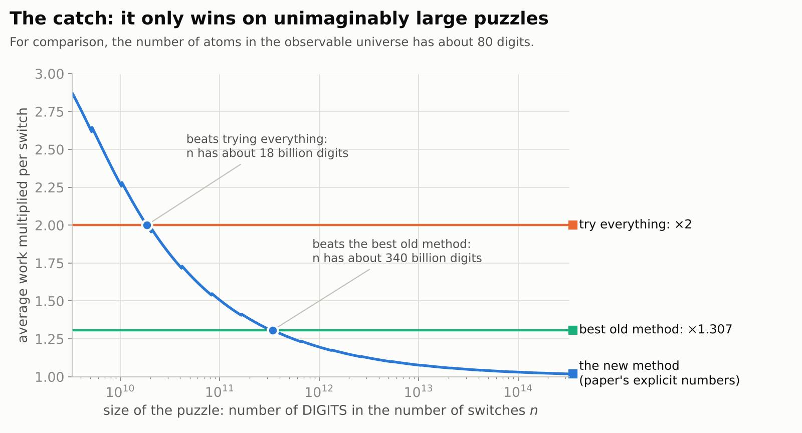

# The Exponential Time Hypothesis is False

> **In one paragraph.** Some puzzles seem to get twice as hard, or at least a fixed amount harder, every time you make them a little bigger. For 25 years most computer scientists assumed the most famous of these puzzles works like that forever: a belief called the *Exponential Time Hypothesis* (ETH). On 26 October 2026 OpenAI released a paper, written by one of its internal AI models, that claims a method whose extra cost per step keeps shrinking as puzzles grow. If the proof holds up, ETH is false. The method is far too slow to ever run in practice, and it does not settle the famous P vs NP question, but it would change what researchers believe about how hard problems can be.

| | |
|---|---|
| **Paper** | [The Exponential Time Hypothesis is False](https://github.com/openai/math/blob/main/preprints/The-Exponential-Time-Hypothesis-is-False-October-25-2026/paper.pdf), OpenAI, 25 October 2026 |
| **The claim, plainly** | A step-by-step method that counts *every* solution of the classic switches-and-rules puzzle (3-SAT and its relatives) with a cost that grows more slowly than any fixed factor per switch |
| **Millennium problem** | Related to [P vs NP](../../../../problems/p-vs-np.md), but does not solve it |
| **Status** (27 October 2026) | Not yet peer reviewed. OpenAI reports a computer-checked proof (in Lean) of a slightly weaker version; a group of experts is examining it |
| **More** | [technical walkthrough](technical.md) · [video](video/) · [code that checks the math on small examples](code/toy_eth.py) |

**[▶ Watch the video](video/eth-is-false.mp4)** (22¾ minutes): the story of this page, told with animations, narrated by an American male voice and captioned. Also with an [American female narrator](video/eth-is-false-us-female.mp4), same pictures and timing. The [script](video/storyboard.md) lists what is on screen and what is said, beat by beat.

## Contents

1. [The puzzle](#1-the-puzzle)
2. [Why it gets hard so fast](#2-why-it-gets-hard-so-fast)
3. [Fifty years of shortcuts](#3-fifty-years-of-shortcuts)
4. [The bet called ETH](#4-the-bet-called-eth)
5. [The new claim](#5-the-new-claim)
6. [How the method works](#6-how-the-method-works)
7. [The catch](#7-the-catch)
8. [What it means, and what it does not](#8-what-it-means-and-what-it-does-not)
9. [Is it true?](#9-is-it-true)

## 1. The puzzle

You have a row of switches, each either **on** or **off**, and a list of rules. Each rule names three switches and says how it would like each of them, for example "A on, or B off, or C on". A rule is happy if **at least one** of its three wishes comes true. The question: is there a way to set the switches so that every rule is happy?

<picture>
  <source media="(prefers-color-scheme: dark)" srcset="figures/plain-puzzle-dark.png">
  
</picture>

This puzzle is called **3-SAT**. It looks like a toy, but a huge range of real problems can be rewritten as it: building timetables, checking that a computer chip is designed correctly, planning routes, solving Sudoku. That is why it is the most studied puzzle in computer science.

The paper solves a harder version: it does not just find one good setting, it **counts all of them**. Counting is at least as hard as finding, because if you know how many good settings there are, you know whether there is one.

## 2. Why it gets hard so fast

The obvious method is to try every setting. With 2 switches there are 4 settings, with 3 there are 8, and each new switch doubles the number. That is **exponential growth**: the work is multiplied by the same factor, here 2, for every switch you add.

<picture>
  <source media="(prefers-color-scheme: dark)" srcset="figures/plain-doubling-dark.png">
  
</picture>

Even a computer checking a billion settings per second needs a second for 30 switches, a year for 55, and longer than the age of the universe for 88. Real puzzles have thousands or millions of switches.

## 3. Fifty years of shortcuts

Clever methods avoid trying every setting. For example, if a rule is unhappy, at least one of its three switches must change, so you only need to explore those three options. Decades of such tricks have pushed the factor down from ×2 per switch to about ×1.3. That is an enormous saving: for 100 switches, ×1.307 per switch means about 400 billion steps instead of about a nonillion (a 1 followed by 30 zeros).

<picture>
  <source media="(prefers-color-scheme: dark)" srcset="figures/plain-history-dark.png">
  
</picture>

But every one of these methods still multiplies the work by a **fixed** factor for each new switch. They make the growth gentler, not different in kind.

## 4. The bet called ETH

In 2001 Russell Impagliazzo and Ramamohan Paturi proposed that this is unavoidable. Their **Exponential Time Hypothesis** says: no method, however clever, can get the factor per switch arbitrarily close to ×1. There is some floor above ×1, maybe ×1.01, maybe ×1.2, that nobody can ever cross.

Nobody proved it, but most experts believed it, and many built on it. A large body of results takes the form "*if* ETH is true, *then* this other problem cannot be solved faster than such-and-such." ETH was a foundation stone. Stronger and weaker cousins of the bet, with names like SETH and #ETH, rest on the same belief.

## 5. The new claim

The paper describes a method whose factor per switch is **not** fixed: it keeps sinking toward ×1 as puzzles get bigger. Growth like that is called **subexponential**. It sits between exponential growth, where each switch always multiplies the work by the same amount, and polynomial growth, the kind computer scientists consider fast, where the factor drops to ×1 quickly.

<picture>
  <source media="(prefers-color-scheme: dark)" srcset="figures/plain-shapes-dark.png">
  
</picture>

Since the factor sinks below any floor you pick, there is no floor, and ETH is false. In symbols, the cost is roughly $2^{n/\sqrt{\log n}}$ for $n$ switches, instead of $2^{cn}$ for a fixed number $c$. (The exact bound has an extra $\log\log n$ factor; see the [technical walkthrough](technical.md#2-the-result).) The method works for rules with any fixed number of switches, not only three, and needs only a modest amount of memory.

## 6. How the method works

The full proof is long and technical. Here are its main ideas.

### Step 1: turn checking into arithmetic

Give every rule a score for each setting: **1** if the rule is happy, **0** if not. Multiply the scores of all rules: the product is 1 only when *every* rule is happy. Add these products over all settings, and the total is the number of good settings. Here is a tiny example with three switches and two rules, "A on, or B off, or C on" and "B on, or C on":

| A | B | C | rule 1 | rule 2 | product |
|---|---|---|:---:|:---:|:---:|
| off | off | off | 1 | 0 | 0 |
| off | off | on | 1 | 1 | **1** |
| off | on | off | 0 | 1 | 0 |
| off | on | on | 1 | 1 | **1** |
| on | off | off | 1 | 0 | 0 |
| on | off | on | 1 | 1 | **1** |
| on | on | off | 1 | 1 | **1** |
| on | on | on | 1 | 1 | **1** |
| | | | | **total** | **5** |

So this puzzle has 5 good settings. Turning the question into a big sum of products is what lets algebra help: sums and products can be rearranged in ways that lists of settings cannot.

### Step 2: the dream of independent teams

Suppose the switches could be split into teams so that no rule mixes two teams. Then you could count the good settings of each team on its own and multiply the answers. With 40 switches in two teams of 20, that means trying about 2 million settings instead of a trillion.

<picture>
  <source media="(prefers-color-scheme: dark)" srcset="figures/plain-teams-dark.png">
  
</picture>

Real puzzles are not like that: rules reach across any split you choose.

### Step 3: a dial that blends the puzzle

The paper adds a **dial** to the sum from Step 1. Inside every rule, each switch is replaced by a blend of switches, and the dial sets the blend. With the dial at **0**, nothing is blended and the sum is exactly the count we want. At the special settings **1, 2, 3, …** the blends are arranged so that each rule reads switches from its own team, plus only **a few totals** from the other teams, such as how many of certain switches are on. A total like that can only take a modest number of values.

<picture>
  <source media="(prefers-color-scheme: dark)" srcset="figures/plain-dial-dark.png">
  
</picture>

So at those settings, go through every possible value of the totals. Once the totals are fixed, the teams no longer interact, and each team can be counted on its own, as in the dream. That is fast, provided there are many teams and few totals. At these dial settings the result is not a count of anything, just a number, but it can be computed quickly.

### Step 4: get back to dial 0

We can compute the blended answer quickly at dial settings 1, 2, 3, … but the number we want is at **0**, where the shortcut does not work. The way back is that the blended answer, as the dial turns, traces a smooth curve of a known kind (a polynomial).

Knowing the curve's height at a few points is not enough: many curves pass through the same points and disagree at 0. But the method can also compute how steeply the curve climbs at each point, how it bends, and so on. With enough of that information, only one curve fits, and reading it at 0 gives the exact count.

<picture>
  <source media="(prefers-color-scheme: dark)" srcset="figures/plain-curve-dark.png">
  
</picture>

### Step 5: the balancing act

The catch inside the method is that every extra piece of information about the curve (slope, bend, and so on) costs more work, so it only pays off if the curve is **gentle**, meaning it cannot wiggle much, while still having **many** special dial settings. Getting both at once is the heart of the paper. It uses a clever mathematical construction in which most of the blending cancels out on its own, and only a small leftover has to be tracked with totals. (Details: [technical walkthrough §3.6](technical.md#36-where-the-replacement-forms-come-from-27-4).)

### Step 6: from tidy puzzles to all puzzles

Steps 1 to 5 work for tidy puzzles in which each switch appears in only a few rules. Any puzzle can be split into tidy pieces, and its rules rewritten as even-or-odd checks, without changing the count. That part is also technical ([§3.8](technical.md#38-from-bounded-occurrence-to-every-k-cnf-2829-56-appendix-a)).

Adding everything up, each part of the work grows more slowly than any fixed factor per switch, so the whole method does too.

## 7. The catch

ETH is a statement about what happens as puzzles grow **without limit**, and the new method only wins in that limit. Using the explicit numbers in the paper's overview, we calculated when it starts to pay off. The answer is absurd: the number of switches would need about **18 billion digits** before the method beats simply trying everything, and about **340 billion digits** before it beats the best older method. For comparison, the number of atoms in the observable universe has about 80 digits.

<picture>
  <source media="(prefers-color-scheme: dark)" srcset="figures/plain-catch-dark.png">
  
</picture>

These figures come from an analysis that was not trying to be efficient, so the true crossover could be much earlier. Still, nobody expects this method to run on a real computer. Its importance is what it proves is *possible*, not what it does in practice.

## 8. What it means, and what it does not

**If the proof is correct, it means:**

- ETH is false, and so are its stronger cousins (SETH, #ETH, Gap-ETH and NSETH);
- results of the form "if ETH is true, then …" lose their footing and need new support. Some of them can be rescued from other, weaker assumptions that are still believed;
- some related problems, such as counting the ways to color a map, get new methods with the same kind of shrinking cost.

**It does not mean:**

- **P = NP.** That famous question, one of the seven [Millennium Prize Problems](../../../../problems/README.md), asks whether such puzzles can be solved with *polynomial* growth, the fast kind. Subexponential growth is still slower than that, so the question stays open;
- **faster puzzle solvers today.** Practical solvers already handle huge real-world puzzles using shortcuts that work well in practice. This method is far too slow at any real size;
- **broken encryption.** Everyday encryption does not depend on ETH, and the method is impractical anyway.

## 9. Is it true?

It is too early to say for sure.

- **It is a preprint.** The paper was written by an unreleased AI model at OpenAI and has not been through peer review. OpenAI describes these papers as "raw research data".
- **Part of it is computer-checked.** OpenAI reports a proof written in Lean, a system in which a computer checks every logical step. It covers a slightly weaker but still ETH-breaking version of the result. We have not re-run that check ourselves.
- **Experts are examining it.** A working group led by Russell Impagliazzo and Ramamohan Paturi, who proposed ETH, and Ryan Williams is studying the proof.
- **We checked the ideas on small examples.** Our [code](code/toy_eth.py) runs the method from Steps 1 to 5 on small puzzles and confirms that it produces the exact count. That shows our reading of the method is consistent; it cannot confirm the proof for large puzzles.

## Words used on this page

| Here | In the paper |
|---|---|
| switch | variable $x_i$, set to 0 or 1 |
| rule | clause of a $k$-CNF formula |
| setting | assignment |
| good setting | satisfying assignment |
| the puzzle | $k$-SAT; counting version #$k$-SAT |
| score of a rule | clause polynomial $\Phi_e$ |
| dial | the deformation parameter $T$ |
| blended answer | the deformed polynomial $H(T)$, with $H(0)$ the count |
| teams, totals | groups of a design, integer measurements |
| slope, bend, … | Taylor coefficients, Hermite interpolation |

Figures: [`code/make_plain_figures.py`](code/make_plain_figures.py). Sources and the full argument: [technical walkthrough](technical.md).
