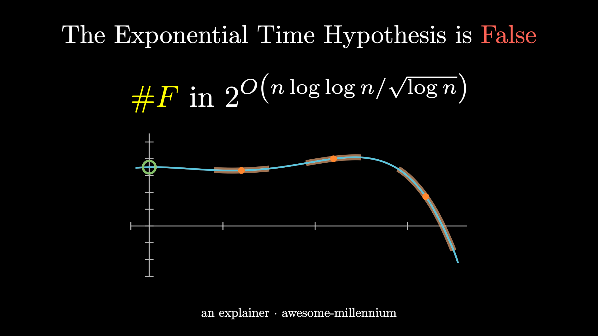
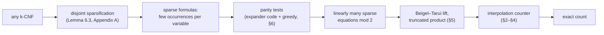
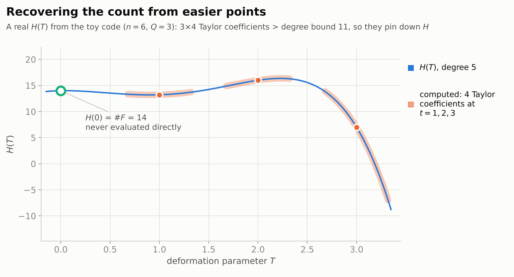
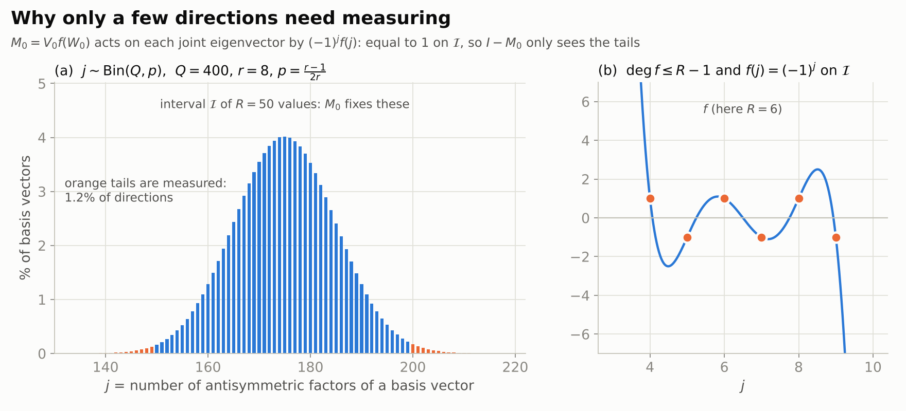
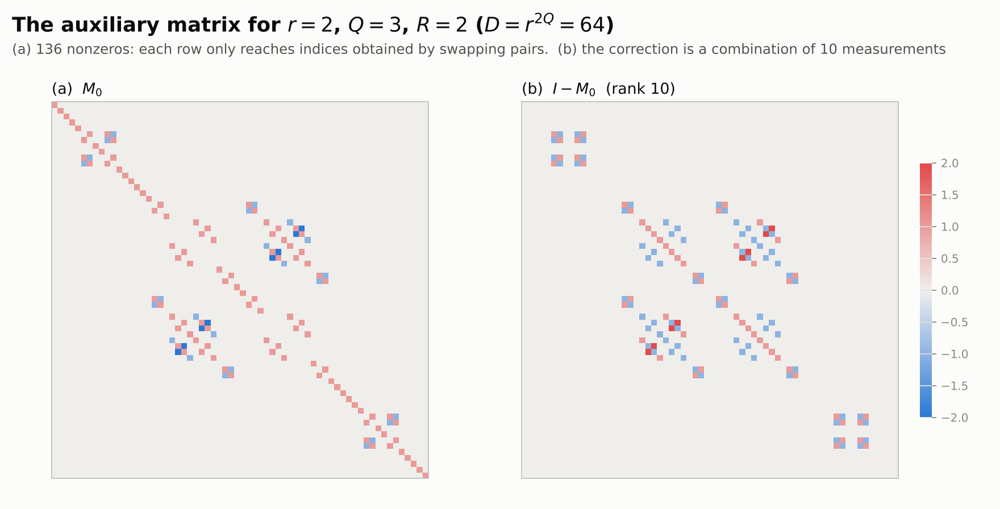
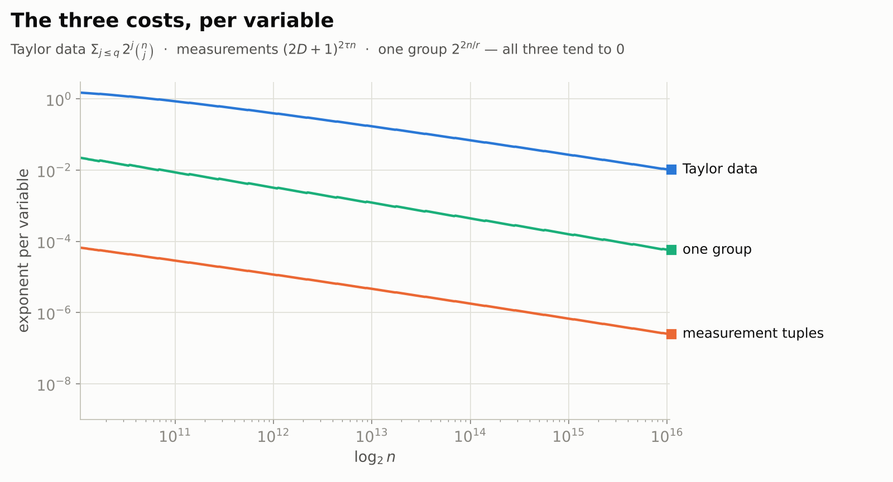
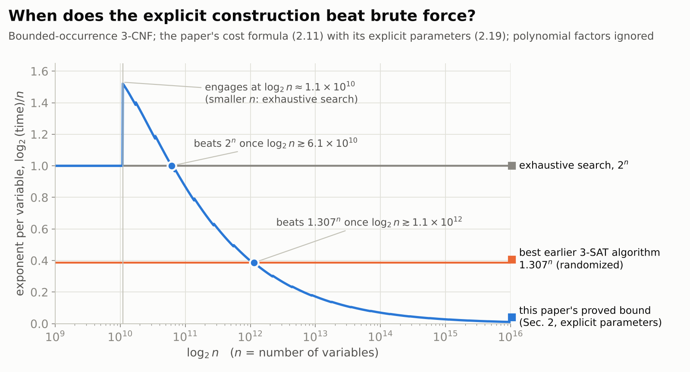

# The Exponential Time Hypothesis is False: technical walkthrough

*This is the detailed version, for readers comfortable with complexity theory. For the plain-language explanation, start with [README.md](README.md).*

> For decades the best algorithms for 3-SAT have been exponential, and the *Exponential Time Hypothesis* (ETH) predicted they always would be: some fixed $c\gt 0$ makes $2^{cn}$ time unavoidable on $n$ variables. On 26 October 2026 OpenAI released a preprint, produced by an internal model, giving a **deterministic algorithm that counts the satisfying assignments of any $k$-CNF formula in time $(n+m)^{O_k(1)}2^{O_k(n\log\log n/\sqrt{\log n})}$ and polynomial space**. That is subexponential, so ETH would be false, together with SETH, #ETH, Gap-ETH and NSETH. The engine is algebraic: deform the counting polynomial so that at a few special parameter values the variables split into independent groups that interact only through a handful of integer summaries, compute Taylor coefficients there, and interpolate back to the true count.

| | |
|---|---|
| **Paper** | [The Exponential Time Hypothesis is False](https://github.com/openai/math/blob/main/preprints/The-Exponential-Time-Hypothesis-is-False-October-25-2026/paper.pdf) — OpenAI. Dated 17 October 2026, revised 25 October 2026; released 26 October 2026 in [openai/math](https://github.com/openai/math) as result family 378. |
| **Claim** | Theorem 1.1 (quoted [below](#2-the-result)): deterministic exact counting for $k$-CNF formulas in subexponential time and polynomial space, for every fixed $k\ge 2$. |
| **Millennium problem** | [P vs NP](../../../../problems/p-vs-np.md), *adjacent*. It refutes the strongest quantitative hardness conjectures for SAT but does not decide whether $\mathsf{P}=\mathsf{NP}$. |
| **Status** (27 October 2026) | Preprint, not peer reviewed. OpenAI reports a Lean 4 proof of the main theorem with a slightly weaker exponent; we have not re-run it. An independent working group led by Russell Impagliazzo, Ramamohan Paturi and Ryan Williams is examining the proof. |
| **This explainer** | [plain-language version](README.md) · [video](video/) · [figures](figures/) · [toy implementation](code/toy_eth.py) that checks every identity on small formulas · [narration script](video/script.md) |

<a href="video/eth-is-false.mp4"></a>

**[▶ Watch the explainer video](video/eth-is-false.mp4)** — 9¾ minutes, made with [3Blue1Brown's manim](https://github.com/3b1b/manim), narrated by an American male voice, captions burned in. Also with an [American female narrator](video/eth-is-false-us-female.mp4) (same pictures and timing).

## Contents

1. [Background: SAT and the exponential-time hypotheses](#1-background-sat-and-the-exponential-time-hypotheses)
2. [The result](#2-the-result)
3. [How the proof works](#3-how-the-proof-works)
4. [How large is "sufficiently large"?](#4-how-large-is-sufficiently-large)
5. [What it does and does not imply](#5-what-it-does-and-does-not-imply)
6. [Verification status](#6-verification-status)
7. [Reproduce this explainer](#7-reproduce-this-explainer)
8. [Sources](#8-sources)

## 1. Background: SAT and the exponential-time hypotheses

A **$k$-CNF formula** $F$ on Boolean variables $x_1,\dots,x_n$ is an AND of $m$ clauses, each an OR of at most $k$ literals ($x_i$ or $\lnot x_i$). **$k$-SAT** asks whether some assignment satisfies every clause; **#$k$-SAT** asks how many do. Throughout, $N(F)$ denotes that number (the paper writes it as #F). Counting is at least as hard as deciding, since $F$ is satisfiable exactly when $N(F)\gt 0$.

Trying all assignments takes $2^n$ steps. Since 3-SAT is NP-complete (Cook, 1971), nobody expects a polynomial-time algorithm, but decades of work have lowered the base of the exponential. The paper's related-work section (§1.1.1–1.1.2) lists these milestones:

| Algorithm | Problem | Running time | Kind |
|---|---|---|---|
| exhaustive search | 3-SAT, #3-SAT | $2^n$ | deterministic |
| Schöning's random walk (1999) | 3-SAT | $(4/3)^n\approx 1.334^n$ | randomized |
| Liu (2018) | 3-SAT | $1.32793^n$ | deterministic |
| PPSZ, extended by Hertli (2014) | 3-SAT | $1.308^n$ | randomized |
| Jiang and Cai (2026 preprint) | 3-SAT | $1.307031578^n$ | randomized |
| Kutzkov (2026) | #3-SAT | $1.637^n$ | deterministic |

Every entry is $2^{cn}$ for some constant $c\gt 0$. Impagliazzo and Paturi proposed that this is unavoidable. Their hypothesis and its strengthenings became standard assumptions in parameterized and *fine-grained* complexity, where they are used to derive precise conditional lower bounds:

- **ETH** (Impagliazzo–Paturi, 2001): 3-SAT requires $2^{\Omega(n)}$ deterministic time in the worst case.
- **SETH**: for every $\varepsilon\in(0,1)$ there is a fixed $k$ such that no deterministic algorithm solves $k$-SAT in time $2^{(1-\varepsilon)n}(n+m)^{O(1)}$.
- **#ETH**: counting the satisfying assignments of a 3-CNF requires $2^{\Omega(n)}$ deterministic time.
- **Gap-ETH**: for some constants $\delta,\gamma\gt 0$, no $O(2^{\gamma n})$-time algorithm distinguishes satisfiable 3-CNFs from those where every assignment violates a $\delta$ fraction of the clauses.
- **NSETH**: the analogue of SETH for *nondeterministic* algorithms that certify unsatisfiability.

The hypotheses are nested: NSETH implies SETH, which implies ETH; Gap-ETH implies ETH; and ETH implies both #ETH and $\mathsf{P}\ne\mathsf{NP}$. An algorithm that counts 3-SAT solutions in $2^{o(n)}$ time refutes #ETH, the weakest of them, and therefore all the others.

## 2. The result

> **Theorem 1.1.** For each fixed $k\ge 2$, there exists a deterministic algorithm that, given a $k$-CNF $F$ on $n\ge 20$ declared variables with $m$ clauses, computes [the number $N(F)$ of satisfying assignments] in
>
> $$(n+m)^{O_k(1)}2^{O_k(n\log\log n/\sqrt{\log n})}$$
>
> bit operations and $(n+m)^{O_k(1)}$ bits of space. For each fixed $D\gt 0$, its running time on inputs with $m\le Dn$ is
>
> $$(n+m)^{O_{k,D}(1)}2^{O_{k,D}(n/\sqrt{\log n})}.$$

The paper uses natural logarithms, and $n\log\log n/\sqrt{\log n}=n/(\log n)^{1/2+o(1)}$. Two routes reach the count:

- The **interpolation argument** of §2–§6 is the heart of the paper and the subject of this explainer. It proves the slightly weaker exponent $O_k(\rho(n))$ with $\rho(n)=n(\log\log n)^2/\sqrt{\log n}$ (Proposition 6.4). This is also the bound OpenAI reports as formalized in Lean.
- **Appendix D** proves both bounds of Theorem 1.1 with a recursive Boolean tensor-contraction algorithm.

From the theorem the paper derives (§1 and Appendix C):

- **Max-$k$-SAT** (Corollary 1.2): for every $\varepsilon\gt 0$, a randomized algorithm finds an assignment satisfying at least $\mathrm{OPT}(F)-\varepsilon m$ clauses in time $2^{O_{k,\varepsilon}(\rho(n))}$ up to polynomial factors.
- **Graph counting** (Corollary 1.3): the numbers of independent sets and of proper $q$-colorings of a graph with $v$ vertices in $2^{o(v)}$ time, and the number of perfect matchings in $2^{o(v+e)}$ time, all in polynomial space.
- **Circuit lower bounds** (Corollaries 1.4 and C.1): some language in $\mathsf{E}^{\mathsf{NP}}$ needs more than $cn\sqrt{\log n}$ gates for infinitely many input lengths $n$; in particular $\mathsf{E}^{\mathsf{NP}}\not\subseteq\mathsf{SIZE}(O(n))$, via Williams's connection between faster SAT algorithms and circuit lower bounds.
- **Inverting local functions** (Corollary C.2): preimages of Boolean maps whose output bits each read a constant number of input bits can be counted and found in $2^{O(\rho(n))}$ time.

## 3. How the proof works



The interpolation counter does the real work, so we explain it first, in the setting of the paper's technique overview (§2): every clause has at most three literals and every variable occurs in at most three clauses. Section 3.8 below explains how arbitrary formulas are reduced to this kind of input.

### 3.1 Counting is a polynomial sum (§2.1–2.2)

For a clause $e$ with variable set $I_e$, let $L_{e,v}(X_v)=X_v$ for a positive literal and $L_{e,v}(X_v)=1-X_v$ for a negative one, and define the clause polynomial

$$\Phi_e=1-\prod_{v\in I_e}\left(1-L_{e,v}(X_v)\right).$$

For example, $x_a\lor\lnot x_b\lor x_c$ gives $\Phi_e=1-(1-X_a)X_b(1-X_c)$: the product equals $1$ only on the single violating assignment $(x_a,x_b,x_c)=(0,1,0)$. On Boolean inputs $\Phi_e$ is the satisfaction indicator of the clause, so

$$N(F)=\sum_{x\in\lbrace 0,1\rbrace^n}\prod_e\Phi_e(x).$$

With at most three occurrences per variable the product has degree at most $3n$, and that linear degree bound is what the rest of the argument uses. Evaluating the $2^n$ summands one by one is still exhaustive search.

### 3.2 The dream: independent groups

Suppose the variables split into groups $S_1,\dots,S_r$ of size at most $2n/r$ and every clause lies inside one group. Then the count factors, $N(F)=N_1N_2\cdots N_r$, and computing each $N_g$ by brute force costs about $r\cdot 2^{2n/r}$ steps instead of $2^n$. Real formulas do not split like this: clauses cross between groups. The strategy is to change the *polynomial*, not the formula.

### 3.3 Deform the inputs (§2.3)

Introduce a parameter $T$. In clause $e$, replace the input $X_v$ by a **replacement linear form**

$$\langle\vec P_{e,v}(T),\vec X\rangle=\sum_{i=1}^n p_{e,v,i}(T)X_i,\qquad \vec P_{e,v}(0)=\vec e_v,\qquad \deg\vec P_{e,v}\le R,$$

where different clauses may use different forms for the same variable, and set

$$H(T)=\sum_{x\in\lbrace 0,1\rbrace^n}\prod_e\Phi_e\left(\langle\vec P_{e,v}(T),x\rangle : v\in I_e\right).$$

At $T=0$ every form is $X_v$ again, so $H(0)=N(F)$, and $\deg H\le 3nR$ (equation (2.4)). At other values of $T$ the forms take non-Boolean values, so $H(t)$ is not a count of anything; it is just a number we will be able to compute quickly.

### 3.4 Separate the sum by fixing measurements (§2.4, §3.3)

The forms are built so that at every point $t\in\lbrace 1,\dots,Q\rbrace$ they admit an **$(r,\tau,D)$-design** (Definition 2.1):

1. the variables are partitioned into groups $S_{t,1},\dots,S_{t,r}$ of size at most $2n/r$;
2. each clause is assigned to one group;
3. each group $h$ has an integer measurement matrix $C_h$, with at most $2\tau n$ rows in total and absolute coefficient sum at most $D$ per row, giving measurements $y_h=C_hx_h$;
4. a clause assigned to group $g$ reads the variables of $S_{t,g}$ freely, but depends on every other group $h$ only through a linear combination of its measurements $y_h$.

Once all measurements $\vec y$ are fixed, every clause depends on its own group alone, so the groups decouple again:

$$H(t)=\sum_{\vec y}\prod_{g=1}^{r}B_{t,g}(\vec y),$$

where $B_{t,g}(\vec y)$ sums, over the assignments $u$ of group $g$ whose measurements equal $y_g$, the product of the transformed clause polynomials assigned to $g$. Measurements of Boolean assignments are integers in $[-D,D]$, so this costs about $(2D+1)^{2\tau n}\cdot 2^{2n/r}$ steps up to polynomial factors, and it needs only polynomial space because one group is scanned at a time (Lemma 3.2).

### 3.5 Recover the count from Taylor coefficients (§2.5, Lemma 3.3)

The designs only exist at $t=1,\dots,Q$, while we need $H(0)$. The $Q$ values $H(t)$ alone cannot pin down a polynomial of degree up to $3nR$. Instead, compute the first $J=q+1$ Taylor coefficients of $H$ at each point, with $q=\lfloor 3nR/Q\rfloor$. Two polynomials of degree at most $3nR$ with the same data differ by a multiple of $\prod_{t=1}^{Q}(T-t)^J$, which has degree $QJ\gt 3nR$, so the data determine $H$ by Hermite interpolation, and with it $H(0)$.

<picture>
  <source media="(prefers-color-scheme: dark)" srcset="figures/hermite-dark.png">
  
</picture>

Computing Taylor coefficients needs one more idea, because the design controls the forms at $t$ but not their changes from $t$ to $t+z$. The paper feeds those changes through a separate formal vector $\vec X$: in the expansion of the product, every occurrence of an $X_i$ comes with a factor $z$, so the coefficient of $z^j$ involves at most $j$ distinct variables. Inclusion–exclusion over sets $E$ of at most $q$ variables then expresses the Taylor data through sums in which $\vec X$ is fixed to the indicator vector of a subset $U\subseteq E$ (equation (2.9)):

$$H(t+z)\equiv\sum_{E\subseteq[n],\vert E\vert\le q}\sum_{U\subseteq E}(-1)^{\vert E\vert-\vert U\vert}Z_{t,E,U}(z)\pmod{z^J}.$$

Each $Z_{t,E,U}$ is again a sum that separates once the measurements are fixed. The price is the number of pairs $(E,U)$, namely $\sum_{j\le q}2^j\binom{n}{j}$. This is small only if $q\approx 3nR/Q$ is small compared with $n$, so the replacement forms must have **low degree $R$** while working at **many points $Q$**. Making both true at once is the heart of the construction.

### 3.6 Where the replacement forms come from (§2.7, §4)

Multiplying a term by $(1-T/s)$ leaves it unchanged at $T=0$ and deletes it at $T=s$, at the cost of one degree. So a term of a replacement form may read a variable outside its clause's group at no more than $R-1$ of the $Q$ points: there it is deleted by a product of such factors, and everywhere else the variable must lie in the clause's own group. The construction finds a decomposition with exactly this property.

**Auxiliary coordinates.** Index coordinates by words $u=\left((a_u(1),d_u(1)),\dots,(a_u(Q),d_u(Q))\right)\in([r]\times[r])^Q$: at point $s$, $a_u(s)$ is the group in which the coordinate lives and $d_u(s)$ is the group of the clause that will use row $u$. There are $D=r^{2Q}$ such words. Write each coordinate as

$$\zeta_u=m_u+\sum_w M_0[u,w]\zeta_w,\qquad m=(I-M_0)\zeta,$$

for a matrix $M_0$ such that $I-M_0$ vanishes on the kernel of a measurement matrix $C$ (so the *measured part* $m$ is a function of the measurements $C\zeta$) and $M_0[u,w]\ne 0$ only when the set $E_{u,w}$ of points $s$ with $a_w(s)\ne d_u(s)$ has at most $R-1$ elements.

**The matrix.** Let $\Pi_s$ swap the two entries of pair $s$ in every word, and set

$$V_0=\prod_{s=1}^Q\Pi_s,\qquad W_0=\frac12\sum_{s=1}^Q(I-\Pi_s),\qquad M_0=V_0f(W_0),\qquad\deg f\le R-1.$$

Swapping every pair puts every coordinate in its clause's group. Expanding $f(W_0)$ undoes at most $R-1$ of those swaps per term, which gives the support condition for free. For the low rank of $I-M_0$, look at the common eigenvectors of the swaps: tensor products, over the $Q$ positions, of vectors that are symmetric (eigenvalue $+1$) or antisymmetric (eigenvalue $-1$) under the swap. If such a vector $\psi$ has $j$ antisymmetric factors, then $M_0\psi=(-1)^jf(j)\psi$. Choosing $f$ to interpolate $(-1)^j$ on an interval $\mathcal I$ of $R$ consecutive integers makes $M_0$ the identity on all those eigenvectors. Over all $D$ basis vectors, $j$ is distributed as $\mathrm{Bin}(Q,p)$ with $p=(r-1)/(2r)$, so with $R$ much larger than $\sqrt Q$ almost every direction is fixed. The rest are the rows of $C$, at most $2De^{-R^2/(8Q)}$ of them.

<picture>
  <source media="(prefers-color-scheme: dark)" srcset="figures/spectrum-dark.png">
  
</picture>

**The rows.** Keep the measured part and damp every other term on exactly its bad points:

$$\langle\vec P_u(T),\zeta\rangle=m_u+\sum_w M_0[u,w]\varphi_{u,w}(T)\zeta_w,\qquad\varphi_{u,w}(T)=\prod_{s\in E_{u,w}}\left(1-\frac{T}{s}\right).$$

At $T=0$ this is $\zeta_u$; its degree is at most $R-1$; and at $T=t$ only coordinates in the clause's group survive next to the measurements. Our toy implementation builds these matrices exactly and checks all three properties. For $r=2$, $Q=3$, $R=2$ the eigenvalues $(-1)^jf(j)$ are $1,1,-3,5$ for $j=0,1,2,3$, and only 10 of the 64 directions need measuring:

<picture>
  <source media="(prefers-color-scheme: dark)" srcset="figures/m0-dark.png">
  
</picture>

**Plugging in the formula.** Each variable $v$ gets a group schedule $a_v\in[r]^Q$ and each clause $e$ a schedule $d_e\in[r]^Q$, chosen by the method of conditional expectations so that groups stay small and no word is used too often (Lemma 4.5). The occurrence of $v$ in $e$ then uses the auxiliary row whose label has $s$-th pair $(a_v(s),d_e(s))$, with copies of the auxiliary array keeping repeated labels apart. Finally, each measurement is split into its contributions from the individual groups.

**Parameters** (equation (2.19)). With $\lambda=\lceil\log_2 n\rceil$ and $\nu=\lceil\log_2\lambda\rceil$:

$$r=\left\lfloor\frac{\sqrt\lambda}{\nu^2}\right\rfloor,\qquad Q=\left\lfloor\frac{\lambda}{128\nu}\right\rfloor,\qquad R=4\left\lceil\sqrt\lambda\right\rceil,\qquad\tau=\frac{1}{r\lambda},\qquad D=r^{2Q}\le(2n)^{1/128}.$$

### 3.7 Paying the bill (§2.6)

Up to polynomial factors the running time is the product of three costs (equation (2.11)):

```math
\underbrace{\sum_{j=0}^{q}2^j\binom{n}{j}}_{\text{Taylor data}}\cdot\underbrace{(2D+1)^{2\tau n}}_{\text{measurement tuples}}\cdot\underbrace{2^{2n/r}}_{\text{one group}}
```

Its logarithm is $O\left(n\left[\frac{R}{Q}\log\frac{2Q}{R}+\tau\log(2D+1)+\frac1r\right]\right)$, and with the parameters above each bracketed term is $O((\log\log n)^2/\sqrt{\log n})$. So bounded-occurrence formulas are counted in $n^{O(1)}2^{O(n(\log\log n)^2/\sqrt{\log n})}$ bit operations and polynomial space (equation (2.12)).

<picture>
  <source media="(prefers-color-scheme: dark)" srcset="figures/costs-dark.png">
  
</picture>

### 3.8 From bounded occurrence to every k-CNF (§2.8–2.9, §5–§6, Appendix A)

**A first, weaker reduction (§2.8).** Disjoint sparsification (Lemma 6.3, Appendix A) splits the satisfying assignments of any $k$-CNF among at most $2^{\sigma n}$ formulas on the same variables (times a polynomial in $n$ and $1/\sigma$), in each of which every variable occurs at most $B=O_k\left((\sigma^{-1}\log(2/\sigma))^{k-1}\right)$ times. OR-gate gadgets turn each such formula into a 3-CNF, and Tovey's implication cycles make every variable occur at most three times, both without changing the count. Choosing $\sigma\approx(\log n)^{-1/(2k)}$ already gives time $2^{O_k(n(\log\log n)^{k+1}/(\log n)^{1/(2k)})}$, which is $2^{o(n)}$: for $k=3$ this alone refutes ETH.

**The faster reduction (§2.9, §5, §6).** Copying variables costs a polylogarithmic factor in the exponent. To avoid it, the paper counts the common zeros of $O(n)$ sparse polynomial equations modulo 2 on the *original* $n$ variables (Theorem 2.2):

- **Parity tests.** A test on a set $S$ of clauses is the equation $\sum_{e\in S}v_e(x)=0$ modulo 2, where $v_e(x)=1$ when $x$ violates clause $e$. Satisfying assignments pass every test. Tests built from an expander (Tanner) code reject every assignment that violates some but fewer than $m/P$ clauses (Lemma 6.1). Then $3n$ further short tests are chosen greedily, each by *counting* how many assignments survive each candidate, and each removes at least a quarter of the remaining non-satisfying assignments (Lemma 6.2). Since $(3/4)^{3n}2^n\lt 1$, none survive.
- **Counting parities exactly.** Write $L_i(x)$ for the integer sum of the monomials of equation $i$, so that the equation holds exactly when $L_i(x)$ is even. The polynomial $p_\ell(Y)=(1-Y)^\ell\sum_{j=0}^{\ell-1}\binom{\ell+j-1}{j}Y^j$ satisfies $p_\ell(y)\equiv 1\pmod{2^\ell}$ for every even integer $y$ and $p_\ell(y)\equiv 0\pmod{2^\ell}$ for every odd one (Lemma 5.1, after Beigel and Tarui). With $\ell=n+1$ the count, which is at most $2^n$, is determined by its residue modulo $2^{n+1}$.
- **Keeping the degree linear.** Multiplying the factors $p_\ell(L_i)$ naively would give quadratic degree. Writing $p_\ell=\sum_{j\lt\ell}e_j(Y)h(Y)^j$ with $h(Y)=Y(Y-1)$, which is even at every integer, any product term containing $\ell$ copies of $h$ vanishes modulo $2^\ell$, even when the copies come from different equations. Tracking the total power of $h$ and truncating below $\ell$ (Lemma 5.2) keeps the input degree at $k(m_{\mathrm{test}}+2(\ell-1))=O(n)$, so the Taylor step of §3.5 still applies. For example, $p_2(Y)=1-3Y^2+2Y^3=(1-Y)+(2Y-1)h(Y)$.

Small values make the lift concrete. Each entry is $p_\ell(y)$ reduced modulo $2^\ell$: it is $1$ on even $y$ and $0$ on odd $y$.

| $y$ | 0 | 1 | 2 | 3 | 4 | 5 | 6 | 7 |
|---|---|---|---|---|---|---|---|---|
| $p_1(y)=1-y$, modulo 2 | 1 | 0 | 1 | 0 | 1 | 0 | 1 | 0 |
| $p_2(y)=1-3y^2+2y^3$, modulo 4 | 1 | 0 | 1 | 0 | 1 | 0 | 1 | 0 |
| $p_2(y)$ before reduction | 1 | 0 | 5 | 28 | 81 | 176 | 325 | 540 |

Branching on the $O(n/\sqrt{\log n})$ most frequent variables leaves every variable in polylogarithmically many equations, which is what the construction of §3.6 needs. Choosing the sparsification parameter $\sigma$ of order $(\log\log n)^2/\sqrt{\log n}$ keeps everything within $2^{O_k(\rho(n))}$ (Proposition 6.4).

### 3.9 The sharper exponent (Appendix D)

Appendix D proves Theorem 1.1 as stated by contracting Boolean tensor networks (Theorem D.1). A recursion on the wires replaces the single global Taylor expansion. At each call it deforms the wire identifications so that, at a chosen interpolation node, only ports in the same group interact. Interactions between groups are expanded in *modes*, and a mode of weight $j$ has coefficient divisible by $2^j$, so only monomials of total weight below the working precision contribute. Hermite multiplicities are tapered with the 2-adic valuation of each node (Lemma D.5). The exponents of the recursion levels sum geometrically to $O(s/\sqrt{\log s})$ for a network with $s$ wires. A formula with $m\le Dn$ clauses becomes a network with $O(n)$ wires; a general formula, after the parity tests, needs $O(n\log\log n)$ wires.

## 4. How large is "sufficiently large"?

Theorem 1.1 is asymptotic: the $O(\cdot)$ hides constants, and the proof handles finitely many small inputs by exhaustive search. To get a feel for the scale, we evaluated the paper's own cost formula (2.11) at its explicit parameters (2.19) for bounded-occurrence formulas, using the exact growth rate $2^{(a+H_2(a))n}$ of $\sum_{j\le an}2^j\binom{n}{j}$ for $a\lt 2/3$ and ignoring polynomial factors.

<picture>
  <source media="(prefers-color-scheme: dark)" srcset="figures/exponent-dark.png">
  
</picture>

| Milestone | $\log_2 n$ |
|---|---|
| parameters satisfy $r\ge 2$, $R\ge 32$ and $6R\le Q$, so the construction engages | $1.09\times 10^{10}$ |
| proved bound drops below exhaustive search, $2^n$ | $6.1\times 10^{10}$ |
| proved bound drops below the best earlier 3-SAT algorithm, $1.307^n$ | $1.1\times 10^{12}$ |

These are *upper bounds from an analysis that does not optimize constants*, and Theorem 1.1's sharper route has different, unspecified constants. The point is qualitative: the result changes the asymptotic landscape, not the practice of SAT solving. (The small kinks in the curve are real: the integer parameters jump whenever $\nu=\lceil\log_2\lambda\rceil$ does.) The data behind the figures are in [figures/data/](figures/data/).

## 5. What it does and does not imply

**It does:**

- refute ETH, SETH, #ETH, Gap-ETH and NSETH, and the bounded-error randomized versions of ETH, SETH and Gap-ETH (§1.1.1–1.1.2), because the algorithm is deterministic and decides satisfiability and unsatisfiability alike;
- remove one basis for many conditional lower bounds in parameterized and fine-grained complexity. Where a problem reduces to fixed-width SAT while controlling the number of variables, it gives new algorithms. Set Splitting with sets of size at most $k$, for example, becomes solvable in time subexponential in the universe size;
- give the corollaries listed in [Section 2](#2-the-result).

**It does not:**

- **decide P vs NP.** A running time such as $2^{n/\sqrt{\log n}}$ is subexponential but still larger than every polynomial;
- **make all of NP subexponential.** Bounds of the form $2^{o(n)}$ do not survive general polynomial-time reductions, which can blow up the number of variables polynomially; one would need $2^{n^{o(1)}}$ (§1);
- **overturn every fine-grained lower bound.** Some follow from weaker hypotheses that may still hold. The Orthogonal Vectors Conjecture still supports the bounds for longest common subsequence and regular-expression matching. The hypothesis that CNF-SAT *with unbounded clause width* has no $2^{(1-\delta)n}$ algorithm still supports bounds for Fréchet distance, diameter approximation and treewidth-parameterized problems, because Theorem 1.1 needs a fixed width $k$ (§1.1.3);
- **contradict unconditional lower bounds** for restricted proof systems such as regular resolution (§1.1.1);
- **give a practical SAT solver** (Section 4).

## 6. Verification status

*As of 27 October 2026.*

- **Release.** The manuscript is dated 17 October 2026 (revised 25 October) and was published on 26 October 2026 in [openai/math](https://github.com/openai/math/blob/main/history.md), a collection of outputs from an unreleased internal OpenAI model. The repository describes its manuscripts as "raw research data, rather than polished academic papers", and says that not all results are formalized and some could have issues.
- **Formalization.** OpenAI publishes a Lean 4 statement, [`ComparatorChallenges/SubexponentialSAT.lean`](https://github.com/openai/math/blob/main/lean/ComparatorChallenges/SubexponentialSAT.lean), with a [scope note](https://github.com/openai/math/blob/main/lean/docs/378.md). It asserts that for each $k\ge 2$ one fixed multi-tape machine, run on the canonical binary encoding of any CNF of clause width at most $k$ on $n$ variables, halts with the exact count and the satisfiability bit on its tapes. It does so within $C(L+1)^d2^{An(\log\log(n+16))^2/\sqrt{\log(n+16)}}$ steps, where $L$ is the encoding length, and has visited at most $S(L+1)^e$ tape cells at every step. The permitted axioms are `propext`, `Quot.sound` and `Classical.choice`. The accompanying development has about 4,000 Lean files. This covers the weaker exponent $\rho(n)$, not the sharper bound of Theorem 1.1. **We have not re-run the check.**
- **Expert examination.** According to OpenAI's release notes, an independent working group of computer scientists led by Russell Impagliazzo and Ramamohan Paturi (who proposed ETH) and Ryan Williams will examine and explain the proof, and asked for the materials to be made public immediately. No peer-reviewed version exists yet.
- **What this explainer checked.** [`code/toy_eth.py`](code/toy_eth.py) implements the bounded-occurrence algorithm of §2 at toy sizes, with exact arithmetic, and checks against brute force on random formulas:
  - that the replacement forms restore every input at $T=0$;
  - that a design exists at every point;
  - that the separated sums equal $H(t)$;
  - the inclusion–exclusion formula for the Taylor data;
  - Hermite recovery of the exact count;
  - the spectrum and support of $M_0$;
  - the Beigel–Tarui lift and the truncation of Lemma 5.2.

  This confirms that our reading of the construction is coherent. It says nothing about the asymptotic analysis, the reductions of §6, or Appendix D.

## 7. Reproduce this explainer

```bash
cd papers/2026/10/eth-is-false
python code/toy_eth.py               # every check, ~30 s (use --quick for ~1 s)
pip install -r code/requirements.txt
python code/make_figures.py          # figures/*.png and figures/data/*.csv
cd video && ./render.sh              # manimgl 1.7.2, LaTeX and ffmpeg; see video/README.md
```

## 8. Sources

**Primary**

- OpenAI, [*The Exponential Time Hypothesis is False*](https://github.com/openai/math/blob/main/preprints/The-Exponential-Time-Hypothesis-is-False-October-25-2026/paper.pdf), preprint, 25 October 2026 ([LaTeX source](https://github.com/openai/math/tree/main/preprints/The-Exponential-Time-Hypothesis-is-False-October-25-2026/build)).
- OpenAI, [Lean 4 statement](https://github.com/openai/math/blob/main/lean/ComparatorChallenges/SubexponentialSAT.lean) and [formalization scope](https://github.com/openai/math/blob/main/lean/docs/378.md).
- OpenAI, [openai/math release notes](https://github.com/openai/math/blob/main/history.md) (26 October 2026) and [announcement](https://openai.com/index/building-scientific-understanding-with-academic-communities/).

**Background** (as cited by the paper)

- R. Impagliazzo and R. Paturi, [On the complexity of $k$-SAT](https://doi.org/10.1006/jcss.2000.1727), *JCSS* 62 (2001), the Exponential Time Hypothesis.
- R. Impagliazzo, R. Paturi and F. Zane, [Which problems have strongly exponential complexity?](https://doi.org/10.1006/jcss.2001.1774), *JCSS* 63 (2001), sparsification.
- R. Beigel and J. Tarui, [On ACC](https://doi.org/10.1007/BF01263423), *Computational Complexity* 4 (1994), the modulus-amplifying polynomial.
- T. M. Chan and R. R. Williams, [Deterministic APSP, Orthogonal Vectors, and more](https://doi.org/10.1145/3402926), *ACM TALG* 17 (2021), Beigel–Tarui polynomials for exact counting.
- R. Williams, [Improving exhaustive search implies superpolynomial lower bounds](https://doi.org/10.1137/10080703X), *SIAM J. Comput.* 42 (2013), faster SAT algorithms imply circuit lower bounds.
- M. Sipser and D. A. Spielman, [Expander codes](https://doi.org/10.1109/18.556667), *IEEE Trans. Inf. Theory* 42 (1996).
- H. Dell, T. Husfeldt, D. Marx, N. Taslaman and M. Wahlén, [Exponential time complexity of the permanent and the Tutte polynomial](https://arxiv.org/abs/1206.1775), *ACM TALG* 10 (2014), #ETH and counting-preserving sparsification.
