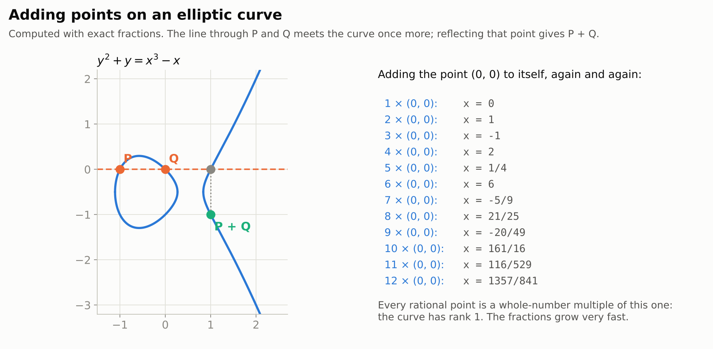
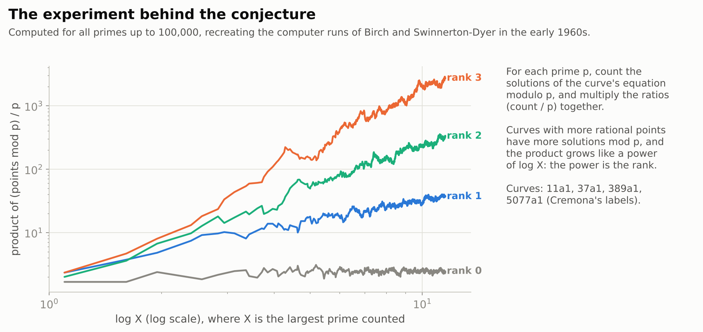
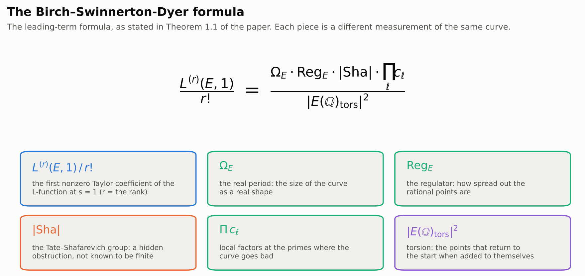
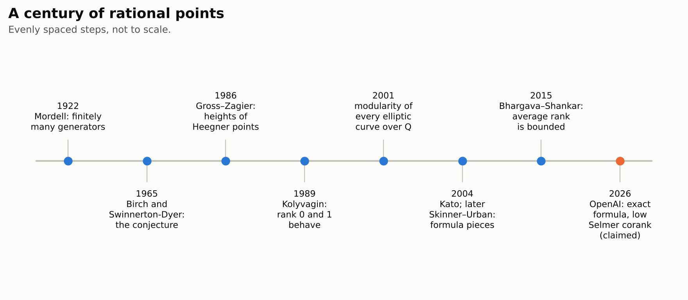
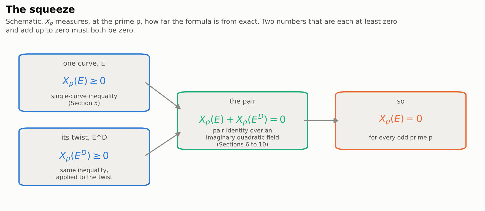
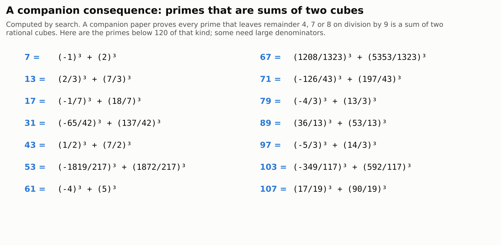

# Exact Birch–Swinnerton-Dyer Formula from Low Selmer Corank

> **In one paragraph.** An elliptic curve is an equation like $y^2 + y = x^3 - x$. Its rational solutions, the points with fraction coordinates, can be added to each other, and a curve may have none, a few, or infinitely many. The Birch and Swinnerton-Dyer conjecture, a Millennium Prize problem, says you can tell which by counting solutions modulo primes: the answer is hidden in a function built from those counts, the curve's $L$-function. A refined version predicts an exact formula linking that function to everything else about the curve. On 3 October 2026 OpenAI posted a paper claiming that exact formula, with every prime factor accounted for, for every elliptic curve whose "Selmer" upper bound on the number of independent points, a bound that can often be computed, is $0$ or $1$. That is expected to cover almost all curves, but curves with two or more independent points are untouched, so the Millennium problem stays open. The paper relies on three companion OpenAI papers, about 380 pages together. None of the four has been checked by experts yet, and none has a computer-checked proof.

| | |
|---|---|
| **Paper** | [Exact Birch–Swinnerton-Dyer Formula from Low Selmer Corank](https://github.com/openai/math/blob/main/preprints/Exact-Birch-Swinnerton-Dyer-Formula-from-Low-Selmer-Corank-October-7-2026/exact-bsd-low-selmer-corank.pdf), OpenAI, 7 October 2026 (94 pages; first posted 3 October) |
| **The claim, plainly** | For every elliptic curve over the rationals whose Selmer group at some prime has corank $0$ or $1$, the rank equals that corank, the Tate–Shafarevich group is finite, and the full Birch–Swinnerton-Dyer formula holds exactly |
| **Millennium problem** | [Birch and Swinnerton-Dyer conjecture](../../../../problems/birch-swinnerton-dyer.md): partial progress; rank $2$ and higher stay open |
| **Status** (4 November 2026) | Not peer reviewed. No formalization. Relies on three unreviewed companion papers. No public expert assessment found |
| **More** | [companions](#7-what-follows) · [figures](figures/) · [figure code](code/make_figures.py) |

**[▶ Watch the video](video/exact-bsd-low-selmer-corank.mp4)** (13 minutes): the story of this page, told with animations, narrated by an American male voice and captioned. Also with an [American female narrator](video/exact-bsd-low-selmer-corank-us-female.mp4), same pictures and timing. The [script](video/storyboard.md) lists what is on screen and what is said, beat by beat.

## Contents

1. [Points on a curve](#1-points-on-a-curve)
2. [The experiment, and the conjecture](#2-the-experiment-and-the-conjecture)
3. [The exact formula](#3-the-exact-formula)
4. [What was known](#4-what-was-known)
5. [The claim](#5-the-claim)
6. [How the proof works](#6-how-the-proof-works)
7. [What follows](#7-what-follows)
8. [Checking it](#8-checking-it)
9. [What it does not do](#9-what-it-does-not-do)

## 1. Points on a curve

Take the equation $y^2 + y = x^3 - x$. Its graph is an **elliptic curve**, a smooth curve with one or two pieces. We care about its **rational points**: solutions where $x$ and $y$ are both fractions, like $(0, 0)$ or $(1, -1)$.

Rational points on such a curve can be **added**. Draw the line through two of them. It meets the curve at exactly one more point, which is also rational, because the algebra only uses addition and division. Reflect that point across the curve's line of symmetry, and you have their sum. This rule makes the rational points into a group, much like the whole numbers under addition.

<picture>
  <source media="(prefers-color-scheme: dark)" srcset="figures/chord-dark.png">
  
</picture>

A theorem of Mordell (1922) says that, however many rational points a curve has, they are all built from a **finite** set of starting points by adding and subtracting. The number of independent starting points needed is the curve's **rank**. A rank $0$ curve has only finitely many rational points. On the curve above, every rational point is a multiple of $(0, 0)$, so its rank is $1$, and it has infinitely many points. Note how quickly their fractions grow: finding points on a curve of high rank can be very hard.

Nobody knows a procedure that always computes the rank. That is the heart of the problem.

## 2. The experiment, and the conjecture

In the early 1960s Bryan Birch and Peter Swinnerton-Dyer tried an experiment on one of the first computers in Cambridge. Instead of searching for rational points, they counted solutions **modulo** each prime $p$: for each $p$, how many pairs $(x, y)$ of remainders satisfy the equation, plus one for a "point at infinity". On average this count is about $p$. Their idea was that a curve with many rational points should have slightly more solutions modulo primes, because each rational point reduces to a solution modulo almost every $p$.

So they multiplied the ratios $(\text{count}) / p$ over all primes up to some limit $X$. For curves of rank $0$ the product stayed roughly level. For rank $1$ it grew like $\log X$, for rank $2$ like $(\log X)^2$, and so on. The rank was showing up as the power of the growth.

<picture>
  <source media="(prefers-color-scheme: dark)" srcset="figures/bsd-plot-dark.png">
  
</picture>

These counts are packaged into one function, the curve's **$L$-function** $L(E, s)$, built so that its behaviour at the point $s = 1$ mirrors the growth of that product. The **Birch and Swinnerton-Dyer conjecture** says that the rank equals the order of vanishing of $L(E, s)$ at $s = 1$, called the **analytic rank**. A rank $0$ curve should have $L(E, 1) \neq 0$; a rank $1$ curve should have $L(E, 1) = 0$ but a nonzero slope there; and so on.

## 3. The exact formula

Birch and Swinnerton-Dyer went further. They predicted not just where $L(E, s)$ starts, but **exactly** how big its first nonzero Taylor coefficient is. The formula, in the form stated in the paper (Theorem 1.1):

```math
\frac{L^{(r)}(E,1)}{r!}
=\frac{\Omega_E\,\mathrm{Reg}_E\,\#\text{Ш}(E/\mathbb{Q})\prod_{\ell}c_\ell(E)}{\#E(\mathbb{Q})_{\rm tors}^{2}} ,
```

where $r$ is the rank. Every symbol is a different measurement of the same curve:

<picture>
  <source media="(prefers-color-scheme: dark)" srcset="figures/formula-dark.png">
  
</picture>

The strangest piece is $\text{Ш}$, the **Tate–Shafarevich group** (the letter is the Cyrillic "Sha"). It measures a failure of a natural strategy: a curve can have solutions modulo every prime power and over the real numbers, and still have no rational solution of a related kind. Ш counts those near-misses. It is conjectured to be finite, but for most curves nobody can prove even that.

## 4. What was known

The rank part of the conjecture is known only when the analytic rank is $0$ or $1$. That rests on a chain of results from the 1980s to the 2000s. Gross and Zagier (1986) built special points, Heegner points, whose size is given by the slope of the $L$-function. Kolyvagin (1989) then showed that in analytic rank $0$ or $1$ the rank equals the analytic rank and Ш is finite. The proof that every elliptic curve over $\mathbb{Q}$ is modular, finished in 2001, made this apply to every curve.

The **exact formula** was harder. Proving it means matching both sides prime by prime: for each prime $p$, the number of factors of $p$ on the left must equal the number on the right. Kato, Skinner–Urban, Jetchev–Skinner–Wan and others proved it at many primes for many curves. But each result needed extra conditions on the curve or the prime, for example that the prime is "ordinary" for the curve, or that certain mod $p$ symmetries are large. No proof covered every prime for every curve of rank $0$ or $1$.

<picture>
  <source media="(prefers-color-scheme: dark)" srcset="figures/timeline-dark.png">
  
</picture>

## 5. The claim

The paper's main theorem (Theorem 1.1), as stated:

> Let $E/\mathbb{Q}$ be an elliptic curve and let $q$ be any prime. If $s_q(E)\in\lbrace 0,1\rbrace$, then $r(E)=a(E)=s_q(E)$, Ш$(E/\mathbb{Q})$ is finite, and, with $r=r(E)$ and the preceding normalizations, the Birch–Swinnerton-Dyer formula above holds. There are no additional hypotheses on reduction, rational torsion, isogenies, complex multiplication, or residual Galois representations.

Here $r(E)$ is the rank, $a(E)$ the analytic rank, and $s_q(E)$ the **Selmer corank** at the prime $q$. The Selmer group is a far more tractable object than the set of rational points, and in practice it can often be computed: it collects everything that looks like a rational point when you check the curve modulo powers of $q$ and at every prime. It contains the true rational points and the $q$-part of Ш, so its corank is an **upper bound** on the rank, and it is exactly the rank when Ш is finite.

In plain words: if this upper bound is $0$ or $1$ at even a single prime, then everything Birch and Swinnerton-Dyer predicted is true for that curve. The rank equals the analytic rank, Ш is finite, and the exact formula holds at every prime. No conditions on the curve are needed.

## 6. How the proof works

The paper is explicit about which parts are new (Section 1). It splits the theorem into four inputs and one new step.

**Inputs from companion papers.**
1. A **low-corank converse** ([companion C](https://github.com/openai/math/blob/main/preprints/The-Selmer-converse-for-elliptic-curves-at-every-prime-October-7-2026/main.pdf), 82 pages): Selmer corank $0$ or $1$ at one prime forces the rank and analytic rank to equal it, and Ш to be finite.
2. The **formula at the prime 2** ([companion B](https://github.com/openai/math/blob/main/preprints/The-two-primary-Birch-Swinnerton-Dyer-formula-in-Selmer-corank-at-most-one-October-6-2026/paper.pdf), 164 pages): the two sides have the same number of factors of $2$.
3. **Goldfeld's twist densities** ([companion](https://github.com/openai/math/blob/main/preprints/Goldfelds-analytic-density-conjecture-and-the-2-converse-for-elliptic-curves-October-7-2026/paper.pdf), 130 pages), used to pick suitable auxiliary twists of the curve.
4. A published theorem of **Burungale and Flach** for curves with complex multiplication in rank $0$.

**The new step: every odd prime.** Write $X_p(E)$ for the number of factors of $p$ by which the formula is off: the $p$-part of the $L$-value side minus the $p$-part of the arithmetic side. The goal is $X_p(E) = 0$ for every odd prime $p$. The paper proves two separate facts:

- **A one-sided inequality** (Section 5): $X_p(E) \geq 0$ for every curve without complex multiplication of analytic rank at most $1$. In words, the $L$-value side never has fewer factors of $p$ than predicted.
- **A pair identity** (Sections 6 to 10): $X_p(E) + X_p(E^D) = 0$, where $E^D$ is a carefully chosen **twist** of $E$, a sister curve whose analytic rank is the opposite one ($0$ if $E$ has $1$, and $1$ if $E$ has $0$).

Two numbers that are each at least $0$ and add up to $0$ must both be $0$. So $X_p(E) = 0$.

<picture>
  <source media="(prefers-color-scheme: dark)" srcset="figures/pinch-dark.png">
  
</picture>

**Where the pair identity comes from.** Combine $E$ and its twist over an imaginary quadratic field $K$, a number system like $\mathbb{Q}(\sqrt{-7})$ chosen to suit the curve. Over $K$ the two curves together have $L$-function with a simple zero, and Gross–Zagier's Heegner point lives there (Section 2). The paper builds two power series in several variables: one from $L$-values ("analytic"), one from Galois cohomology ("algebraic"). It then proves that their ratio is a **unit**, so neither has an extra factor the other lacks. Reading off the value at the centre gives the identity.

Proving the ratio is a unit happens in stages. First it is shown to be integral and not divisible by $p$ (Section 6). Theta series then rule out other common factors (Sections 7 and 8). Finally, extra "tame" variables push any remaining bad factor into too small a set to matter (Section 9).

**Putting it together** (Section 10). For a curve without complex multiplication, the inequality applied to $E$ and to its twist, plus the pair identity, gives $X_p(E) = 0$. For curves with complex multiplication, Burungale–Flach handles rank $0$, and the pair identity carries it to rank $1$. Combined with the factor-of-2 result, the ratio of the two sides is a positive fraction with no prime factors at all, so it equals $1$, and the formula is exact.

## 7. What follows

- **Almost all curves in each family.** The companion on Goldfeld's conjecture claims that, for any elliptic curve, half of its quadratic twists have analytic rank $0$ and half have rank $1$, with the rest a negligible fraction. Combined with this paper, the full Birch–Swinnerton-Dyer formula would hold for almost all twists of every curve (OpenAI's summary, result 006).
- **Sums of two cubes.** The low-corank converse companion applies its theorem to the curves $x^3 + y^3 = \ell$. It concludes that every prime $\ell$ that leaves remainder $4$, $7$ or $8$ on division by $9$ is a sum of two rational cubes, a question that goes back to Sylvester in the 19th century. Earlier work had settled only some of these primes, or needed extra conditions.

<picture>
  <source media="(prefers-color-scheme: dark)" srcset="figures/cubes-dark.png">
  
</picture>

## 8. Checking it

The paper was first posted on 3 October 2026 and released with OpenAI's batch of manuscripts on 6 October. The 7 October edition changes nothing in the mathematics: it drops a passing credit to a supporting manuscript that OpenAI had removed, and updates references to revised companions (we compared the two LaTeX sources).

What a reader should know:

- **No computer-checked proof.** Unlike OpenAI's quasi-Riemann hypothesis and Navier–Stokes papers, this family has no Lean formalization.
- **Four unreviewed papers.** The theorem stands on this 94-page paper plus three companion OpenAI manuscripts of 82, 164 and 130 pages. All of them would need to be right.
- **No public expert verdict yet.** As of 4 November we found news coverage of the release, but no number theorist's assessment of this proof and no response paper. News coverage reported wider criticism of how the release was handled: the sheer number of manuscripts, the lack of named collaborators, and the use of an unreleased model.

## 9. What it does not do

- **It does not solve the Millennium problem.** The Clay problem asks for the rank prediction for **every** elliptic curve. Curves of rank $2$ or more, such as the curve $y^2 + y = x^3 + x^2 - 2x$ of rank $2$, are not covered. For them, nobody can prove even that Ш is finite.
- **It does not give a way to compute the rank.** For a curve covered by the theorem, the Selmer computation already tells you the rank is $0$ or $1$. The theorem then confirms the full formula; it does not find rational points.
- **It is not yet confirmed.** Until experts check the four papers, the claim should be treated as unconfirmed.
