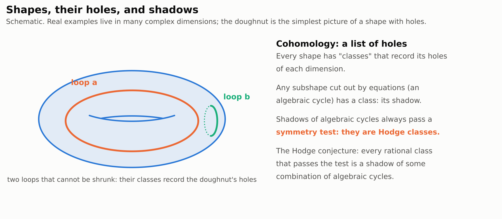
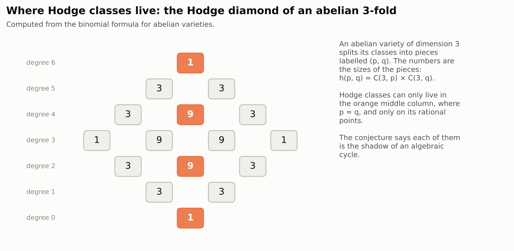
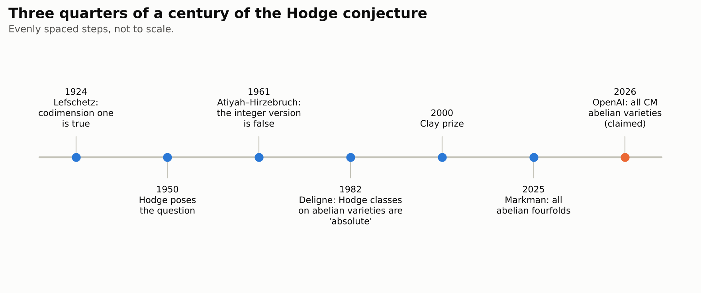
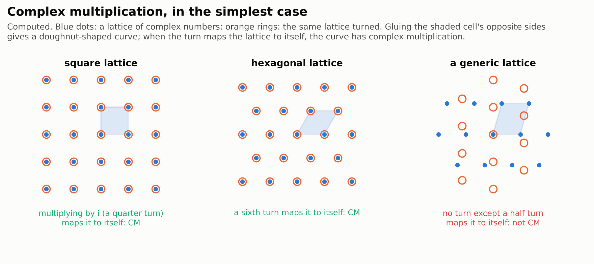
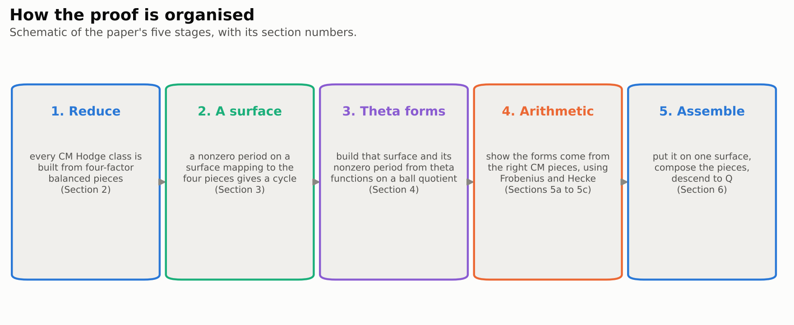
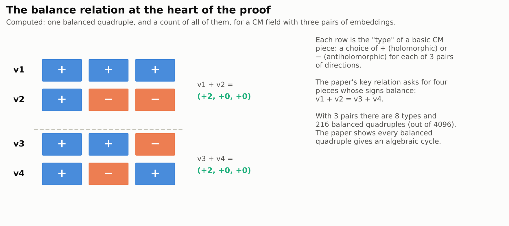

# The rational Hodge conjecture for CM abelian varieties

> **In one paragraph.** Some shapes in geometry can be described by polynomial equations. Their "holes" are recorded by objects called cohomology classes. Any smaller shape cut out by equations inside a bigger one casts a "shadow" class, and those shadows always pass a certain symmetry test. The Hodge conjecture, a Millennium Prize problem, says the converse: every class that passes the test (with rational coefficients) is a shadow, a combination of shapes cut out by equations. On 30 September 2026 OpenAI posted a 53-page paper claiming the conjecture for one important family, abelian varieties with complex multiplication ("CM"), in every dimension. These are the shapes where the hardest known test cases live. Through older theorems of Milne, the result would also settle the Tate conjecture for abelian varieties over finite fields. OpenAI added a computer-checked proof of the main theorem in Lean. No expert has yet publicly assessed the written proof, and the conjecture for general shapes stays open.

| | |
|---|---|
| **Paper** | [The rational Hodge conjecture for CM abelian varieties](https://github.com/openai/math/blob/main/preprints/The-rational-Hodge-conjecture-for-CM-abelian-varieties-October-6-2026/paper.pdf), OpenAI, 6 October 2026 (53 pages; first posted 30 September) |
| **The claim, plainly** | On every complex abelian variety with complex multiplication, every rational Hodge class is a rational combination of classes of algebraic subvarieties, in every dimension and codimension |
| **Millennium problem** | [Hodge conjecture](../../../../problems/hodge-conjecture.md): partial progress; the general conjecture stays open |
| **Status** (4 November 2026) | Not peer reviewed. Lean formalization of the main theorem published by OpenAI. No public expert assessment found |
| **More** | [Lean scope](https://github.com/openai/math/blob/main/lean/docs/032.md) · [figures](figures/) · [figure code](code/make_figures.py) |

**[▶ Watch the video](video/hodge-cm-abelian-varieties.mp4)** (10 minutes): the story of this page, told with animations, narrated by an American male voice and captioned. Also with an [American female narrator](video/hodge-cm-abelian-varieties-us-female.mp4), same pictures and timing. The [script](video/storyboard.md) lists what is on screen and what is said, beat by beat.

## Contents

1. [Shapes, holes and shadows](#1-shapes-holes-and-shadows)
2. [The Hodge conjecture](#2-the-hodge-conjecture)
3. [Abelian varieties and complex multiplication](#3-abelian-varieties-and-complex-multiplication)
4. [Why this case is hard](#4-why-this-case-is-hard)
5. [The claim](#5-the-claim)
6. [How the proof works](#6-how-the-proof-works)
7. [What follows](#7-what-follows)
8. [Checking it](#8-checking-it)
9. [What it does not do](#9-what-it-does-not-do)

## 1. Shapes, holes and shadows

Algebraic geometry studies shapes cut out by polynomial equations, called **varieties**. A circle is $x^2 + y^2 = 1$. In complex numbers, even simple equations give rich shapes: the solutions of $y^2 = x^3 - x$, with $x$ and $y$ complex, form a surface shaped like a doughnut.

Topology records the **holes** of a shape. On a doughnut, a loop around the hole and a loop around the tube cannot be shrunk to a point, and they cannot be deformed into each other. Each such loop gives a **cohomology class**. Higher-dimensional shapes have holes of every dimension, and so classes in every degree.

<picture>
  <source media="(prefers-color-scheme: dark)" srcset="figures/shadow-dark.png">
  
</picture>

Now take a smaller shape inside a variety, itself cut out by equations, such as a curve inside a surface. It is called an **algebraic cycle**, and it has a class, its "shadow" in cohomology. The question is which classes arise this way.

## 2. The Hodge conjecture

For a complex variety, every cohomology class splits into pieces labelled by pairs of numbers $(p, q)$. Roughly, $p$ counts holomorphic directions and $q$ antiholomorphic ones; this is the **Hodge decomposition**. A shadow of a subvariety of codimension $p$ always lives in the "balanced" piece $(p, p)$, and it has rational coefficients. A class with both properties is a **Hodge class**.

<picture>
  <source media="(prefers-color-scheme: dark)" srcset="figures/diamond-dark.png">
  
</picture>

The **Hodge conjecture** (posed by W. V. D. Hodge in 1950) says the converse: on a smooth projective complex variety, every Hodge class is a rational combination of shadows of algebraic subvarieties. In symbols, writing $\mathrm{Hdg}^p(X) = H^{2p}(X, \mathbb{Q}) \cap H^{p,p}(X)$, every class in $\mathrm{Hdg}^p(X)$ is a rational linear combination of classes of codimension-$p$ subvarieties.

It is known for $p = 1$ (Lefschetz, 1924): every Hodge class of degree $2$ comes from divisors, shapes of codimension one. Products of divisors give Hodge classes in higher degree too. The hard part is any Hodge class that is **not** a combination of divisor products. With integer coefficients instead of rational ones the statement is false (Atiyah and Hirzebruch, 1961), which is why the Clay problem asks for rational combinations.

<picture>
  <source media="(prefers-color-scheme: dark)" srcset="figures/timeline-dark.png">
  
</picture>

## 3. Abelian varieties and complex multiplication

An **abelian variety** is the higher-dimensional cousin of the doughnut. Take complex space $\mathbb{C}^g$, pick a lattice (a grid of points, like the integer points of a plane), and glue each point to every point that differs from it by a lattice vector. When $g = 1$ this gives an elliptic curve, a doughnut; when $g$ is larger it gives a $g$-dimensional "doughnut" with many holes, which can be cut out by polynomial equations. Their cohomology is simple to write down: the Hodge numbers are $h^{p,q} = \binom{g}{p}\binom{g}{q}$, as in the diamond above.

Most lattices have no symmetry beyond the obvious one, $v \mapsto -v$. A few have many more: the square lattice is carried to itself by multiplication by $i$, a quarter turn. When an abelian variety has the largest possible set of such extra symmetries, it is said to have **complex multiplication**, or to be **CM**.

<picture>
  <source media="(prefers-color-scheme: dark)" srcset="figures/lattices-dark.png">
  
</picture>

There are only countably many CM abelian varieties, yet they are spread densely among all abelian varieties. They play a central role in number theory, because their symmetries are governed by number fields, the **CM fields**.

## 4. Why this case is hard

Abelian varieties are the classical testing ground for the Hodge conjecture. For many of them every Hodge class is a combination of divisor products, so the conjecture holds easily. But some carry **exotic** Hodge classes that are not built from divisors. The best-known are **Weil classes**, which appear when an imaginary quadratic field acts on the variety in a balanced way. They already occur in dimension four (Moonen and Zarhin, 1999). Producing algebraic cycles for them requires a genuinely new geometric construction.

Two older results frame the problem. Deligne (1982) proved that every Hodge class on an abelian variety is "absolute Hodge", an arithmetic property shared by shadows of cycles. That is strong evidence, but it does not produce cycles. Deligne and André showed that, on CM varieties, every Hodge class reduces to Weil-type classes on auxiliary CM varieties; producing cycles for those was the missing step. In 2025 Eyal Markman proved the Weil classes algebraic on a family of abelian sixfolds, and deduced the Hodge conjecture for all abelian fourfolds.

## 5. The claim

The paper's main theorem (Theorem 1.1), as stated:

> Let $A$ be a complex CM abelian variety. For every integer $p\geq0$, the Betti cycle-class map $\mathrm{CH}^p_{\mathbb{Q}}(A) \to H^{2p}(A,\mathbb{Q})\cap H^{p,p}(A)$ is surjective. In particular, the rational Hodge conjecture holds in every codimension on every finite product of complex CM abelian varieties and on every power of such a product.

In plain words: on every abelian variety with complex multiplication, of any dimension, every Hodge class is the shadow of a rational combination of algebraic subvarieties. This includes the exotic classes.

## 6. How the proof works

The paper has five stages (its Sections 2 to 6).

<picture>
  <source media="(prefers-color-scheme: dark)" srcset="figures/proof-dark.png">
  
</picture>

**1. Reduce to balanced four-piece classes** (Section 2). Each basic CM piece $B(v)$ is described by a list of signs $v$, one $+$ or $-$ for each pair of directions, saying which are holomorphic. Building on Hazama, André and Gao–Ullmo, the paper shows that every Hodge class on a CM abelian variety can be assembled from one kind of building block. The block is a class on a product of four pieces whose sign lists **balance**: $v_1 + v_2 = v_3 + v_4$. It is enough to prove that each such block is algebraic.

<picture>
  <source media="(prefers-color-scheme: dark)" srcset="figures/balance-dark.png">
  
</picture>

**2. A surface does the work** (Section 3). Suppose a surface $S$ maps to each of the four pieces, and a certain integral over $S$, built from four one-forms pulled back from the pieces, is not zero. Then the image of $S$ in the product of the four pieces is an algebraic cycle whose shadow touches the balanced block. A little more linear algebra, using divisors, turns that into the block itself. So the problem becomes: find such a surface with a nonzero integral.

**3. Build the surface from theta functions** (Section 4). The surface is a compact quotient of the complex two-dimensional ball, a classical object in number theory. On it, the paper constructs one-forms from **theta functions**, and shows that a suitable integral of them is not zero. The argument varies some data continuously while keeping the total fixed, then uses an approximation step.

**4. Show the forms come from the right pieces** (Sections 5a to 5c). The forms must come from exactly the four prescribed CM pieces, not just any shapes. The paper realises the ball quotients in a moduli space, uses Hecke operators and the Frobenius map of the reduction modulo primes, and shows the forms have exactly the right CM type.

**5. Assemble** (Section 6). Put everything on one surface, compose the pieces as correspondences, and descend from complex numbers back to rational coefficients. This gives Theorem 1.1. Section 7 then draws the consequences.

## 7. What follows

The paper deduces three further statements (Section 7), each from published reductions:

- **The generalized Hodge conjecture** for CM abelian varieties, following arguments of Hazama and Abdulali.
- **The Tate conjecture for all abelian varieties over finite fields.** This is the analogue of the Hodge conjecture over finite fields. Milne showed in 1999 that it would follow from the Hodge conjecture for CM abelian varieties.
- **The Hodge standard conjecture for abelian varieties in every characteristic**, one of Grothendieck's standard conjectures, again by a theorem of Milne.

Several companion OpenAI papers use this one to prove the Hodge conjecture for further families, including powers of certain abelian sixfolds and Jacobians of abelian covers of curves.

## 8. Checking it

- **Lean.** On 26 October OpenAI added a Lean 4 formalization ([scope](https://github.com/openai/math/blob/main/lean/docs/032.md)). The formal statement says every rational Hodge class of every degree on a smooth projective complex group variety with the stated CM data is a rational combination of classes of algebraic subvarieties. The Lean statement of the Hodge conjecture it builds on comes from an independent project. The consequences in section 7 are outside the formalized statement. We have not re-run the check. Early news reports said this paper had no Lean proof; that was true before 26 October.
- **Other Hodge papers were withdrawn.** On 6 and 7 October OpenAI withdrew three other Hodge-related manuscripts after a sign error in one of them ([notice](https://github.com/openai/math/blob/main/preprints/Algebraicity-of-Weil-classes-on-split-abelian-eightfolds-September-18-2026/README.md)). We checked the LaTeX source: this paper does not cite any of them, and its 6 October revision only updates a citation.
- **No public expert assessment** of the written proof was found as of 4 November.

## 9. What it does not do

- **It does not solve the Millennium problem.** The conjecture is for every smooth projective variety. CM abelian varieties are a special, if important, family. General abelian varieties, K3 surfaces and their products, and most other varieties are not covered here.
- **It gives no general method.** The proof relies heavily on the arithmetic of CM fields: theta functions, Hecke operators and Frobenius. These tools are special to this family.
- **It is not yet confirmed by experts.** The Lean check covers the main theorem as formalized. Experts still need to read the written proof and match it to the formal statement.
