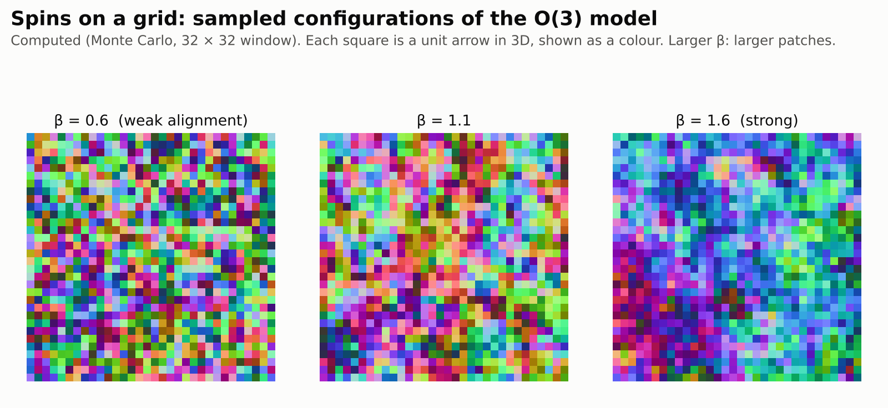
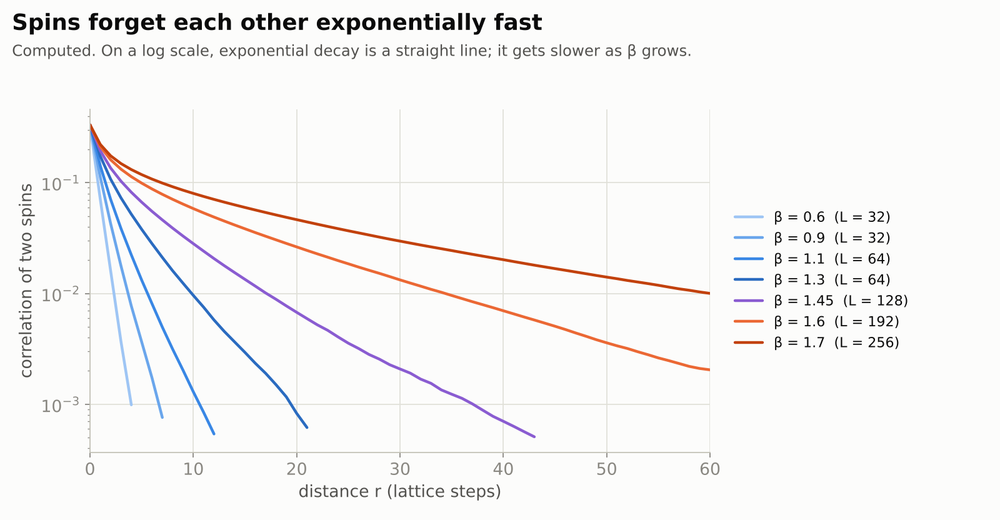
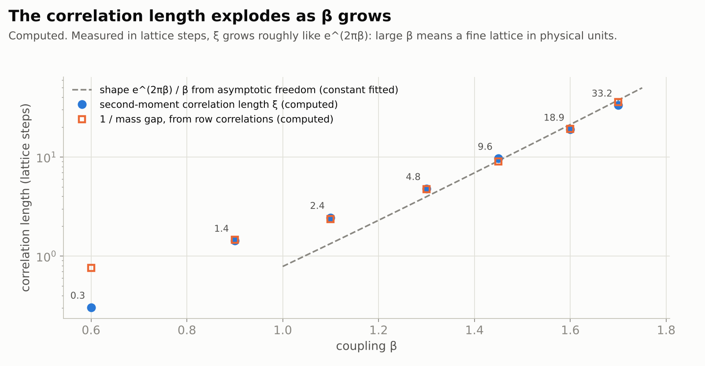
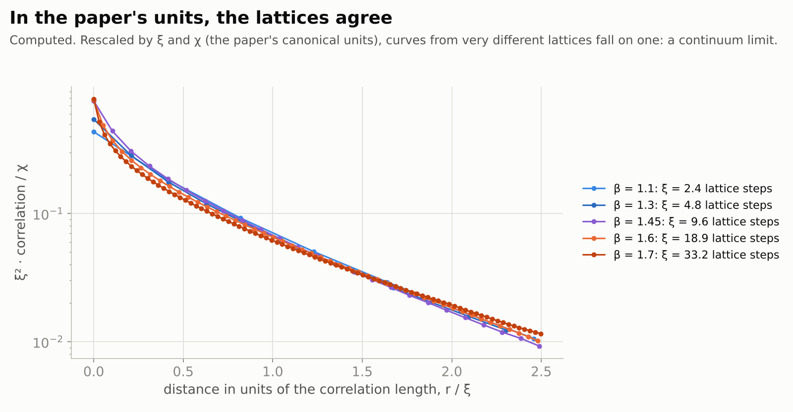
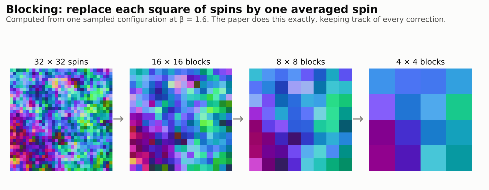
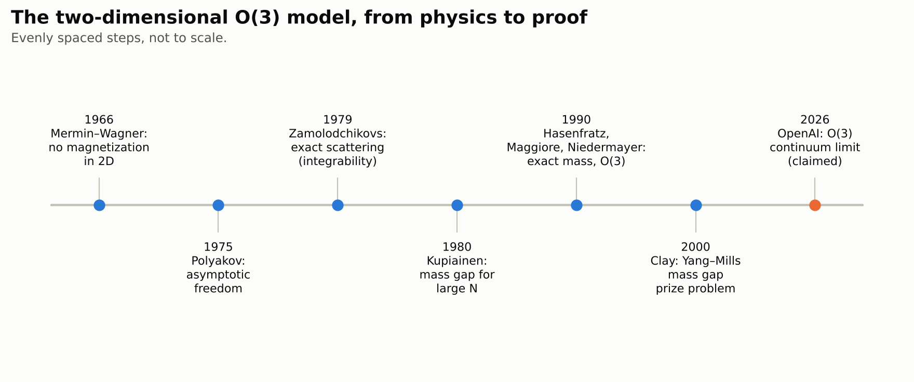

# The canonical massive continuum limit of the two-dimensional O(3) model

> **In one paragraph.** The Yang–Mills Millennium problem asks for a mathematical construction of the quantum theory behind the strong nuclear force, and a proof that its lightest particle has positive mass: a **mass gap**. Physicists have long practised on a simpler model with the same key features, the two-dimensional **O(3) sigma model**: a grid of arrows that like to point the same way. On 4 October 2026 OpenAI released a 122-page paper claiming to construct this model's continuum limit rigorously. Starting from the grid, it shrinks the spacing to zero and adjusts the coupling. It claims the limit is a genuine relativistic quantum field theory, is interacting rather than free, and has a positive mass gap. If correct, this settles a long-standing problem in constructive field theory. It is not Yang–Mills theory: it lives in two dimensions and has no gauge field. No expert assessment has been reported, and this paper has no computer-checked proof.

| | |
|---|---|
| **Paper** | [The canonical massive continuum limit of the two-dimensional O(3) model](https://github.com/openai/math/blob/main/preprints/The-canonical-massive-continuum-limit-of-the-two-dimensional-O3-model-October-4-2026/massive-continuum-o3.pdf), OpenAI, 4 October 2026 (122 pages) |
| **The claim, plainly** | The lattice O(3) model has a continuum limit, the same for every way of sending the coupling to infinity: an interacting relativistic quantum field theory in one space and one time dimension, with a unique vacuum and a positive mass gap |
| **Millennium problem** | [Yang–Mills existence and mass gap](../../../../problems/yang-mills.md): adjacent. A two-dimensional model with the same key features, not Yang–Mills theory |
| **Status** (4 November 2026) | Not peer reviewed. No Lean formalization of this paper; OpenAI's Lean work in the same family covers a companion result on exponential decay. No expert assessment found |
| **More** | [figures](figures/) · [Monte Carlo code](code/o3_mc.py) · [figure code](code/make_figures.py) |

**[▶ Watch the video](video/o3-sigma-model-continuum-limit.mp4)** (7 minutes): the story of this page, told with animations, narrated by an American male voice and captioned. Also with an [American female narrator](video/o3-sigma-model-continuum-limit-us-female.mp4), same pictures and timing. The [script](video/storyboard.md) lists what is on screen and what is said, beat by beat.

## Contents

1. [Yang–Mills and the mass gap](#1-yang-mills-and-the-mass-gap)
2. [A toy model: arrows on a grid](#2-a-toy-model-arrows-on-a-grid)
3. [No order, but how fast do spins forget?](#3-no-order-but-how-fast-do-spins-forget)
4. [The continuum limit](#4-the-continuum-limit)
5. [The claim](#5-the-claim)
6. [How the proof works](#6-how-the-proof-works)
7. [The family of papers](#7-the-family-of-papers)
8. [Checking it](#8-checking-it)
9. [What it does not do](#9-what-it-does-not-do)

## 1. Yang–Mills and the mass gap

**Quantum field theories** describe particles as ripples in fields that fill space. The strong nuclear force is described by a **Yang–Mills** theory. Its force carriers, the gluons, are massless in the equations. Yet experiments and computer simulations show that the lightest particles the strong force produces have positive mass. This is the **mass gap**: a minimum energy for any excitation above the empty state, the **vacuum**.

The Clay Millennium problem asks for two things in four-dimensional spacetime. First, construct quantum Yang–Mills theory mathematically, so that it satisfies the standard axioms for a quantum field theory. Second, prove that it has a mass gap. Neither is known. Indeed, no interacting quantum field theory in four dimensions has ever been constructed rigorously.

## 2. A toy model: arrows on a grid

The **O(3) model** puts an arrow of length one, pointing anywhere in three-dimensional space, at each point of a square grid. Neighbouring arrows prefer to align. The strength of that preference is a number $\beta$: each configuration of arrows $q$ has probability proportional to $\exp\left(\beta \sum q_x\cdot q_y\right)$, summed over neighbouring pairs.

<picture>
  <source media="(prefers-color-scheme: dark)" srcset="figures/spins-dark.png">
  
</picture>

The pictures are samples we computed with Wolff's cluster Monte Carlo algorithm ([code](code/o3_mc.py)). Larger $\beta$ means larger patches of aligned arrows.

Physicists study this model as a stand-in for Yang–Mills theory because it shares its two key features. Polyakov showed in 1975 that it is **asymptotically free**: at short distances its interaction becomes weak. And it is expected to generate a **mass gap** although its basic field has no mass term. It is also much simpler: two dimensions instead of four, and no gauge symmetry.

## 3. No order, but how fast do spins forget?

In two dimensions, arrows that can turn continuously never line up across the whole grid. That is the Mermin–Wagner theorem (1966). So the correlation between two far-apart arrows tends to zero. The question is how fast.

<picture>
  <source media="(prefers-color-scheme: dark)" srcset="figures/decay-dark.png">
  
</picture>

For the O(3) model, physics predicts **exponential** decay at every $\beta$, with a decay length that grows enormously as $\beta$ grows. That decay length is the **correlation length** $\xi$, and its inverse is the mass gap measured in lattice units. Proving exponential decay at every $\beta$, not just small $\beta$, was a well-known open problem. OpenAI claims it in a companion paper (Section 7).

## 4. The continuum limit

A quantum field theory lives in continuous space, not on a grid. To get one from the grid, shrink the grid spacing $a$ to zero, and at the same time raise $\beta$ so that the correlation length stays fixed **in physical units**. In lattice steps, the correlation length then grows without bound.

<picture>
  <source media="(prefers-color-scheme: dark)" srcset="figures/length-dark.png">
  
</picture>

Asymptotic freedom predicts that $\xi$ grows roughly like $e^{2\pi\beta}/\beta$. Our simulations follow that shape. This is why the limit needs $\beta\to\infty$: a large $\beta$ makes the grid fine compared to the physical scale.

The paper fixes the physical units from the lattice itself, using two standard quantities: the **susceptibility** $\chi$ (the sum of all spin correlations) and the **second-moment correlation length** $\xi$. It rescales distances by $\xi$ and the field so that $\chi$ becomes one.

<picture>
  <source media="(prefers-color-scheme: dark)" srcset="figures/collapse-dark.png">
  
</picture>

In these units, our simulated correlations from very different lattices fall on one curve. That is what a continuum limit looks like numerically. The paper's task is to prove that such a limit exists, for every correlation, and to identify what it is.

## 5. The claim

The paper's main theorem (Theorem 1.1) says, in plain words:

- **The limit exists.** As $\beta\to\infty$, through all real values and not just a chosen sequence, the rescaled lattice fields converge, together with all their correlations.
- **It is canonical.** The limit has susceptibility one and correlation length one, and it is the same limit whichever way $\beta$ tends to infinity.

The companion statements (Theorem 1.2 and Corollary 1.3) describe the limit:

- **It is a quantum field theory.** The limiting correlations satisfy the **Osterwalder–Schrader axioms**. So they define a local, relativistic quantum theory in one space and one time dimension, by a standard reconstruction.
- **It has a mass gap.** The theory has a unique vacuum, and every state orthogonal to it has energy at least some $m\gt 0$.
- **It is interacting.** A connected four-point correlation is nonzero. So the limit is not a free (Gaussian) field.

All three come from the same fields in the same units. That matters: a mass estimate on the grid alone, at fixed spacing, does not settle the continuum problem.

## 6. How the proof works

The method is a **renormalization group**: look at the system at larger and larger scales, one step at a time.

<picture>
  <source media="(prefers-color-scheme: dark)" srcset="figures/blocking-dark.png">
  
</picture>

- **Exact blocking** (from OpenAI's companion O(4) paper, adapted). Group the grid into squares, keep one averaged arrow per square, and integrate out the rest exactly, keeping track of every correction term. Repeat. The pictures above use plain averages. The paper's version is exact.
- **Four new estimates.** A rough first bound on the correlation length, $Ce^{(4\pi-\eta)\beta}$, beats the trivial rate by a fixed amount. A contraction shows that the leftover corrections shrink by nearly a factor $L^{-2}$ per step. A comparison controls rare regions where arrows change fast. And sources added to the fields are carried through every step, which gives the convergence of the actual fields and the nonzero four-point correlation.
- **Matching trajectories.** The coupling $\beta$ must be tuned over arbitrarily many steps. A sensitivity estimate shows that nearby choices agree at each coarse scale, which is what makes the limit canonical.
- **Rotations.** A square grid is not round. Two tilted first blockings, with length factor 5, compare grid orientations through a rotation by an irrational multiple of $\pi$. With continuity, that gives full rotation invariance.
- **Reconstruction.** Finally, the Osterwalder–Schrader theorem turns the Euclidean correlations into a quantum theory, where the decay of correlations becomes the mass gap.

The paper does not assume the exact scattering theory that physicists derived from integrability (Zamolodchikov and Zamolodchikov, 1979). It also does not compute the exact mass found by Hasenfratz, Maggiore and Niedermayer (1990).

<picture>
  <source media="(prefers-color-scheme: dark)" srcset="figures/timeline-dark.png">
  
</picture>

## 7. The family of papers

OpenAI's release (family 215 of [openai/math](https://github.com/openai/math)) contains several related manuscripts:

- [Sharp mass bounds for the two-dimensional O(4) model](https://github.com/openai/math/blob/main/preprints/Sharp-mass-bounds-for-the-two-dimensional-O4-model-September-23-2026/paper.pdf) (23 September): the source of the blocking method, with a positive gap at every $\beta$ for the O(4) lattice model.
- [Exponential decay in two-dimensional classical O(n) models](https://github.com/openai/math/blob/main/preprints/Exponential-decay-in-two-dimensional-classical-On-models-September-23-2026/paper.pdf) (23 September): exponential decay of correlations at every $\beta$, for every $n\ge3$. It describes this as resolving the all-temperature decay conjecture for these models. This is the result formalized in Lean.
- [An isolated particle pole for the two-dimensional O(3) spin field](https://github.com/openai/math/blob/main/preprints/An-Isolated-Particle-Pole-for-the-Two-Dimensional-O3-Spin-Field-October-4-2026/o3-particle-pole.pdf) (4 October): the limit constructed here has a particle of the lowest mass, separated from everything else.
- [Exact mass asymptotics for the two-dimensional O(4) lattice model](https://github.com/openai/math/blob/main/preprints/Exact-mass-asymptotics-for-the-two-dimensional-O4-lattice-model-October-5-2026/exact-mass-o4.pdf) (5 October).

## 8. Checking it

- **Lean.** The family's Lean formalization ([scope](https://github.com/openai/math/blob/main/lean/docs/215.md)) covers the exponential-decay companion only. It states uniform exponential decay on finite grids for every $n\ge3$ and every $\beta$. The continuum limit, the mass gap of the limit, and the O(4) results are not formalized. We have not re-run it.
- **Follow-up.** According to search results, a Zenodo preprint dated 13 October 2026 builds on this paper and the O(4) paper, conditionally on their correctness. We could not open it directly.
- **Experts.** We found no public expert assessment as of 4 November 2026, and no reported error. At 122 pages of hard constructive analysis, a careful check will take time.

## 9. What it does not do

- **It is not Yang–Mills theory.** It has two spacetime dimensions instead of four, and no gauge field. Constructing four-dimensional Yang–Mills theory with a mass gap remains open.
- **It covers one lattice model.** The nearest-neighbour model on the square grid, with no external field and no topological term.
- **It does not compute the exact mass.** The exact mass formula from integrability is not proved here, and the exact scattering matrix is not used.
- **Our simulations are illustrations, not evidence.** Numerical studies of this model go back decades and agree with the physics picture. The paper's contribution is a proof, and it has not yet been checked by experts.
